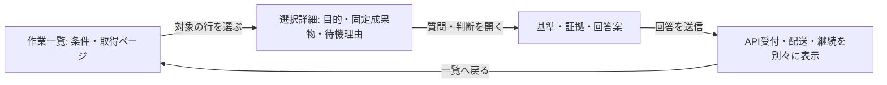
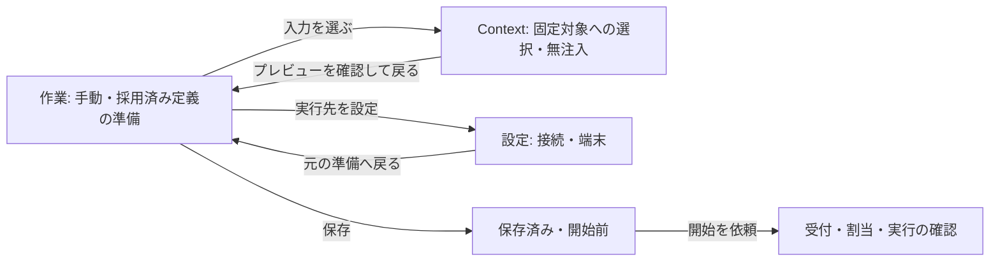
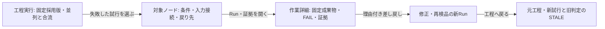
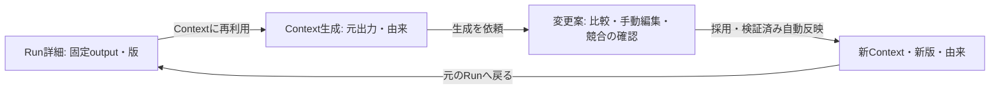
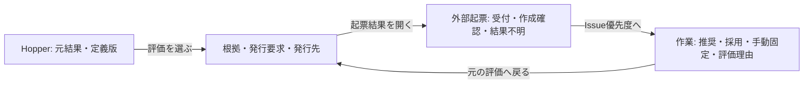
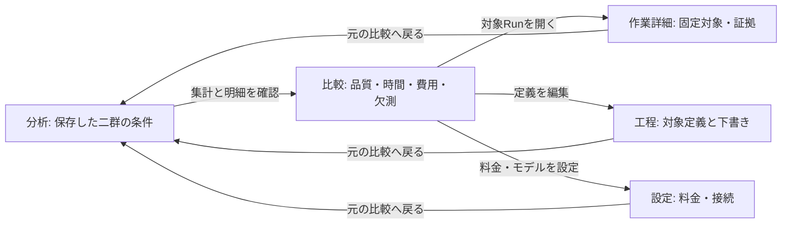

# 情報構造と対象の遷移

[視覚仕様の入口](../../DESIGN.md) / [部品](components.md) / [実装](implementation.md)

#71〜#77の実装契約。利用目的を主ナビ、業務対象を一覧と詳細、Scopeを任意の所属・絞り込みとして扱う。文書の粒度はSentence/Paragraph/Section/Document、ScopeはProduct/Project/Milestone/Issueであり、同じ階層へまとめない。GitHub Issue、Issue Scope、TriageのIssue情報も別の対象として表示する。

## 分類と機能の移設

Workspace選択・API接続・同期の要約を共通シェルに置く。現在位置にはWorkspace、用途、画面名を表示し、対象がある場合は名前・種別・版を加える。画面間はリンク、同じ対象内の表示切替はタブを使う。狭い幅は画面選択に切り替え、全業務パネルを縦に積まない。

| 従来の入口・維持する機能 | 移動先 | 実装担当 |
| --- | --- | --- |
| Teamの作業と判断、Run一覧・手動作成・入力・Pause・原出力・利用量・export | 作業 / 作業と判断 | #72・#73 |
| Team内の工程実行、質問・人の判断、回付・理由付き差し戻し、修正・再検品の関連 | 作業の選択対象詳細。工程構造からも同じ対象へ開く | #73・#74 |
| Triageの優先度順一覧、推奨・採用・手動固定、評価の根拠と外部同期 | 作業 / Issue優先度 | #72・#76 |
| 外部起票の下書き、元成果、プレビュー、送信、結果不明の照合、外部変更・履歴 | 作業 / 外部起票 | #72・#73 |
| Contextの検索・ページ取得・文書編集・版・参照・下書き・競合 | Context / 文書編集 | #72・#75 |
| Scope探索、任意の親・複数所属、所属の版管理 | Context / Scope所属 | #75 |
| 関係探索・利用先、固定版include/exclude・順序・無注入・Manifestプレビュー | Context / 入力選択。準備中のRun・定義から呼び出す | #73〜#75 |
| ContextのLLM選択、自由入力からのRun定義生成、固定outputからのContext生成・提案・採用・自動反映履歴 | 対象に応じてContextまたは工程から開き、元対象へ戻る | #74・#75 |
| Run/Workflow定義の一覧・lossless編集・import/export・静的検証・採用、端末能力の参照 | 工程 / Run・Workflow定義 | #72・#74 |
| 検品定義・条件・例外判断、固定入力、証拠登録と版履歴 | 工程 / 検品定義・証拠管理。結果と証拠は作業詳細からも参照 | #72・#73 |
| Hopper定義、発行なし評価、本番有効化、評価・発行履歴、元結果、連鎖停止・再開 | 自動化 / Hopper | #72・#76 |
| Triage方針・採用・有効化・再評価・評価履歴、方針別のサーバーLLM設定 | 自動化 / Triage方針・評価 | #72・#76 |
| 共通主体・処理枠・予算・Worker状態と処理履歴 | 自動化 / 共通の処理運用。Hopper・Triage双方から到達 | #72・#76 |
| 利用量、期間集計、訂正、遅着、記録・版履歴、export、二群の費用・品質・時間比較 | 分析 / 費用・品質・利用量 | #72 |
| GitHub Issue/PR/commit/Actionsの観測データ・取得時刻・変更履歴・根拠リンク | 分析 / GitHub観測。関連作業からも開く | #72・#73 |
| Accountの設定・ログアウト、Webの登録・確認・復旧、ネイティブの認証復帰 | 設定 / アカウント。未ログイン時と認証専用URLは独立した入口 | #72 |
| Workspaceの作成・参加・離脱、役割・実行依頼の許可、招待の発行・失効 | 設定 / Workspace・参加者・招待 | #72 |
| 端末登録・資格情報・接続確認・入力/報告の許可・失効、LLM送信禁止分類の共有方針 | 設定 / 端末・共有ポリシー | #72 |
| 端末固有CLI接続・Windows/WSL・能力・リポジトリ、独立Runnerの状態・設定 | 設定 / CLI・独立Runner。Webでは能力がない理由を表示 | #72 |
| クライアントLLMの接続先・認証・キー・モデル・個別単価参照・上限 | 設定 / クライアントLLM接続。操作側には利用する接続の選択を残す | #72・#75 |
| サーバー側で設定したLLM接続・版・利用可能モデルの確認 | 設定 / サーバーLLM接続。認証はサーバー構成、評価条件はHopper・Triageの各方針で扱う | #72 |
| 料金版と数量区分・評価設定の手動編集 | 設定 / 料金表・費用評価。分析との往復を保持 | #72 |
| AppのAPI接続・クライアント種別・接続先の確認 | 設定 / API接続 | #72 |

機能を移す際は旧入口も撤去する。共有設定と端末固有設定、クライアントLLMとサーバーLLMを区別し、画面移動で権限や実行能力を追加しない。

## 遷移の契約

`navigation.tsx`が共通の参照を扱う。状態の所有境界はAPI・利用者・Workspace。同じ境界内で画面と選択を保持し、変更時に旧画面の状態を破棄する。

| フィールド | 意味 |
| --- | --- |
| `workspace` | 現在のWorkspace。所属の一覧をページ取得して選ぶ |
| `screen` | 作業・Context・工程・自動化・分析・設定内の画面 |
| `target.kind / id / version` | 対象種別と参照。版は数値へ変換しない。固定対象の取得で暗黙にheadへ置き換えない |
| `origin / input` | 呼出し元の固定参照と、準備へ戻す固定Manifest。Context生成では元Runとoutputを別々に保持する |
| `view` | 同じ対象内の表示モード |
| `query / cursor` | 一覧の検索条件と取得位置。対応するAPIがある範囲だけ使う |
| `returnTo / scroll / focus` | 関連対象や設定からの戻り先、元のページ位置と操作のfocus。ブラウザ履歴と同じ対象を指す |

URLへ保存するのは参照と表示条件だけ。本文・回答案・定義のJSON・秘密値は入れない。招待の`#join`と認証専用URLは既存処理を使う。画面を移る操作は読み取りと選択であり、保存・LLM依頼・Run開始・回答送信・外部起票はそれぞれの明示操作でのみ行う。

訪問した有限個の画面では、コントローラーの状態を保持する。非表示のフォームはDOMへ常設しない。閲覧用の取得は表示画面で行い、Context同期と許可済みの生成処理はWorkspaceの寿命で継続する。全Contextや全履歴の取得・クライアント側の結合を、遷移を成立させる前提にしない。

## 六つの画面遷移

各図の角括弧は画面、矢印のラベルは操作箇所。固定対象と戻り先は省略せずに引き継ぐ。これらは画面の契約であり、実行エンジンに新しい状態や遷移を加えるものではない。

### S1: 質問・人の検品への回答

### S2: Runの準備

### S3: 並列工程と修正・再検品

### S4: 固定outputのContext化

### S5: HopperとIssue優先度

### S6: 比較から定義の改善へ

## 確認の分担

共通部品の七種と操作状態は[部品仕様](components.md)を使う。画面ごとに別の状態モデルを作らず、実行・検品・観測・同期、提案・採用・固定、外部受付・作成、未取得・未算定をそれぞれ表す。

各子の局所確認と親のS1〜S6は同じ証拠を再利用する。現在の判定と変更前後の観測は[実装計画](../progress/2026-10-21-issue-71-plan.md)から辿る。人の初見操作とAIの固定シナリオ確認を区別する。

## 判断に必要な情報の順序

質問では固定成果物と確認条件を、工程では問題・戻り先・修正試行・再検品結果を先に示す。出力の再利用では対象本文、優先度ではIssue名・採用値・推奨・理由、比較では群の条件名と品質・時間・費用を先に読む。固定版・内部ID・原記録・全試行・別目的のフォームは、必要時に開ける詳細へ置く。取得失敗は閉じた詳細に隠さず、発生時に通知へfocusを移す。

本人の初見未達と、本人の指示による背景を渡さない独立AI検証を[修正記録](../progress/2026-10-21-uiux-first-view-revision.md)で区別する。独立AIの成功を本人の再確認として扱わない。
