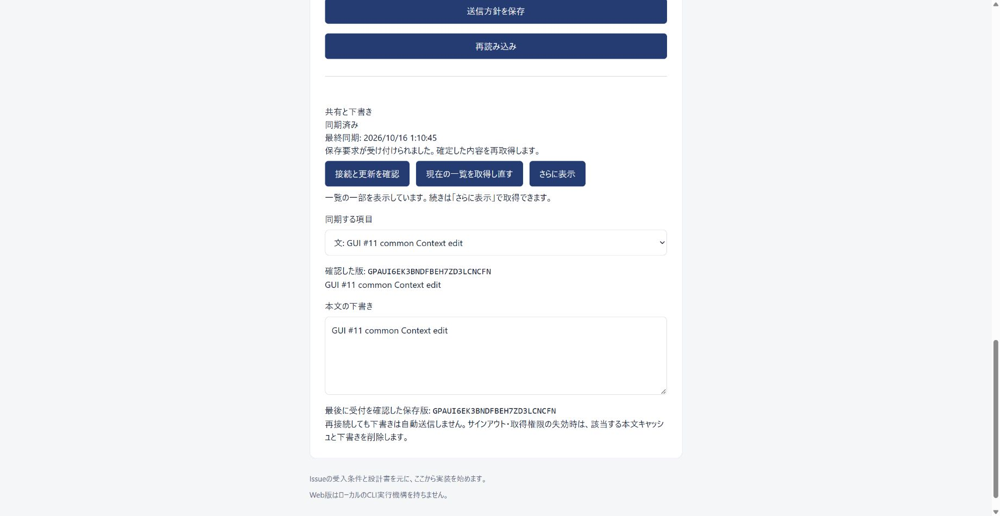

# Issue #11の検証記録

- 基準: main `1f9acedb7cd091ef9da10c5bb8c4fd665b991305`。
- 条件: [計画](2026-10-15-issue-11-plan.md)のAC-1〜6、INVAR-1〜5。区分C、Scope revision 1。
- 現在の判定: [現在状態](current-state.md)。独立検品・PR CI・マージ後照合は、実施後に追記する。

## 条件と証拠

| 条件 | 確認した結果 |
| --- | --- |
| AC-1 | Go SDK v1.8.0・2026-07-28のmetadata発見、実Oryの事前登録・ブラウザログイン・PKCE・broker・resource指定からStreamable HTTPへ接続。通常APIのtoken、ID Token、期限切れ、別Workspaceのhandleを拒否 |
| AC-2 | 同じUserの通常HTTPとMCPで同じ更新を再送し、保存版と履歴数が一致。異なる要求の古い元版は競合。共通UIでも別HTTP更新との競合を表示し、明示的な再適用後の本文・版がAPIと一致 |
| AC-3 | 操作・User・Workspace・固定版、read/edit目的、none/excludeを検証。固定Manifestからcontrol APIで作った操作でも範囲を維持。tools/resourcesの双方から禁止対象を取得できず、別操作のcursor・resource URIも拒否。resourceはprivate・TTL 0、HTTPはno-store。現在の参加権限失効を接続中に反映 |
| AC-4 | 実Bleve/ArcadeDBの候補と本文を分離。上限・継続・位置・完全性を返す。未反映の固定版と両エンジンの基準位置不一致を再現し、実Bleveのclose・専用ArcadeDBの停止でも不完全な状態を保持し、不完全な候補から完全な入力を作らない。1万Context×3版で最初の許可済み100件を取得 |
| AC-5 | 本文中に分類変更、別Workspace取得、shell・mergeの要求を入れても権限は変わらない。read操作の編集、未知のtool、MCP編集による分類変更を拒否 |
| AC-6 | User・操作・tool/resource・ID/版・範囲・反映位置・時刻・編集の操作IDを追跡。操作履歴にtoken、handle、本文・対話を保存せず、MCPプレビューからManifest保存やRun開始も行わない |

GUI・HTTP・MCPは同じContext保存、現在認可、版照合、StoreのCAS・receiptを使う。モデル通信、CLI実行、未実装Domainの仮toolは追加していない。閲覧権限と送信禁止分類を別に確認し、本文やログを権限の根拠にしない。これらをINVAR-1〜5の照合対象とする。

## 大量Context

送信禁止は1件のWorkspace方針にあるタグ・直接所属Scopeの規則で管理する。MCPの通常操作に全ContextのID一覧を渡さない。PostgreSQLでは要求されたID・固定版を索引で照合する。歴史版のタグと現在の分類を確認し、構成に禁止の子があればその構成の取得を拒否する。

実SDKの試験ではContext 1万件×3版を用意し、タグの1規則で半数を除外した。最初の許可済み100件は2.140秒で、本文を含まず、操作に結び付いた継続を返した。この値は1回のMCP要求の実測であり、p95ではない。

先行試験では広い検索が時間上限に達した。全一致候補を認可してからページを返す処理を、順序付き候補ページから許可済み1ページと継続判定分を集める処理へ置き換えた。認可の前後確認とopaque cursorを維持し、固定版の分類照合を索引による点取得へ修正した。通常HTTPとMCPで別の検索実装は残していない。

既存の合意負荷も再測定した。[実測JSON](2026-10-16-issue-11-search-load.json)はWindows・Go 1.27.2、Context 1万件×3版、Scope 100件、同時検索4、40検索×4回。正解40/40、通常検索のwarm p95は21.498ms、反映1008ms、再構築49,554ms、最大RSS 95,756,288 bytesで、#9の基準を維持した。

## 共通UIの実操作

Chrome拡張のComputer Useで、`test:mcp:ui`の専用環境を操作した。Go側で実認証した同じ試験用Userの通常API tokenを、loopback限定gatewayで設定する。標準環境の利用者の認証や証明書例外を使わず、資格情報をブラウザへ渡していない。

1. Workspace `mcp-one`で禁止タグ`secret`へ`internal-fixture`を追加し、保存成功と再読み込み後の保持を確認。
2. `bulk-1`の本文を下書きに保持したまま、通常HTTPから別の本文を保存。画面は競合とサーバーの最新内容を表示し、下書きを自動送信しなかった。
3. 「この下書きを最新の版へ再適用して送信」を操作。本文`GUI #11 common Context edit`と保存版`GPAUI6EK3BNDFBEH7ZD3LCNCFN`が画面とAPIで一致した。

この試験は既存の共通UIと新しい送信方針の確認であり、#12の本編集GUIやMCP Hostを完成扱いにしない。

## 実行結果

| 検証 | 結果 |
| --- | --- |
| `pnpm run check` | PASS |
| `pnpm run test` | PASS、Goと共通UI24件 |
| `pnpm run test:auth` | PASS、実Oryの既存認証・復旧・TOTPを含む |
| `pnpm run test:access` | PASS、操作境界と1万件の分類を含む |
| `pnpm run test:contexts` | PASS、既存の固定入力・履歴・除外 |
| `pnpm run test:search` | PASS、既存の認可・継続・履歴・再構築 |
| `pnpm run test:graph` | PASS、既存の認可・両端・固定入力・復旧 |
| `pnpm run test:search-load` | PASS、上記の合意負荷 |
| `pnpm run test:mcp` | PASS、停止・cache境界・固定プロトコルを含む |
| `pnpm run build` | PASS |
| `pnpm run test:mcp:ui` | PASS、実SDK・実認証・大規模分類・実操作後に終了 |

SDKの初期schema推論がJSON本文をbyte配列と解釈し、実接続試験で編集を拒否したため、RawMessageをJSONとして扱うschemaを明示した。本文は共通の厳密なdecoderへ渡し、任意の追加フィールドを業務処理で受け入れる変更はしていない。

UI用fixtureのbuild参照path誤りと、失効で閉じられたSDK接続を再利用した試験も修正した。最終の専用環境は終了時に削除した。区分C検品・実PR CI・マージ後確認が揃うまでIssueをCloseしない。

検索・探索の候補と選択の対応確認は`contexts.CandidateInput`へ集約し、HTTPとMCPの両方から使う。既存のHTTP応答・競合・cursor形式を維持した。最終差分でも`test:search`、`test:graph`、`test:mcp`を再実行してPASSした。

[独立検品](2026-10-16-issue-11-inspection.md)は固定commit `941c611969a7c5a56575c181ed9d75984eebe88a`のAC-1〜6・INVAR-1〜5を全てPASS、blocker 0件と判定した。実装セッションを継承しない別コンテキストで、check・通常テスト・実認証/DB/検索/探索/MCPを再実行した。検品後の追加は記録とADR状態のみで、製品コードを変更していない。PRは[#43](https://github.com/KingYoSun/koujou-san/pull/43)。
