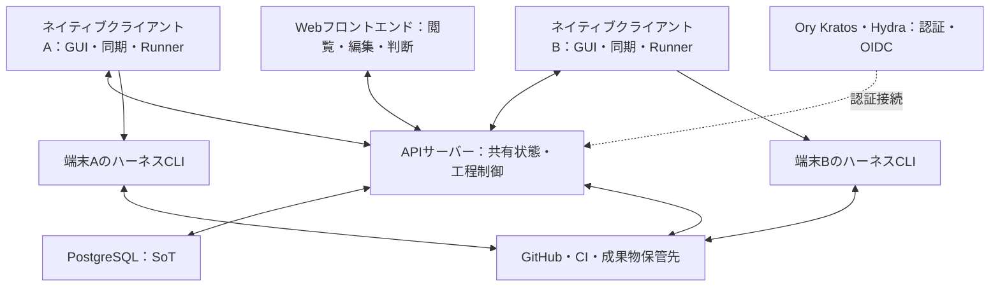
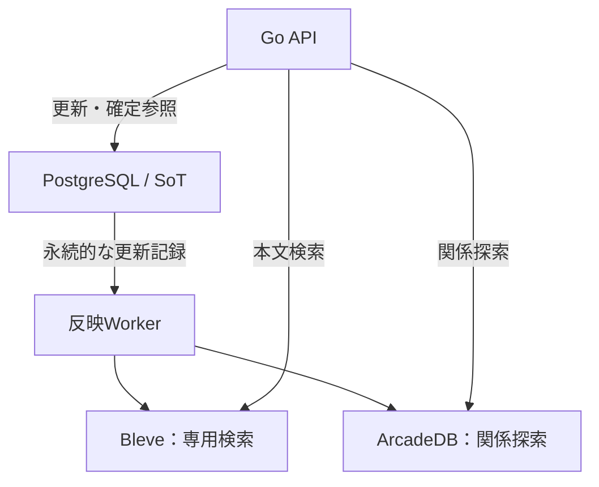
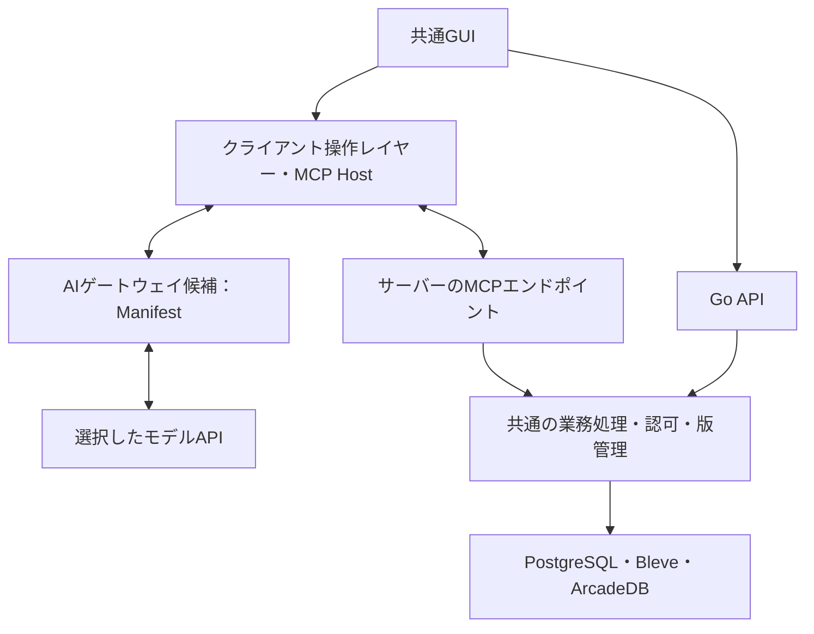
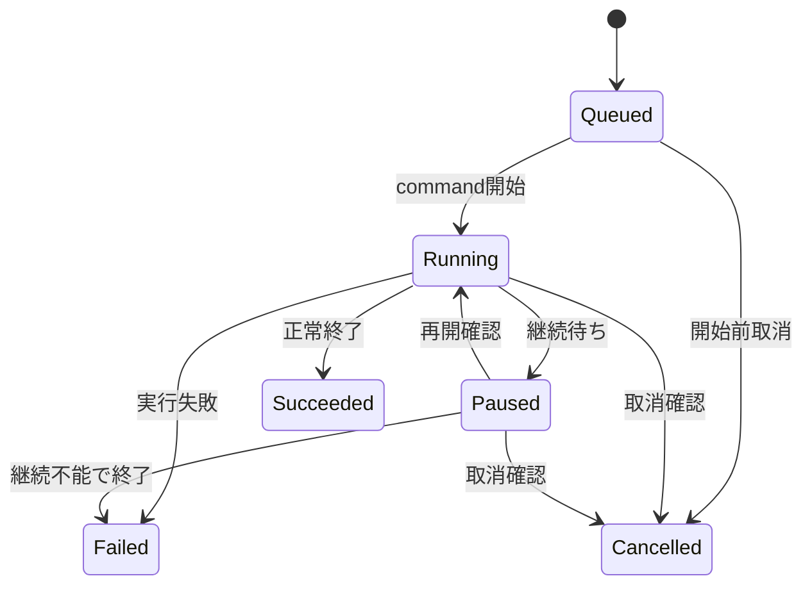
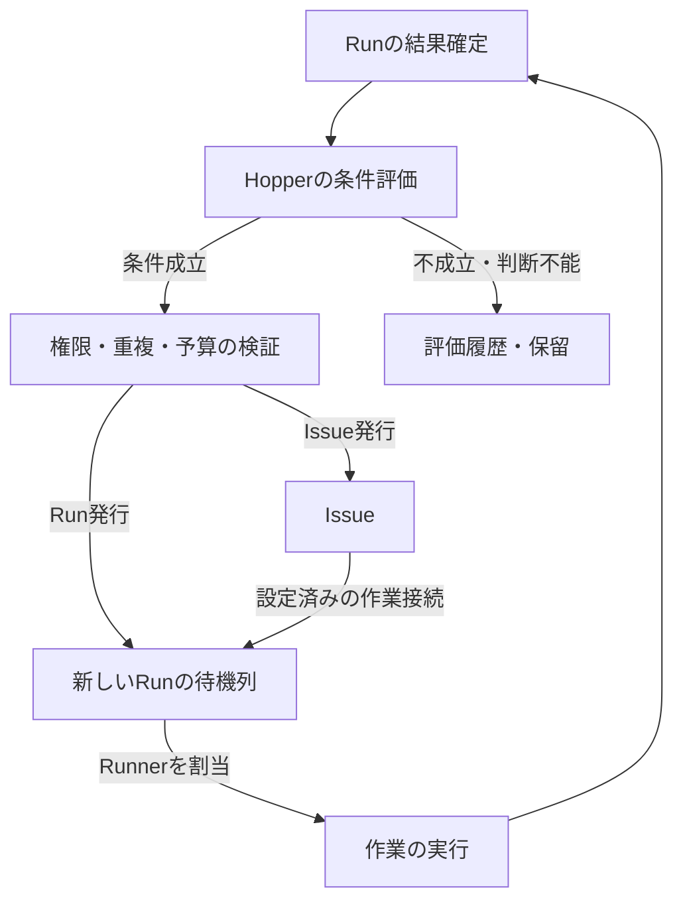

# koujou-san DesignDoc

既存のツールと配置を維持しながら、ソフトウェア開発の工程を可視化し、組み替える。

| 項目 | 内容 |
| --- | --- |
| 状態 | Draft / v0.13 |
| 作成日 | 2026-10-13（JST） |
| 更新日 | 2026-10-15（JST） |
| 対象 | ソフトウェアファクトリーを構成・運用するためのOSS |
| 最初の利用プロジェクト | kukuri |
| 本書の目的 | プロダクトが担う範囲、設計原則、主要な構成、初期の検証範囲を共有する |

本書は、これまでの議論をまとめた設計案である。1.1節の「合意済みの方針」を要求として扱う。これを満たすアーキテクチャ、データ構造、段階的な開発計画は本書での提案とする。記載したAPI・設定形式・状態名は設計を説明するためのものであり、実装済みの仕様ではない。

これまでの改訂内容を次に示す。

| 改訂 | 主な変更 |
| --- | --- |
| v0.2 | `input / pause / output`の組を、最小実行単位のRunとした |
| v0.3 | コンテキストの再利用・選択・無注入を整理した |
| v0.4 | ContextをSentence → Paragraph → Section → Documentの四段階とし、それぞれをScope（Product → Project → Milestone → Issue）へGroupingする構造に改めた。文書の構成とScopeへの所属を独立した関係とした |
| v0.5 | チーム開発を必須の前提とした。共有状態を管理するAPIサーバーと、ハーネスCLIを実行できるネイティブクライアントを基本構成とした |
| v0.6 | 専用検索・グラフエンジンを初期構成の必須要素とした。Go・共通Web UI・Tauri・PostgreSQLの選定案と、Bleveを検索の第一候補とする方針を追加した |
| v0.7 | PostgreSQLをSoT、Bleveを検索、ArcadeDBを関係探索に採用する構成を確定した。接続・更新反映・運用・検証の方針を整理した |
| v0.8 | yomiyasuのルールに沿って文章を推敲した。設計上の合意事項、提案、未決事項は変更していない |
| v0.9 | Oryを標準環境に同梱する方針を追加した。Kratos＋Hydraの構成、Web・Tauriの認証、Workspace・端末の権限との分担、導入・運用・受入条件を整理した |
| v0.10 | クライアント側のLLM連携とサーバーのMCP公開を初期機能に追加した。三つのLLM機能をRunの上位にある操作レイヤーへ置き、手動操作と共通の版・履歴で扱う構成にした。AIゲートウェイはManifest LLM Gatewayを検討候補とした |
| v0.11 | コスト最適化の基盤として、Run別のLLMモデル・トークン消費量・費用の計測と可視化を初期機能に追加した。複数モデルと再試行の内訳、取得元・欠測・推定の区別、料金の版、チーム集計、操作レイヤーとの費用の分離を整理した |
| v0.12 | Runの結果からIssueまたはRunを発行するHopperを初期機能に追加した。決定論的条件・LLMによる意味判断、クライアント不在時のサーバー処理、再送・重複・連鎖の制御を整理し、サーバー側LLM Gatewayの第一候補をBifrostとした |
| v0.13 | サーバー側LLMでIssueを自動で優先度付けするTriageを初期機能に追加した。Contextと評価方針、再評価、手動固定、Hopper・実行割当との接続、外部同期、費用と履歴を整理した |

具体的な参照形式、版管理、同期・競合解消、端末への実行割当、各エンジンへの更新反映方式、認証の接続・運用方式は、本書での提案とする。

## 1. 概要

koujou-sanは、任意のCLI、AIエージェント、リポジトリ、CI、人による判断を接続し、チームでソフトウェア開発の工程を構成・運用するためのオーケストレーション基盤である。

共有状態の正本はAPIサーバーで管理し、各メンバーのネイティブクライアントが作業進捗や起票状態を同期する。クライアントはGUIとローカルRunnerを備え、その端末でハーネスCLIを実行できる。依頼・確認を行う人と、Runを実行する端末は分けて扱う。

コードや実行環境をkoujou-sanへ移す必要はない。GitHub上のリポジトリとGitHub Actions、手元のCodexやClaude Code、別のハーネスや独自スクリプトをそのまま使える。koujou-sanは、作業に渡した入力、得られた成果、検品した内容、次の工程へ進んだ根拠を管理する。

工程内の共通の実行単位はRunである。Runは、任意のcontext、任意のprompt、必須のcommandからなるinputを受け取り、必要に応じてpauseで質問や外部条件を待ち、outputを返す。実装も検品もRunから派生し、複数のRunを接続して開発工程を構成する。

コンテキストはSentenceを最小単位とし、Paragraph、Section、Documentへ組み立てる。それぞれをProduct・Project・Milestone・IssueのScopeへGroupingし、Scopeへの所属と文書の構成を別々に管理する。

クライアント側に接続したLLMが、MCP経由でサーバーのContext・定義・作業結果を参照する。Contextの自動選択、ユーザーの自由入力からのRun定義生成、Run.outputからの新しいContext生成を、初期リリースから提供する。これらはRunを構成・管理するクライアントの操作レイヤーの機能であり、Runの派生にはしない。生成結果の提案と、設定した範囲での自動反映を選べるようにし、人による選択・設定・編集も同じデータに対して行えるようにする。

Runへ渡す内容は、四段階のどの粒度からでも選べる。実装には広い背景を与え、検品には対象と基準だけを与える構成を選べる。あえてコンテキストを注入しない検品も可能にする。

多数の工程とメンバーが、細分化したContext、その版、構成・所属・利用の関係を横断して扱う規模を対象とする。専用検索エンジンと専用グラフエンジンは初期構成から必須とする。PostgreSQLを正本（SoT）とし、検索をBleve、関係探索をArcadeDBで処理する。

認証基盤としてOryを標準環境に同梱する。Kratosでユーザー認証を、HydraでOAuth 2.0／OIDCを提供する構成とする。Workspaceへの参加や作業・端末への権限は、koujou-sanが管理する。

コスト最適化を初期機能に含める。各Runで使ったLLMのモデル、トークン消費量、費用を記録し、工程やScopeごとに比較できるようにする。取得できた利用量、料金表からの推定、未取得を区別し、検品結果や手戻りも合わせて改善を判断できるようにする。

Hopperは、Runの結果を条件に照らし、新しいIssueまたはRunを発行する仕組みである。nightly CIの失敗のような決定論的条件と、作業中に見つかったが対応されなかったバグのようなLLMによる意味判断を設定できる。評価・発行はサーバー側で行い、クライアントが終了していても、サーバーが取得した結果から次の仕事を作れるようにする。

Triageは、サーバー側LLMがIssueの内容と選択されたContextを評価し、優先度とその理由を記録・更新する機能である。Hopperによる発行、人の起票、外部サービスからの取り込みを共通の対象とする。評価方針に従って自動反映でき、人による編集・固定も提供する。Hopperと同じく初期リリースから含める。

検品を開発工程の中心に置く。実装を生成する能力に加え、成果を独立した条件で確認する能力を重視する。不合格や判断不能の場合には、必要な修正や人の判断へ戻せるようにする。検品には、テスト、コード監査、UI・UX確認、実機操作、製品哲学との整合性の確認などを組み合わせられる。

ネイティブクライアントのGUIを運用の主たる入口とする。非エンジニアやプロジェクトの背景を深く知らないエンジニアも、目的、成果、未確認事項、自分に求められる判断を理解し、開発へ参加できることを目指す。同じ工程定義と操作をファイル・CLI・APIからも扱える構成を提案する。

### 1.1 合意済みの方針

- OSSとして開発し、kukuriで日常的に利用しながら改善する。
- チーム開発を前提とし、グローバルな状態管理用のAPIサーバーと、状態を同期するローカルのネイティブクライアントで構成する。
- 実行を担うネイティブクライアントは最低限ハーネスCLIを実行できるものとする。併せて、ローカルRun実行機構を持たないWebフロントエンドを提供する。
- kukuri固有の運用を、別のプロジェクトでも変更・利用できる形に抽象化する。
- Codex、Claude Code、他のハーネスを含め、CLIで動かせる道具の選択自由度を最大限確保する。
- リポジトリ、CI、作業環境の配置を維持したまま導入できるようにする。
- 工程と検品方法を自由に組み立て、プロジェクト固有の哲学・判断基準を注入できるようにする。
- 実装と検品の間で、不要な履歴や結論が持ち込まれるコンテキスト汚染を防ぐ。
- 工程の確認、操作、調整を、分かりやすいGUIから行えるようにする。
- `input / pause / output`の組を最小単位のRunとする。`run.input`は任意のcontext、任意のprompt、必須のcommandを持ち、実装・検品等はRunから派生する。
- ContextはSentence → Paragraph → Section → Documentの四段階で構成し、それぞれをScope（Product → Project → Milestone → Issue）へGroupingする。文書構造と所属Scopeを独立した関係として扱う。
- workflow全体でコンテキストの再利用と選択を制御し、Runごとに無注入・選択注入を指定できるようにする。
- 専用検索エンジンと専用グラフエンジンを初期リリースから必須とする。大量のContextと関係を検索・分類・合成・追跡する処理を、主要な利用形態として設計する。
- PostgreSQLをSoT、Bleveを専用検索、ArcadeDBを専用グラフの実装として採用する。本文・関係・版・共有状態の正本と、検索・探索用に構築するデータの責務を分ける。
- 認証基盤としてOryを標準環境に同梱し、セルフホストでチーム開発を始められるようにする。
- サーバーの機能をMCPで公開し、クライアント側に接続したLLMから利用できるようにする。Contextの自動選択、自由入力からのRun定義生成、Run.outputからのContext生成を初期から含める。
- 三つのLLM機能は、Runより一段上のクライアント操作レイヤーに置く。Runやその派生、Workflowの実行ノードとして定義しない。
- LLMによる処理は自動化できるものとし、人による手動設定・手動編集も可能にする。自動処理と手動操作で、別々の定義やContextを管理しない。
- コスト最適化を初期から扱い、各RunのLLMモデルとトークン消費量を計測し、費用を可視化する。
- Hopperを初期から提供し、Runの結果に基づいて新しいIssueまたはRunを発行できるようにする。決定論的な条件と非決定論的な条件の両方を設定可能にする。
- Hopperはクライアントの起動状態に依存せずサーバー側で評価・発行する。LLMを使う評価のために、サーバー側にもLLM Gatewayへの接続を設ける。
- Triageを初期から提供し、サーバー側LLMでIssueの優先度を自動評価・設定する。クライアントが起動していなくても処理できるようにする。

### 1.2 本書で提案する実現方法

- APIサーバーで共有状態と工程を制御し、各ネイティブクライアントにGUI・同期・ローカルRunnerを置く。外部サービスへの接続は配置に応じて分離する。
- 操作要求と実行報告をAPIサーバーで確定し、版を条件にした更新、再送時の重複排除、切断後の照合でチームの状態を揃える。
- 工程間では、明示された入力、成果物、検品結果を受け渡す。
- 実行時の工程定義、対象成果物、評価基準を識別できる状態で固定する。
- 接続先の能力を宣言し、観測や操作のできる範囲をGUIへ反映する。
- 既存作業の観測から始め、必要な工程だけ段階的に制御を引き受ける。
- 一つのRunの中断と再開、別Runでのやり直し、複数Runの工程制御を分離する。個別作業の意味はRunの派生へ置く。
- 各Contextを版付き参照で合成・再利用し、Scopeへの所属を別の関連付けとして管理する。所属・合成だけではRunへ注入しない。
- Sentence・Paragraph・Section・Documentをそれぞれ版管理し、workflowの基準版と、各Runへ実際に渡した内容・構造・順序・由来を記録する。
- PostgreSQLの更新記録からBleveの検索インデックスとArcadeDBのグラフを継続的に構築する。各エンジンの反映位置、再構築、Runが参照する版を管理する。
- Ory Kratos＋Hydraを標準構成とし、OIDCでクライアントとAPIを接続する。ユーザー認証、Workspace内の権限、端末の実行許可、CLI自身の資格情報を分ける。外部IdPとの接続は拡張点として保つ。
- LLMによる選択・生成はクライアントの操作として扱い、依頼・途中の質問・生成結果・反映を操作履歴に記録する。MCPとGUIは同じ業務処理・認可・版管理を利用する。
- クライアント操作レイヤーのモデルAPI接続は交換可能なゲートウェイ経由とし、Manifest LLM Gatewayを第一候補として検証する。MCPの業務操作とモデルへの推論要求を分ける。
- 利用量と費用はRunに関連付ける計測データとして保持する。CLI・ゲートウェイ等の取得元を共通の形式へ変換し、実際のモデル、再試行、計測範囲、料金の根拠を記録する。操作レイヤーのLLM費用も同じ形式で扱い、Runの費用と分けて集計する。
- Hopperの定義・評価・発行要求を永続化し、サーバー側Workerが処理する。LLM GatewayはBifrostを第一候補としてHTTPで接続する。Issue・Runの発行、外部での作成確認、Runnerへの割当・起動を分ける。
- Triageは版付きの評価方針とContext選択を持ち、HopperとサーバーLLM接続・永続キューの基盤を共用する。評価履歴、採用中の優先度、手動固定を分け、古い評価による上書きと自己更新による再評価を防ぐ。
- 自動処理には対象範囲、反映方式、手動で固定した項目、予算を設定する。採用結果を版付きで確定し、実行中の入力や共有文書を遡って変更しない。

## 2. 背景と解く課題

### 2.1 kukuriの現在地

2026-10-13時点のkukuriでは、受入条件と維持条件の固定、AIによる実装、独立監査、CI、修正、マージ後確認という工程が文書化され、実際に運用されている。重要な変更では、別コンテキストでの監査が問題を検出し、修正後に再判定した記録もある。

これらの工程を制御する知識は、kukuriの原則文書、Issue、PR、作業セッション、人の判断に分散している。工程を変更したり、新しい参加者へ引き継いだりするには、文書の関係、ツールの操作、過去の意思決定を理解する必要がある。

kukuriには既に工程がある。課題は、その工程を再利用・変更・運用するための共通の仕組みと、利用者向けの入口がないことである。

### 2.2 解く課題

| 課題 | koujou-sanで目指す状態 |
| --- | --- |
| 工程がプロジェクト固有の文書と運用に埋め込まれている | 工程、接続先、評価基準を独立した定義として変更できる |
| ツールや基盤の乗り換えが導入の前提になる | 現在のCLI・リポジトリ・CIへ接続して使い始められる |
| 次に何を動かし、どの結果を待つかを人が追跡する | 工程の依存関係、待ち、差し戻し先が明示される |
| 作業状態やCLIの実行状況が各メンバーの端末へ閉じている | 進捗・起票・質問・結果を共有し、実行担当の端末と同期状況を確認できる |
| 実装者の説明や会話が検品の判断を誘導する | 検品に必要な入力を選び、渡した情報を追跡できる |
| CI成功、監査合格、実機未確認が一つの「完了」に混ざる | 確認対象と根拠ごとに結果を分け、完了条件へ対応させる |
| 背景知識がないと開発に参加できない | 目的・成果・証拠・判断点をGUIで理解し、担当範囲に参加できる |
| 共通の背景を渡すために、各工程で同じ文書をコピーする | 小さなContextを参照で合成し、変更と利用先を追跡できる |
| 共通化すると検品にも不要な背景や自己評価が流入する | 所属階層と注入を分け、Runごとに内容・順序・無注入を指定できる |
| 大量のContextから必要な情報を選ぶ作業が重い | LLMが範囲を絞って検索・選択し、人は理由と実入力を確認・修正できる |
| 作業の意図を毎回Runの設定へ書き直す必要がある | 自由入力からRun定義を生成し、同じ工程編集画面で調整できる |
| 作業結果を共有Contextへ反映する手間が蓄積する | outputから再利用する記述を生成し、由来付きで登録・更新できる |
| モデルや工程ごとの消費が分からず、費用と品質の改善を判断できない | Runごとのモデル・トークン・費用を可視化し、検品結果・手戻りとともに比較できる |
| 作業中の見送り事項や夜間CIの失敗が次の仕事へつながらない | Hopperが結果を評価し、Issue・Runを発行して由来と対応状況を追跡する |
| Issueが増えるほど、先に取り組む仕事を判断する負担が増える | Triageが製品方針と根拠に沿って優先度を付け、理由を確認・修正できる |

### 2.3 最初の利用例

kukuriの一つのIssueを対象に、実装をCodexまたはClaude Codeへ依頼し、GitHub上のPRとGitHub Actionsを追跡する。独立した検品工程が特定のcommitを監査し、問題があれば該当工程へ戻す。利用者はGUIから成果と証拠を確認し、製品判断が必要な場合に回答する。

この一連の工程を実運用で成立させ、繰り返し必要になる操作を共通化する。kukuriの「一つの末端受入条件に一つのPR」などの規則は、kukuri向けの設定として表現する。

## 3. 目的と対象外

### 3.1 目的

1. **道具を選べること。** 工程ごとに異なるCLI・ハーネス・実行場所を選び、共通基盤を変更せず差し替えられる。
2. **検品を設計できること。** 対象、基準、入力、検品者、証拠、合否後の経路を組み立てられる。
3. **既存環境のまま導入できること。** リポジトリ・CI・成果物を移行せず、現在の作業を観測・接続できる。
4. **人が参加できること。** 依頼、確認、判断、差し戻し、工程の調整を、役割に応じたGUIで行える。
5. **結果を説明できること。** どの成果物と基準に対する判定か、何が未確認か、次へ進んだ理由を追跡できる。
6. **運用を持ち出せること。** 工程定義と実行記録を取得でき、koujou-sanを停止しても既存の開発を継続できる。
7. **チームで進められること。** 複数メンバー・複数端末で作業状態を共有し、各端末のCLIを使いながら依頼・実行・検品・判断を分担できる。
8. **費用を判断できること。** どのRun・モデルでどれだけ消費したかを把握し、品質を確かめながらモデル・Context・工程を調整できる。
9. **結果から次の仕事を作れること。** Hopperで発行条件を定め、クライアント不在時にもIssue・Runの連鎖を進め、未対応の発見を拾える。
10. **仕事の優先度を共有できること。** TriageでIssueの重要性と緊急性を評価し、根拠と人の判断を含めてチームで扱える。

### 3.2 初期の対象外

- 独自の基盤モデルや汎用コーディングエージェントの開発。
- リポジトリホスティング、CI、IDE、課題管理サービスの全面的な再実装。
- あらゆるCLIに、同一の対話・停止・再開機能があるように見せること。
- AIが製品哲学、受入条件、公開判断を無制限に変更する運用。
- すべての検品をLLMだけで代替すること。
- 一つのプロジェクトで使った工程を、全プロジェクトへ必須化すること。
- 初期段階での大規模組織向け管理機能、プラグイン市場、課金基盤。チームの認証・権限・状態同期は初期から含める。
- LLMプロバイダへの請求・決済や会計システムの代替。Run別の消費・費用の可視化は初期に含めるが、全契約の実請求額との自動照合は必須にしない。
- ネイティブ側の実行機構を持たず、ブラウザだけですべての実行を完結させる構成。APIサーバーを使わず各端末が共有状態を独立確定する構成。

採用する技術構成は6.7節に記載する。Oryの標準同梱を前提とし、各技術の具体的な設定・配置、koujou-san自身のOSSライセンス、配布パッケージの形式は未決とする。本書の作成は、リポジトリの新設や公開、kukuriの運用変更を実施するものではない。

## 4. 設計原則

### 4.1 既存環境の維持と共有状態の集約

作業進捗・起票状態・工程・Runの共有記録をAPIサーバーで管理する。ローカルクライアントはその状態を同期し、CLIの実行と端末上の実行状況・作業ファイル等の観測を担う。

GitHubのリポジトリ、GitHub Actionsのワークフロー、既存の作業用ディレクトリを現在の配置のまま利用する。必要に応じてローカルcheckout、worktree、一時的な検証環境を作成できるようにするが、中央サービスへの移行は要求しない。

GUIで工程を閲覧・手動編集するだけでは、CLI起動、CI起動、pushなどを実行しない。LLMへの選択・生成の依頼は、モデルへの通信を伴う操作として示す。生成したRun定義の保存と、その定義による作業の開始は分ける。接続確認や実行を伴う操作では、その操作によって何が起こるかを明示する。

### 4.2 工程間の共通仕様

共通基盤は、工程に何を入力し、何を得て、どう判定し、次にどこへ進むかを扱う。ツール内部の推論、エージェント同士の会話方式、CLI固有の操作は接続側で扱う。

実行機構の共通契約はRunのinput、pause、outputとする。実装・検品の意味や固有の合格条件は派生の契約で定め、Run本体に特定の作業種別やLLMの利用を要求しない。

最小のCLI接続では、専用SDKへの組み込みを要求しない。コマンド、作業場所、入力の渡し方、ログと成果物の取得方法を設定できれば、一つの工程として扱えるようにする。

### 4.3 原則と工程を変更可能にする

製品哲学、開発原則、検品基準、工程の構造、接続先を分けて管理する。モデルの交換で製品哲学を書き直したり、リポジトリの交換で検品ロジックを書き直したりする必要を減らす。

共通の情報はContextの部品として保持する。ProductやProjectへ所属することだけでは、その情報を配下の全Runへ注入しない。既定の組み合わせも編集可能なRun定義として明示し、共通化と一律注入を分ける。

「コード量を最小にする」「一条件一PR」「特定のリスク区分で独立監査を必須にする」といったkukuriの規則は、プロジェクト側の定義とする。

### 4.4 検品には明示した情報だけを渡す

実装セッションの会話履歴や自己評価を、独立検品へ自動的に継承しない。仕様、受入条件、製品哲学、対象成果物、必要なテスト結果などから、検品の目的に必要な情報を選択する。

仕様との一致を検品するRunには、必要な基準を与える。一方、初見の操作体験を確認するRunでは、製品思想や設計意図を注入しない構成も選べる。何を知らせ、何を知らせないかを検品の設計に明示する。無注入で確認した結果を、知らせていない仕様や思想に適合する証拠として扱わない。

### 4.5 観測できないことを成功にしない

プロセスの正常終了、CI成功、検品合格、利用者による受入れは、それぞれ別の事実である。未実行、対象不一致、証拠不足、外部サービスへの接続断を、合格へ変換しない。

任意のCLIを接続できることと、そのCLIから詳細な進捗や判定を取得できることは別である。取得できる範囲を明示し、不足する部分はラッパー、別の検品、または人の確認で補う。

### 4.6 自律実行の範囲と終了条件

工程には完了条件、差し戻し先、再試行方針、人へ判断を戻す条件を持たせる。再試行回数、実行時間、同時実行数、費用など、測定・制御できる予算を設定できるようにする。

費用を取得できないCLIについて推計を実測として表示しない。工程の判断で受入条件や製品要件を変更する場合は、設定された判断権限に従う。人の承認を毎回挟むかどうかも工程の方針であり、既にある権限を形式的に取り直さない。

コスト最適化では、計測・比較と、モデルや工程を変更する制御を分ける。安価なモデルへの自動変更や必須Context・検品の省略を既定動作にしない。計測が遅延・欠落する経路では、費用上限を超えないと保証しない。上限に応じた停止・後続抑止は、利用量の取得範囲と接続先の停止能力に従う。

HopperによるIssue・Runの発行にも、許可した範囲、連鎖の終了条件、発行数・評価回数・費用等の上限を適用する。定期CIを継続して観測することと、一つの結果から派生する仕事が際限なく増えることを分け、周期ごとの観測と連鎖ごとの予算を設定する。

## 5. 利用者とGUI

### 5.1 利用者

| 利用者 | 主な関心 | 必要な操作 |
| --- | --- | --- |
| 製品責任者・依頼者 | 何を実現するか、製品方針に合うか | 依頼、受入条件の確認、選択肢への回答、成果の受入れ |
| 工程を設計するエンジニア | どの道具をどう接続するか | 工程、接続先、入力、検品、分岐、権限の設定 |
| 実装・運用を担当する人 | 実行状況、失敗原因、再開方法 | 起動、ログ確認、停止、再接続、修正、元ツールへの移動 |
| デザイナー・業務担当者・検品者 | 利用体験や業務上の期待が満たされたか | プレビュー、証拠確認、合否、理由付き差し戻し |
| 背景を知らない参加者 | 今回の対象と自分の判断点 | 作業の要約、用語・条件の確認、担当部分への回答 |

これらは利用場面の分類であり、固定された職種や権限モデルではない。同じ人が複数の役割を担える。

### 5.2 主な画面

**作業一覧**には、目的、現在の工程、起票状態、担当者・実行端末、何を待っているか、次の操作を示す。同期したチームの状態を基本とし、未送信の下書きや古いキャッシュの表示を区別する。正常に進んでいる作業と、判断や対応が必要な作業を識別できるようにする。 Issueの採用中の優先度、未評価・再評価待ち・手動固定も表示し、優先度で絞り込み・並べ替えられるようにする。

**作業詳細**は、目的、今回の対象、受入条件、成果物やプレビュー、検品結果、未確認事項、判断依頼を中心に構成する。commitやジョブIDなどの技術情報は、根拠を確認するときに辿れるようにする。初期表示を理解するための必須情報にはしない。

**Run詳細**では、入力、途中の質問・回答、出力を共通の構造で確認する。実装Runや検品Runなどの派生に応じて、差分、プレビュー、基準別判定を追加表示する。加工した表示からも元の出力へ戻れるようにする。依頼者、担当端末、最終報告時刻、未同期の記録も確認できる。

同じ画面に、実際に使ったモデル、入力・出力トークン、費用、計測状態を表示する。複数モデルを使ったRunは内訳を展開でき、キャッシュ・推論トークン等の取得できた内訳、失敗した呼び出し、再試行、料金の根拠まで確認できる。実行中は取得済みの暫定値と最終更新時刻を示し、終了時しか取得できない接続も明示する。

**コンテキスト編集**では、Sentence・Paragraph・Section・Documentを作成・編集し、参照と利用先を確認する。各Scopeから四種類の候補を探し、文書全体の再利用から一文の選び直しまで行える。文書を組み立てる表示とScopeへのGroupingの表示を分け、所属変更と本文編集を区別する。

**注入プレビュー**では、各Runへ渡す文・段落・節・文書と、その版・構造・順序・由来を表示する。除外した項目も示し、元の文書と抜粋した入力を区別する。「注入なし」を明示的に選べるようにし、実行を開始せずに選択結果を確認できるようにする。

内容の確定に外部からの取得が必要な場合は、その操作を示す。取得とCLI・CIの起動は区別し、未取得部分を含むプレビューを完全なものとして表示しない。

**工程編集**では、Run定義の追加・接続・並列化、command、context、prompt、検品条件、失敗時の戻り先を変更する。単純な作業は順序付きの一覧で扱え、依存関係が複雑な場合はグラフで確認できる。ファイル編集とGUI編集は同じ定義へ反映する。編集のためにRunを実行する必要はない。

**検品画面**では、基準と観測結果を対応させ、合格・不合格・判断不能を理由付きで記録する。実機確認や利用者確認をAIのコメントと混ぜず、誰が何を確認したかを表示する。

**コスト画面**では、期間、Workspace、Product・Project・Milestone・Issue、Workflow、Runの種別・定義、モデルで絞り込み、トークン・費用・計測状況を比較する。費用の推移、工程別・モデル別の内訳、消費の大きいRunから詳細へ移動できる。Runの実行費用、Context選択・定義生成・Context生成の操作費用、Hopper・Triageの評価費用を分け、全体ではそれぞれを一度ずつ含める。未取得・一部取得のRunや、価格未設定の利用量も併記し、取得済み部分の合計を全費用と誤認させない。

**接続設定**では、APIサーバー、参加する共有領域、登録端末、CLI、リポジトリ、CI、利用できる操作と権限を示す。共有の接続定義と、端末ごとのCLI・パス・資格情報への対応を分ける。秘密情報そのものは工程定義に埋め込まない。

**アカウント**では、ログイン、ログアウト、認証設定、アカウント復旧を扱う。認証画面は共通UIに合わせて提供し、Tauriではシステムブラウザで認証してアプリへ戻る。

**LLM連携**では、利用するゲートウェイとモデル、処理ごとの対象範囲、提案・自動反映の設定、処理するクライアント、利用量や上限を確認する。「Contextを選ぶ」「この依頼からRun定義を作る」「結果をContextへ反映する」を既存の編集画面から依頼できるようにする。生成中、質問待ち、検証エラー、提案、反映済みを区別する。

**生成結果の確認**では、選択理由、参照した版、変更差分、元のoutput、手動で固定した項目を示す。項目ごとの採否、文章の編集、再生成、以前の内容を基にした新しい版の作成を行える。自動反映した変更も同じ画面と履歴から編集できる。

**チームと端末**では、参加者、招待・所属・役割、実行を依頼できる端末、利用できるCLI、接続状況を確認する。アカウントへのログインと、Workspaceへの参加、端末の登録・実行許可を区別して表示する。接続断を作業の失敗と同じ表示にせず、最後に分かっていた状態を示す。

**Hopper設定**では、監視するRun・結果、条件、参照するログ・Context、発行先、テンプレート、提案・自動発行、Runの起動方針、重複時の扱い、連鎖の上限を編集する。保存と有効化を分け、過去の結果で発行せずに評価を試せる。LLM評価を試す操作は、モデルへの送信と費用が発生することを示す。

**Hopper履歴**では、入力結果、適用した定義の版、判定・根拠、発行したIssue・Run、見送り・保留・失敗、費用を確認する。由来の連鎖をたどり、一時停止、設定変更、未確定の提案の編集、明示的な再評価を行える。発行済みと実行中を分け、クライアント再接続後も同じ履歴を表示する。

**Triage設定**では、対象Scope・Issue、評価方針、優先度の段階、参照するContext、モデル、再評価の契機、自動反映・提案、評価回数・費用の上限を設定する。既存Issueで反映せずに評価を試し、方針を調整できる。

**Issueの優先度**では、採用中の値、AIの最新推奨、評価理由・根拠・不確実な点、参照した方針とContextの版、評価時刻を確認する。手動変更と固定、固定の解除、再評価、提案の採用を同じ画面で行う。固定中も新しい推奨を確認でき、自動反映した変更も履歴からたどれる。

### 5.3 判断依頼の形式

判断依頼には、質問、背景、選択肢、各選択の影響、回答を待つ工程を含める。専門知識が必要な場合はその旨を示し、回答できる担当者へ回せるようにする。非エンジニアの参加は、理解できない技術判断への承認を求めることではない。

実行中の質問は、そのRunのpauseとして表示する。回答の送信と実際の再開を区別し、解決済みの質問と回答は履歴に残す。あらかじめ工程へ置く人の検品は、人への依頼を行うcommandを持つRunとして表現し、その回答待ちをpauseとする。

GUIで入力された差し戻しは、対象成果物、該当条件、観測した問題、期待する結果を持つ記録にする。単なる自由文をすべて実装への指示として自動実行しない。

### 5.4 工程変更と実行の分離

工程定義では、下書き、検証、採用した版を区別する。静的検証では、未接続の入力、存在しない戻り先、必要な能力の不足、終了条件のない循環などを確認する。静的検証に合格しても、実際のCLIやCIの成功を保証するものではない。LLM生成は操作レイヤーへ明示的に依頼し、その結果も手動で作った定義と同じ静的検証を通す。

実行中の作業は開始時の定義を参照する。定義を編集しただけでは、進行中の作業を変更しない。適用する場合は、影響する工程と失効する判定を示し、変更した版での継続を記録する。

## 6. アーキテクチャ案

### 6.1 チーム共通のAPIサーバーとネイティブクライアント

基本構成は、チームの共有状態を管理するAPIサーバーと、ローカルのRun実行を担うネイティブクライアントとする。閲覧・編集・起票・判断への回答には、実行機構を持たないWebフロントエンドからも参加できる。

単一クライアントを正本として後から共有機能を追加する構成にはしない。作業進捗、起票状態、工程、Run、Context、質問・回答をAPIサーバー経由で同期する。

ここでのグローバルな状態は、権限で区切られたチームの共有領域内の状態を意味する。チームと共有領域を管理するWorkspaceを導入する案とし、Product等のScopeや文書階層とは分ける。複数のWorkspaceを同じサーバーで扱う場合も、状態や資格情報を混在させない。



| 構成要素 | 責務 |
| --- | --- |
| APIサーバー | Oryとの認証接続、認証済み要求の検証、業務上の認可、共有状態の更新、工程の依存・分岐、Runの割当、pauseへの応答、クライアントへの同期を扱う |
| Ory Kratos・Hydra | ユーザー認証、認証セッション、OAuth 2.0／OIDCを提供する。標準環境に同梱する。Workspaceの権限とRunの実行割当はAPIサーバーが扱う |
| PostgreSQL | 工程・Contextの版、Scopeの所属、関係、Run記録、進捗、起票操作の状態、更新履歴を正本として永続化する |
| Bleve（専用検索エンジン） | Context本文・メタデータの検索、絞り込み、順位付けを担う。初期から必須とする |
| ArcadeDB（専用グラフエンジン） | 文書の構成、所属、参照、由来・利用関係をたどり、合成・選択・変更影響の探索を担う。初期から必須とする |
| MCPサーバー | Go APIと同じ業務処理を、LLMクライアント向けのtools・resourcesとして公開する。認可・版管理・更新記録を共通化する |
| ネイティブクライアント | GUI、共有状態の同期、ローカルキャッシュ、端末設定、CLIを実行する機構、操作レイヤーのLLM接続とMCP Hostの機能を提供する |
| Webフロントエンド | 共通UIで閲覧・編集・起票・判断への回答を提供する。ローカルRunnerを持たない |
| ローカルRunner | 割り当てられたRunのcommandを端末上で実行し、原出力・pause・実行状態を記録してAPIサーバーへ報告する |
| Connector | 外部状態を取得し、許可された操作を行う。認証・接続条件に応じてサーバー側または端末側へ配置する |
| Hopper Worker | サーバー側で結果イベントを取り込み、条件の評価、LLM呼び出し、Issue・Runの発行要求と履歴を扱う。業務上の認可・割当はAPIと共通化する |
| Triage Worker | サーバー側でIssueと評価方針・Contextを読み、優先度の推奨、検証、反映、再評価の履歴を扱う。共通の認可と永続キューを使う |
| サーバー側LLM Gateway | Hopper・Triageの推論要求をモデルへ中継する。Bifrostを第一候補とし、業務状態・判断の採用・実行権限はkoujou-sanが管理する |
| Contextの解決 | 共有された選択と版に従って入力を確定する。端末固有のファイル等も由来と版を記録し、実際に渡した内容をManifestへ対応付ける |

APIサーバーは共有状態を確定する役割を担う。一台の物理サーバーや特定のクラウドに限定せず、セルフホストを可能にする。開発・試用でサーバーとクライアントを同じ端末に置く場合も、APIと状態管理の役割分担は維持する。一人で利用する場合も、チーム構成の一メンバーとして扱う。

APIサーバーへのハーネスCLIの導入は必須にしない。標準のCLI実行場所はネイティブクライアントの端末とする。常設の実行端末やGUIのないRunnerは同じ契約で追加可能だが、通常のクライアントがCLIを実行できる要件を置き換えない。

### 6.2 ネイティブクライアントの必須機能

標準クライアントはデスクトップ向けのネイティブアプリとし、GUIとローカルRunnerを提供する。画面にはWeb技術を使えるが、OS上のプロセス起動・入出力・ファイル操作はネイティブ側の実行機構で担う。ブラウザフロントエンドだけでは、この要件を満たさない。

| 必須の能力 | 内容 |
| --- | --- |
| CLIの起動 | 指定した実行ファイル・引数・作業場所で任意のハーネスCLIやスクリプトを起動する |
| 入出力の接続 | context・promptを接続設定に従って渡し、標準出力・標準エラー・終了状態・成果物を取得する |
| 実行中の記録 | Runと端末内の実行を対応付け、ログ・イベント・未送信記録を保持する |
| APIとの同期 | 共有状態を取得し、操作要求と実行報告を送る。未同期と確定済みを区別する |
| 利用量の収集 | CLIの接続能力に応じてモデル・トークン・報告費用を取得し、Runと取得元を対応付ける。未送信の計測記録を保持する |
| ローカル設定 | CLIの所在、利用できる能力、checkoutやworktreeの配置、資格情報への参照を管理する |
| LLM連携 | Runの実行機構から独立して、LLMへの接続、MCP操作、選択・生成、質問・生成結果・利用量の記録を行う |

対話入力、停止、セッション復元は、接続するCLIの能力に応じて提供する。これらを全CLIの必須能力にはしない。任意CLIを接続する自由度と、クライアント自身がCLIを起動できる要件を区別する。

GUIとRunnerの役割を分け、ウィンドウを閉じる操作と実行を停止する操作を区別する。バックグラウンドで継続するための実装方式は未決とし、終了時には実行への影響を表示する。端末のスリープ・再起動・プロセス消失後に継続できるかは、RunnerとCLIの能力を確認して判断する。

クライアントにはCLIを実行する機構を備えるが、閲覧・起票・検品への回答だけを行う利用者へハーネスの設定完了を要求しない。その端末で実行するRunに必要な道具を、実行前に検証する。

### 6.3 状態の正本と端末固有の情報

| 情報 | 正本・確定する場所 | クライアントでの扱い |
| --- | --- | --- |
| Oryの認証情報・セッション・トークン発行状態 | Oryが管理するPostgreSQL | 認証フローを通して利用し、チームの状態同期へ含めない |
| Userと認証主体の対応、Workspaceの参加者・権限、工程・Context・Scopeの所属 | APIサーバー側 | 権限のある範囲を同期し、編集要求を送る |
| WorkflowExecution、Runの割当・共有進捗、pauseの回答 | APIサーバー側 | 実行報告や操作を送り、受理された状態を同期する |
| 利用量の記録、料金の版、費用評価と集計 | APIサーバー側のPostgreSQL | 端末等で観測した値を送信し、集計・計測状態を共有する。ゲートウェイの元ログや外部の請求額は取得元の情報として参照する |
| Hopperの定義・評価・発行要求・連鎖・処理待ち | APIサーバー側のPostgreSQL | GUIで設定と履歴を同期する。クライアントを停止してもサーバー側の処理は継続する |
| Triageの方針・評価・優先度・手動固定・処理待ち | APIサーバー側のPostgreSQL | 現在の優先度と推奨、反映状態、外部同期状態を共有する。外部での変更も共通の更新処理へ取り込む |
| Hopper・Triage用のモデル・外部サービス資格情報 | サーバー側の安全な設定領域 | 参照名と利用可能な能力を表示する。クライアントの秘密値を自動複製しない |
| CLIプロセス・セッション・作業ディレクトリの実体 | 実行した端末・CLI | ローカルRunnerが観測し、必要な状態と証拠を報告する |
| 起票要求とその処理・照合の履歴 | APIサーバー側 | 未送信、受付済み、外部確認済みなどを区別して表示する |
| 外部Issue本文、PR、commit、CIの実際の状態 | GitHub等の外部サービス | サーバーが保持する観測結果を同期し、必要なら外部の正本を開く |
| ローカルパス、個人のCLI設定、端末の資格情報 | 当該端末 | 共有する論理参照と端末上の配置を対応付ける |
| LLM連携の方針、操作履歴と生成案、採用した定義・Context・選択結果 | APIサーバー側 | 手動と自動で同じ版・変更履歴を扱う。原出力と編集後の内容を区別する |
| LLMゲートウェイへの資格情報・ローカルの接続設定・進行中の対話 | 操作するクライアント | 秘密値を保持し、共有に必要な操作履歴だけを送る。上流のモデル資格情報は接続先ゲートウェイが管理する |
| 未送信の編集下書き・実行ログ、共有状態のキャッシュ | 当該端末 | サーバーで確定した状態と区別し、再接続時に照合する |

APIサーバーにRunningと記録されていても、端末上のプロセスが現在動いているとは限らない。最後の報告時刻と観測状態を併記する。ローカルで完了した結果も、同期前は他のメンバーから確認できない。端末上での完了と、チームへ共有された完了を区別する。

コードや成果物の全量をAPIサーバーへ移すことは必須にしない。別端末で続きを行う場合は、固定commitや成果物の固定参照を使い、必要ならsnapshotを明示的に共有する。端末Aの絶対パスや未共有ファイルを、端末Bでも使える参照として扱わない。対象の版とアクセスできることを確認してからRunを開始する。

共有された進捗・会話・検品結果を、ハーネスのcontextへ自動で注入しない。GUIから閲覧できる情報と、Runへ選択して渡す情報を分ける。状態同期はContextの選択・無注入の規則を変更しない。

外部情報の要約やキャッシュには、取得元、識別子、取得時刻を持たせる。GUIからIssue等を変更する場合は外部の正本を更新し、その結果を確認する。外部で行われた変更も取り込み、異なる内容を双方で正本として維持しない。

工程定義は版管理可能なファイルとして表現する。Gitでの管理は選択可能とし、専用の配置先を既存リポジトリへ強制しない。ファイルから更新する場合も、APIサーバーへ登録して採用版を確定する。GUI・ファイル・別端末からの更新が競合した場合は、元の版を照合して解消する。

### 6.4 実行の依頼者と担当端末

作業の依頼者、担当者、実行端末、CLIの資格情報に紐付く主体をそれぞれ記録する。あるメンバーが自分のクライアントから工程を開始し、許可された別端末で実装Runを動かし、別のメンバーが質問へ回答する構成を扱えるようにする。

APIサーバーは、対象端末の利用許可、CLIと実行環境の能力、接続状態を確認してRunを割り当てる。端末は自分に割り当てられた要求を認証済みの接続で受け取り、ローカルの実行方針と照合して起動する。Oryでのログインやチームへの参加だけで、他のメンバーの端末に任意のcommandを実行できる権限は与えない。端末の登録と失効は12.3節で扱う。

Runの開始前に、担当端末で使うcommandの接続、入力の版・固定参照、ContextManifestを確定し、APIサーバーへ記録する。端末の事情で別の版や情報へ置き換える必要がある場合は、入力を再確定してから開始する。実行準備の完了と、プロセスの起動は別々に報告する。

一つのRunの実行担当を同時に複数端末へ与えない。割当の世代と有効期間をサーバーで管理し、開始前に確認する方式を提案する。ただし割当期限の失効は、既に起動したCLIの停止を意味しない。切断時の照合と引き継ぎは第11章の規則に従う。

CI結果の取得や人への依頼もcommandとして扱う。CLI以外のcommandは、能力を宣言したサーバー側の実行機構で処理することもできる。Runのinput・pause・outputは配置に依存しない。Connectorのpollingや同期通信を、一回ごとに別の業務Runへ分ける必要はない。

### 6.5 段階的な接続

接続ごとに、観測のみ、明示操作、承認済み範囲の自動操作を選べるようにする。GitHubを観測するために、PR作成やマージの権限まで一括で要求しない。

既存のCIは、その起動条件を利用する。例えばPRへのpushで起動した実行を追跡する場合、同じ検証をkoujou-sanから重複起動しない。外部実行への接続は、リポジトリ、commit、PR、ワークフロー、実行ID、再実行の回を照合する。

### 6.6 必須の検索・グラフ基盤

Sentence単位の本文に加え、各単位の版、順序付き参照、複数Scopeへの所属、Runごとの採用履歴が増えることを前提とする。検索と関係探索は、Contextを発見・選択・組み合わせ、検品の独立性や変更影響を確認するための日常的な処理である。両エンジンの導入を、PostgreSQL単独での運用後へ先送りしない。

| 層 | 管理する内容・処理 |
| --- | --- |
| PostgreSQL / SoT | 本文や固定参照、版、構成・所属・利用の関係、権限、更新記録、確定したManifest |
| Bleve / 専用検索 | 文・段落・節・文書を各粒度で検索し、Scope・版等で絞り込み、候補を順位付けする |
| ArcadeDB / 専用グラフ | 型と版を持つノード・関係を探索し、再利用先、合成範囲、由来、変更の影響を取得する |
| Go API | 認可、検索と探索の組み合わせ、結果の版の照合、選択の確定とRunへの受け渡しを行う |



検索と関係探索を専用エンジンに分担させる。物理サーバーの分離や分散クラスタの採否は、配置要件に応じて決める。組み込み型エンジンを専用サービスとして提供する実装も選べる。クライアントにはDBを直接公開せず、チームの認可と共有状態の仕様をAPIで管理する。

関係の正本もPostgreSQLへ保存する。文書構造の包含、Scopeへの所属、Runによる利用・生成、人やAIが判断した意味的関係は、それぞれ型と由来を持たせる。AIが生成した関係には対象の版、生成操作のID、参照元RunまたはContext、採用状態を記録する。再構築時にAIへ再推論させて関係の正本を変えない。

更新方式として、業務データと更新イベントを同じPostgreSQLトランザクションで保存し、Workerが両エンジンへ反映する方式を提案する。APIから三つの保存先へ個別に書き込み、途中で失敗したときの整合性の回復を利用者へ委ねる構成は採らない。再送時の重複排除、削除の反映、更新順序、再構築中の更新を取り込む方法を設計する。

両エンジンは、それぞれ反映済みの位置とデータの版を報告する。本文検索とグラフ探索の結果を組み合わせる場合は、対象ContextのID・版と基準となる状態を照合する。必要な版がまだ反映されていなければ、反映待ちとして扱う。結果の欠落を「関係なし」「対象なし」と断定しない。

検索・探索の結果は選択候補として扱い、Runへ注入する範囲は明示した選択規則で確定する。選択済みIDの本文・版・権限の照合はSoTで行い、採用した結果をContextManifestへ固定する。検索順位や意味的な関連が変わっただけで、開始済みRunの入力を変えない。

検索・グラフのデータはSoTから再構築できるようにする。両エンジンは常設の必須構成とし、停止時には、そのエンジンを必要とする機能に利用不可・待機を表示する。入力が既に確定したRunを継続できるかは別途判断し、すべての工程を無条件に失敗させない。

一覧の全件取得や、全グラフをクライアントへ渡す表示を基本にしない。検索・探索の範囲、取得件数、ページ継続、時間・展開量の上限を設定できるようにする。上限に達して探索を打ち切った場合は、未探索の範囲を示す。その結果を、変更影響や除外範囲を完全に確認したものとして扱わない。

### 6.7 採用する技術構成

以下を実装の基本構成として採用する。製品の選定と、採用版・接続方式・配置・性能目標の確定を分けて記録する。具体的な運用条件は第18章で管理する。

| 対象 | 採用技術 | 担わせる責務 |
| --- | --- | --- |
| サーバーバックエンド | Go | API、工程制御、実行割当、認証接続、認可、更新配信、Hopper・Triage Worker |
| 標準のユーザー認証 | Ory Kratos（OSS版） | ユーザーの認証情報、ログイン・復旧等のフロー、認証セッションを管理する |
| 標準のOAuth 2.0／OIDC | Ory Hydra（OSS版） | OIDC接続とトークン発行を担い、Kratosによるログインへ接続する |
| LLM向けサーバー接続 | MCP / Streamable HTTP | Goの業務処理を公開する。Go SDKと採用するプロトコル版は接続検証で確定する |
| クライアント側LLM連携 | 操作レイヤーのLLM接続層・MCP Host | Context選択、Run定義生成、Context生成を行う。ローカルRunnerとは分離する |
| クライアント側AIゲートウェイの検討候補 | Manifest LLM Gateway | 操作レイヤーからのモデルAPI接続・利用量の観測を担う。HTTP接続を基本に検証し、同梱・標準採用は別途確定する |
| サーバー側AIゲートウェイの検討候補 | Bifrost（OSS版） | Hopper・Triageからの推論要求を中継する。Go WorkerとはHTTPで接続し、採用版・設定・配布方式を検証する |
| Webフロントエンド | TypeScript / React / shadcn / Zustand / TanStack Query | 閲覧・編集・起票・判断への回答。ローカルのRun実行機構を持たない |
| ネイティブクライアント | 共通のフロントエンド + Tauri | 上記の画面に、ローカルRunnerとOS連携を追加する |
| SoT | PostgreSQL | 共有状態とContext・関係・版の正本 |
| 専用検索 | Bleve | Goで各粒度のContext本文検索と絞り込みを実装する。APIとの配置・負荷分離を決める |
| 専用グラフ | ArcadeDB | 型・版付きの関係探索、合成・参照・由来・影響の追跡。独立したサーバーとして配置する |

ZustandはUI・編集状態、TanStack QueryはAPI上の共有状態の表示用キャッシュを担う案とする。同期プロトコル、競合判定、永続的な未送信記録は別に設計する。共通UIからネイティブAPIへの依存を分離し、Web版とTauri版の実行能力の違いを明示する。

OryはKratosとHydraを標準配布へ含め、外部の認証SaaS契約を導入の必須条件にしない。認証画面とログイン・同意フローの接続処理はkoujou-san側で提供する。KetoとOathkeeperは初期の必須構成に含めない。構成と運用は6.9節、認証・認可の仕様案は第12章に記載する。

BleveはGo向けの索引・検索ライブラリであり、Goバックエンドとの統合を理由に採用する。専用検索エンジンとして、Bleveを組み込む検索コンポーネントを設ける。APIと同一プロセスに置くか、独立したGoサービスにするかは、負荷・配布要件に応じて決める。初期からAPIとの役割を分け、検索・索引作成の負荷とライフサイクルを切り離せるようにする。

検索インデックスでは、Workspace、およびContextのID・種別・版を識別する。本文、Scope、タグ、コード識別子等に適したフィールドを定義する。BleveにはCJK向けのAnalyzerがある。日本語本文、英語、コード識別子、IDの完全一致は、それぞれ設定・評価する。Analyzer・schemaの版、インデックスの更新担当、永続化、再構築と切替は、検索コンポーネントで管理する。

Scopeの検索用フィールドには、正本に記録した所属関係を反映する。Documentの所属を子のSentenceへ自動的に複製しない。文書構造をたどる検索と、Scopeへの直接所属で絞る検索を区別する。

日本語の検索品質と大量データでの性能は、実際のContext・問い合わせ例で評価する。Bleveを採用しただけでは、分散配置や可用性の設計は確定しない。必要に応じて、分割・複製・障害復旧の方式を配置設計に含める。

ArcadeDBはネイティブのグラフエンジンを持つDBMSで、Apache 2.0で公開されている。ディスクとページキャッシュを使ってデータを保持でき、Go向けのHTTP・gRPCドライバも提供されている。配布・再利用の自由度、増加するContextと履歴の保持、共有サーバーへの接続を理由に採用する。

ArcadeDBのマルチモデル機能のうち、koujou-sanでは関係探索を使う。本文・版・関係の正本はPostgreSQL、本文検索はBleveが担う。選定経緯は第17章、公式資料は第19章に記載する。

採用した構成を対象負荷で検証し、必要な検索・探索・更新性能と運用性を満たす設定・配置を決める。保存件数に加え、版の数、関係数、共有される子の数、探索の深さ・分岐、同時更新と検索、再構築時間を測る。性能上の問題が見つかった場合も、専用検索・グラフを必須とする要件は維持して改善する。

### 6.8 ArcadeDBの接続・反映・運用

ArcadeDBはサーバー側の独立サービスとして配置し、Go APIと反映Workerから接続する。Java実行環境はこのサービスに含め、Web・Tauriクライアントには要求しない。

接続には、Goの公式HTTPドライバを使うことを初期案とする。大量の結果や一括反映を扱う経路ではgRPCも評価する。サーバー・ドライバの対応版とクエリ言語を固定し、タイムアウト、再試行、トランザクション、結果上限の挙動を接続仕様として確認する。

グラフには、Contextの種別・ID・版、Scope、Runと、それらの構成・所属・参照・由来・利用の関係を反映する。参照先の版や文書内の順序など、探索・合成に必要な属性も保持する。対応付けにはPostgreSQL上の安定したIDを使い、ArcadeDB内部のレコードIDを外部のContext参照には使わない。

Contextの版管理、ScopeへのGrouping、注入規則はkoujou-sanの仕様である。過去版を保存する代わりに、DB内部のトランザクションやMVCCを使うことはしない。

更新は6.6節の永続的な更新記録から反映する。反映Workerは、同じイベントを再処理してもノード・関係を重複させない。古い更新で新しい状態を上書きすることも防ぐ。

グラフの更新と、その更新に対応する反映位置を、同じArcadeDBトランザクションで確定する方式を基本案とする。競合や応答喪失時は、確定した状態を照合して再試行する。一括ロードを複数回に分けてコミットする場合は、途中まで反映された範囲を記録し、全体が成功したとは扱わない。

探索APIは取得結果とともに、対象版、反映位置、探索範囲、結果の完全性を扱う。公式HTTPドライバの`truncated`やストリームの完了情報を受け取り、上限到達・中断による部分結果を完全な結果と区別する。必要な関係を取得できたことを確認してから、ContextManifestを確定する。画面でのページ分割や部分プレビューは許容するが、変更影響を完全に確認したものとしては扱わない。

ArcadeDBはディスクとページキャッシュを利用するため、全グラフを常駐メモリへ収めることを前提にしない。JVMメモリ、キャッシュ、ディスクI/O、WALの永続化、バックアップと復旧を運用設定に含める。

性能検証では、採用する永続化条件を明示する。キャッシュが効く場合と効かない場合、共有Sentence等へ関係が集中する場合、検索・更新が競合する場合を検証する。

HAを構成する場合、現行の公式モデルでは単一リーダーへ書き込み、レプリカから読み取る方式が基本となる。読み取りの整合性と遅延を選び、Workerからグラフへの反映待ちと、グラフ内のレプリカへの反映待ちを区別する。

HAを導入しただけで、単一グラフの書き込み能力や保存容量が水平に増えるとは扱わない。また、ArcadeDBを初期から必須とする要件は、初期から複数ノードを必須とするものではない。Workspaceと物理DBの対応、容量上限、HAの標準配置は第18章で確定する。

### 6.9 Oryの標準同梱と運用

標準環境には、Go API、Web UI、PostgreSQL、Bleve、ArcadeDBに加え、Ory KratosとHydraのOSS版を含める。同梱とは、対応するバージョン、設定例、初期化・起動・更新手順をまとめて提供し、チームが認証基盤を別途選定せず使い始められることを意味する。各サービスをGo APIの単一バイナリへ組み込むことは要求しない。

| 構成・作業 | 方針 |
| --- | --- |
| ユーザー認証 | Kratosでログイン、認証設定、復旧等を扱う。採用する認証方式と画面の詳細は第18章で確定する |
| OAuth 2.0／OIDC | Hydraでクライアント登録とトークン発行を扱う。Go側の接続処理がKratosのログイン結果を確認し、Hydraのログイン・同意フローへ渡す |
| 認証画面 | React／shadcnの共通UIに合わせて提供する。Oryのフロー状態、検証エラー、期限切れを扱う |
| 永続化 | koujou-san、Kratos、HydraでDBと接続ロールを分ける。同じPostgreSQLクラスタの利用は可能とする |
| 初期設定 | 公開URL、OIDC issuer、Web・Tauriのclientとredirect URI、秘密値、必要なメール配送を設定し、最初の管理者とWorkspaceを作る |
| 保守 | 対応版を固定し、各サービスのmigration、バックアップ、鍵・秘密値の管理、更新と復旧の手順を提供する |

Oryの管理APIはサーバー内部の接続に限定する。クライアントから使う公開APIと、管理・初期化に使うAPIの経路を分ける。koujou-sanはOryの内部テーブルを直接更新せず、Oryが提供するAPIとmigrationを使う。認証情報をBleveやArcadeDBへ転記しない。

初期設定では、Webでのログイン、Tauriからの認証と復帰、Workspaceへの参加、端末登録までを確認できるようにする。公開登録の可否、招待の受諾条件、最初の管理者の作成方法は明示的に設定する。単に最初にアクセスした利用者へ管理者権限を与える方式にはしない。

Kratosの認証セッション、Hydraのトークン、Webのアプリセッション、端末の資格情報は別々に管理する。ログアウトや失効が各状態へ及ぼす範囲を定義し、一つを破棄しただけですべて失効したとは扱わない。Ory停止中のログイン・更新は利用不可とし、既存の認証済み要求を受理できる条件は、トークンの検証方式と期限に従う。検証できない要求は受理しない。

Workspaceの所属・権限はkoujou-sanで管理し、標準環境をOryの商用Organizations・マルチテナント機能へ依存させない。複数Workspaceを扱えることと、組織ごとに独立した認証設定・企業SSOを提供することは別要件とする。

koujou-sanと認証基盤の接続面はOIDCを基本とし、Ory固有の処理は認証接続部へ集約する。外部IdPとの接続は拡張点として保つが、初期リリースの標準配布・受入確認は同梱したOryを対象とする。外部IdPの対応範囲とアカウント移行手順は、対応時に別途検証する。

### 6.10 クライアントの操作レイヤーとMCPサーバー

クライアントの操作レイヤーは、Run定義の作成、Contextの選択、作業結果の再利用を扱う。人がGUIで行う操作を、LLMにも依頼できる構成とする。このレイヤーはRunを構成・管理する側にあり、LLM処理のためにRunやcommandを生成しない。

| 層 | 責務 | 記録 |
| --- | --- | --- |
| 操作レイヤー | 自由入力の解釈、Contextの選択・生成、RunDefinitionの作成・編集、変更の採用 | 操作ID、依頼者、参照、生成案、質問・回答、変更・反映の履歴 |
| 工程・Runの実行レイヤー | 採用した定義からRunを開始し、commandを実行する | Run.input・pause・output、実行状態、成果物と検品結果 |

LLMによる操作中の質問は、操作レイヤーの対話として扱う。Run.pauseを作らず、WorkflowのノードやRunの実行回数にも含めない。Run.outputを参照してContextを作る場合も、元のRunと生成した操作を別々に識別する。操作履歴は汎用の業務実行モデルにはしない。



この三つの機能では、モデルへ問い合わせ、返されたtool要求を処理するのはクライアントのMCP Hostである。サーバーはMCPを通して、Contextの検索・探索・取得、Run定義やoutputの参照、変更案の検証・反映を提供する。モデルAPIへの通信はゲートウェイ、業務データへの操作はMCPという別の接続にする。ゲートウェイにMCP HostやWorkspaceの認可を担わせない。

操作レイヤーとUIはWeb・Tauriで共通化し、モデルとMCPへの接続部分を環境ごとに分ける。WebがRunを実行できないことは、LLMによる設定・編集まで禁止する意味ではない。初期のゲートウェイ連携はTauriから検証する。Webからの利用は、安全に接続できるゲートウェイと資格情報の扱いを確認して提供し、ローカルゲートウェイへブラウザから無条件に接続できるとは仮定しない。

クライアントが終了・切断している間も自動化の要求を失わないよう、操作要求と反映結果はサーバーに保存する案とする。処理を担当するクライアントを識別し、重複したイベントから同じ変更を作らないようにする。対応するクライアントがない場合は保留とし、サーバーへLLM処理を黙って移さない。Runの実行割当・再開とは別の操作履歴として照合する。

Hopperは、最初からサーバー側へ配置する別の自動化機能である。クライアント操作の保留を肩代わりする方式にはせず、Hopperの定義・権限・入力範囲に基づいて評価・発行する。サーバー側のLLM接続は6.12節に定める。

選択・生成に使うモデルは、実装Runのハーネスから独立して選べる。接続先のtool呼び出し・構造化出力・ストリーミング等の能力を確認し、MCP非対応のモデルAPIにはHostがtool呼び出しを仲介する。任意CLIをRunで使えることと、操作レイヤーのLLMに必要な能力を分ける。

この三つの操作機能はクライアントからLLMを呼び出す方式とし、MCPのSamplingには依存しない。MCPとGUIは同じ業務処理・認可・版管理・重複排除を利用する。モデルの会話やゲートウェイのログを、チームの共有状態の正本にしない。

### 6.11 Manifest LLM Gatewayの検討

クライアント操作レイヤー向けAIゲートウェイの第一候補をManifest LLM Gateway（`mnfst/llm-gateway`）とする。公式リポジトリはMITライセンスを掲げ、OpenAI互換の接続先、複数プロバイダ・ローカルモデルへのルーティング、利用量の記録、セルフホストを提供している。独立したゲートウェイへのHTTP接続を基本に、koujou-sanとの連携を検証する。

| 項目 | koujou-sanでの方針案 |
| --- | --- |
| 接続 | base URL、ゲートウェイ用キー、モデルまたはルートを設定する。別の互換ゲートウェイやモデルAPIも選べる接続契約にする |
| 配置 | 個人端末またはチームが管理する環境へ配置できるようにする。LLM操作の制御はクライアント側に維持する |
| 資格情報 | 上流プロバイダの秘密値はゲートウェイ側で管理し、クライアントは接続用キーを保持する。Oryの認証やMCP用トークンとは分ける |
| データ | koujou-sanの定義・Context・操作履歴の正本は既存のPostgreSQLに置く。ゲートウェイの設定・認証・記録用DBと保存先は分離する |
| モデル選択 | 明示したモデルと、許可するルーティング・fallback先を区別する。実際の接続先とモデル、再試行を取得できる範囲で記録する |
| 要求の変更 | Autofix等が要求内容を変える場合は、送信範囲と実際の入力を確認できることを条件にする。初期の検証構成ではAutofixを無効にする |
| ログ | 本文ログの範囲・保存先・保持期間・閲覧権限を定める。モデルへの送信許可とゲートウェイへの保存許可を分ける |

現行のセルフホスト手順はDockerとPostgreSQLを前提とし、要求記録用の永続化も必要となる。Tauriの軽量なライブラリとして扱わず、別プロセス・別サービスの起動、更新、保存容量を導入負担として評価する。既存のチーム用ゲートウェイに接続する場合は、各端末に同じ環境を置く必要はない。

公式のセルフホスト資料では、Autofixを有効にすると失敗した要求が外部の修復サービスへ送られる。初期の設定例では`AUTOFIX_GLOBAL_ENABLED=false`を指定し、匿名利用統計も`MANIFEST_TELEMETRY_DISABLED=1`で無効にする案とする。ゲートウェイをセルフホストしたことだけで、すべての通信やモデル推論がローカルに閉じるとは扱わない。

採用前に、三つの操作で必要なtool呼び出し・構造化出力、モデル固定、送信先制限、再試行、本文ログ、更新と復旧を確認する。ゲートウェイ側の再試行が、koujou-sanの変更反映を重複させないことも検証する。MCP接続先やOryの利用者を、ゲートウェイの管理者・APIキーへ自動的に対応付けない。

Manifestの利用量・費用の記録を取り込む場合は、koujou-sanのRun IDまたは操作IDと要求の対応を確認する。任意の相関情報、実際のモデル、キャッシュ等の内訳、内部再試行の利用量を取得できるかは接続検証の対象とする。ゲートウェイのダッシュボードをそのままRun別集計とは扱わず、9.8節の共通形式へ変換する。Manifestを経由しないCLIの計測も同じ基盤で扱う。

AstrLinkは、依存を含む配布条件を理由に今回の採用候補から外す。Manifestの標準採用・同梱の可否は、接続検証と、採用版に含まれる依存・配布物の確認後に確定する。Oryを標準同梱する合意とは分けて扱う。

### 6.12 Hopperのサーバー処理とBifrost

Hopperの処理はGoのWorkerとして実装し、クライアントの起動状態に依存させない。WorkerとAPIを同じプロセスに置くかは配置上の選択とし、永続キュー・実行中の処理・再開位置をPostgreSQLで管理する。Runの結果が共有状態へ反映された時点で評価要求を残す方式を基本とする。

サーバー側LLM Gatewayの第一候補にはBifrost（`maximhq/bifrost`）のOSS版を提案する。公式リポジトリのライセンスはApache 2.0であり、OpenAI互換のHTTP GatewayとGo SDKを提供している。Goバックエンドと接続しやすく、独立したサービスとして配置できる点が今回の用途に合う。初期の接続案はHTTPとし、ゲートウェイを交換できる境界を保つ。

| 構成 | 担うこと |
| --- | --- |
| Hopper Worker | 対象結果の取得、決定論的条件の評価、LLMへの指示と入力の組立て、応答検証、発行要求の確定、再送・連鎖制御 |
| Bifrost | 設定されたプロバイダ・モデルへの推論要求、許可した範囲のfallback、利用量等の観測 |
| 共通の業務処理 | Workspaceと自動化主体の認可、Issue作成、Run作成・割当、版・予算・重複の確認 |
| PostgreSQL | Hopperの定義、評価対象、判定、発行要求、連鎖の由来、費用と処理状態の永続化 |
| サーバー側Connector | 外部CIの結果の取得・照合、許可された外部Issueの作成と確認 |

モデル呼び出しと判定後の業務操作はWorkerが制御する。Bifrost自身をHopperの実行エンジンにせず、MCP Gateway機能の利用も必須にしない。サーバー内ではGUI・MCPと共通の業務処理へ、Hopperの権限でアクセスする。LLMに検索toolを渡す場合は、対象範囲を制限した参照操作を基本にする。

クライアント向けのManifestと、サーバー向けのBifrostは独立した接続設定を持つ。二段に中継する構成や、全CLIをBifrost経由へ変更することは要求しない。将来同じゲートウェイを共用する場合も、資格情報、処理の担当、入力範囲、費用の帰属を分ける。

Bifrostの設定・ログ保存先は、koujou-sanの業務データの正本から分離する。公式手順にはDocker配置と永続領域、SQLiteによる設定・ログ保存が示されている。採用構成では対応版を固定し、管理APIの認証、必要な保存領域、更新・バックアップ・復旧を確認する。初期設定のまま管理面を外部へ公開しない。Oryの利用者やWorkspace権限がBifrostへ自動的に伝わるとは扱わない。

LLMの応答schema、モデルの固定、許可する送信先とfallback、再試行の上限、利用量と要求IDの取得を接続検証に含める。Hopperの評価では意味的なキャッシュを初期設定で無効とし、別の結果やContextから判定を流用しない。本文ログ・外部観測サービスへの送信・保存期間を明示し、採用するOSS版だけで必要機能が成立する構成にする。Enterprise機能を初期要件の前提にしない。

LLM接続が停止しても、決定論的な評価とGUIの閲覧・編集は続けられるようにする。LLMが必要な評価は期限と再試行方針に従って保留・失敗として残し、条件不成立へ変換しない。Bifrostの標準採用・同梱方式は接続検証後に確定するが、Hopper向けのサーバーLLM接続は初期から実装対象とする。

### 6.13 Triageのサーバー処理

TriageはGoのWorkerとして実装し、Hopperと同じサーバー側LLM Gateway接続を使う。第一候補は引き続きBifrostとし、Triage専用のゲートウェイ製品は追加しない。推論の要求、応答の検証、優先度の反映はkoujou-sanが制御する。

永続キュー・再送・予算・利用量収集の仕組みはHopperと共用し、評価ID、指示、Context、モデル設定、権限、同時処理枠は処理ごとに分ける。一つの対話履歴をHopperとTriageで暗黙に共用しない。両機能を同じWorkerプロセスに配置することは可能だが、大量のTriageがHopperを無期限に待たせないよう、処理枠と待機を管理する。

Issueの作成・対象項目の更新をサーバーが受理した時点で、Triageの要求を永続化する。クライアントがすべて終了していても評価と反映を進め、再接続時には通常の状態同期で結果を表示する。サーバーが取得できない端末上の下書きは、共有されてから対象にする。

モデル障害や入力不足の間も、Issue一覧・手動編集・既存の優先度を利用できるようにする。未評価・判断不能・再評価待ち・失敗を表示し、障害によってIssueの優先度を最低値へ変更しない。入力の組立てと業務更新は、GUI・MCPと共通のアクセス制御・版管理を使う。

## 7. Runを最小単位とするデータモデル

### 7.1 Runの定義

Runは、inputを受け取り、commandを実行し、必要に応じてpauseを挟み、outputを得る一回の作業である。実装、検品、テスト、人への確認などの実行は、この同じ単位から構成する。Run単体でも実行でき、工程全体やIssueへの所属は必須にしない。

次は構造を示す概念型であり、言語や永続化方式を確定するものではない。Command、Pauseの詳細な形式は後述の契約を満たすものとする。

```typescript
type Run<ContextInput = unknown, Prompt = unknown, Output = unknown> = {
  input: {
    context?: ContextInput;
    prompt?: Prompt;
    command: Command;
  };
  pause: Pause[];
  output?: Output;
};
```

| 要素 | 必須性・回数 | 意味 |
| --- | --- | --- |
| `run.input.context` | 任意 | 作業に与える情報。文書、成果物、データ、参照など |
| `run.input.prompt` | 任意 | 作業への指示。自然文やテンプレートから解決した指示など |
| `run.input.command` | 必須 | 実際に何を実行するかを表す要求 |
| `run.pause` | 0回以上。本案では配列で保持 | 実行途中の中断、その理由・質問・回答・再開の記録 |
| `run.output` | 出力が発生したときに保持 | commandが返した出力そのもの |

RunのID、種別、状態、時刻、使用した定義の版、実行場所、終了コードは、共通の実行メタデータとして保持する。共有領域、依頼者、実行担当の端末・Runner、割当世代、最後の報告もここに含める。 モデル・トークン・費用は7.10節の計測データとしてRunに関連付け、LLMを使わないRunにも同じ最小構造を適用する。

input・pause・outputの最小構造は維持する。実行メタデータの具体的なschemaは未決とし、input・pause・outputが持つ業務上の内容とは区別する。

ここでのatomicは、工程を組み立て、記録する際の最小単位を意味する。Run全体を単一のDBトランザクションにすることや、失敗時に外部への副作用を自動で取り消すことは意味しない。一つのcommandの内部で、CLIが複数プロセスやサブエージェントを使うことも許容する。

### 7.2 input: context・prompt・command

**context**は任意の値または参照を受け取る。workflowで管理する場合は、Sentence・Paragraph・Section・DocumentからRunごとに選択・解決した内容を渡す。過去のRunのoutputをそのまま渡すことも、必要な一部だけを選ぶこともできる。どちらもContextの選択と同じ入力組み立てに含め、別経路で選択や無注入の指定を迂回しない。

contextを省略したRunへ、前のRunの会話や上位スコープの情報を自動補完しない。基底Runへ必須のContext型やLLM向け文字列を要求せず、任意の値を渡す接続も保つ。作業場所やCLIが独自に読むファイルは、実行環境の設定・観測として別途扱う。

**prompt**は任意とする。LLMへ依頼するRunでは利用できるが、テストコマンドや既存CIの結果取得のために、空のpromptやLLMを用意する必要はない。contextは作業の材料、promptは作業への指示という責務で分け、受け渡し方法は接続先へ合わせる。

**command**は必須とする。CLIの実行ファイルと引数を基本に、Connectorの操作や人への依頼など、接続先で解決できる実行要求も表現できる形式を提案する。空値は実行可能なcommandとして扱わない。promptだけから実行するツールを暗黙に推測しない。

commandがcontext・promptをどの方法で受け取るかは、接続設定に明示する。受け渡しには標準入力、引数、ファイル、API payloadを使う。指定された入力を接続先が扱えない場合は、設定上の問題として示す。利用者に知らせずに入力を破棄しない。

入力テンプレートや前段の出力参照は、Runの開始時に解決して記録する。開始後のinputを書き換えて履歴を変えない。途中の質問への回答はpauseへ記録する。commandや目的を変更して実行し直す場合は、新しいRunを作る。

### 7.3 pause: 質問・回答・再開

pauseは、Runの開始後に、継続に必要な情報や条件を待つための中断である。実装中の質問、権限の確認、検品に不足する証拠の要求などを表す。中断のないRunも成立する。

`run.pause`には、0回以上のPauseを保持する案とする。解決済みのPauseも削除せず、一つのRunで質問と回答を複数回繰り返せるようにする。初期実装では、同じRun内の未解決Pauseは一つを基本とする。並行する質問は一つの要求にまとめるか、別Runに分けられる。

| Pauseの内容 | 意味 |
| --- | --- |
| IDと理由 | どの中断か、なぜ継続を待つのか |
| request | 質問、選択肢、必要な情報などの任意の値 |
| 再開条件 | 誰のどの回答、またはどのイベントで続けられるか |
| response | 回答または観測したイベント。応答者・由来も記録する |
| 状態・時刻 | 未回答、応答受領、解決、取消と、それぞれの時点 |

応答を受領したことと、commandがそれを受け取って再開したことを区別する。再開が確認できるまでは、応答の再送で作業を二重に進めない。PauseのIDとRunのIDを使い、既に解決した質問への古い回答も識別する。

質問への回答後に作業を継続する場合は、同じRunを使う。CLIを終了せずに入力を返す方法と、永続化したセッションを復元する方法のどちらも許容する。ただし、作業を継続できることを接続先の能力として確認する。失われたセッションを新規実行で置き換える場合は、新しいRunを作り、元Runへ関連付ける。

pauseはOSのプロセスを一時停止する操作と同義ではない。commandが継続待ちであることを示し、必要な入力や条件を扱うための共通契約である。対応しないCLIについて、ログ中の疑問文だけから自動的にpauseを生成しない。

### 7.4 outputの保持

outputの内容は、文字列、構造化データ、バイナリ、ストリーム、成果物参照など、commandが返すものに従う。すべてのRunへ、合否・要約・PR番号などの共通の業務スキーマを要求しない。大きな出力は外部保存への参照で保持できる。

実行中の部分出力や失敗時の出力も保持する。pauseが発生しても、それまでの出力は消えない。出力の有無でRunの終了を判断せず、終了状態は実行メタデータで確認する。出力のない正常終了も許容する。

ログのチャンネル、順序、出力元は接続層で保持し、GUIの要約や解釈で原出力を上書きしない。接続層による単純なデコードや参照化と、LLM等による意味の変換を区別する。工程内で新しい推論を実行する場合は別Runとして定義できる。クライアント操作レイヤーがoutputを参照してContextを生成・編集する処理は、この実行モデルに含めない。

### 7.5 Runからの派生

Runの派生では、共通のRun構造を使い、入力・出力の型、commandの選択、pauseの意味、表示・検証の規則を具体化する。クラス継承、型、schema、テンプレートのどれで実装するかは未決である。どの方法でも、基盤には同じ実行契約を使う。

| 派生の例 | input | pauseの例 | output |
| --- | --- | --- | --- |
| ImplementationRun | 仕様・対象コード、実装指示、選んだ実装command | 仕様上の質問 | 実装ツールが返す出力。差分やcommit参照を含む形式も選べる |
| InspectionRun | 対象成果物・基準、検品指示、選んだ検品command | 根拠の追加要求 | 検品者が返す出力。判定レポート形式を契約にできる |
| TestRun | 必要なら対象情報、テストcommand。promptは不要 | 通常なし | テストログ・既存のテストレポート |
| CIObservationRun | 対象commit・実行ID、既存CIを観測するcommand | CI完了待ち | 外部CIから取得した結果と証拠参照 |
| HumanReviewRun | 対象・確認条件、人へ依頼するcommand | 人による確認・回答待ち | 人が返した判断・コメント・証拠 |

上記は拡張可能な例であり、作業種別を固定した列挙にはしない。単なるコマンド実行には、派生名を新設せず基底のRunを使える。人だけが判断するRunでも、依頼の提示と回答の受け取りを実行するcommandを持ち、必須commandの例外を作らない。

InspectionRunが特定の判定schemaを要求する場合、出力がそのschemaに適合したかを確認する。形式不正や必要項目の欠落をPASSに変換しない。基底Runの実行が正常終了していても、検品としての判定が利用できないことはある。

Contextは入力素材を管理する版付きデータであり、工程内の実行単位は引き続きRunだけとする。クライアントの操作履歴は工程の実行とは別に扱う。周辺のデータは次のように整理し、それぞれに別の実行ライフサイクルを設けない。

| データ | 役割 |
| --- | --- |
| ContextManifest | Contextを選択・解決した記録 |
| ArtifactRef | 成果物の参照 |
| InspectionReport | 検品出力の形式 |
| DecisionRequest | pause.requestで利用できる形式 |
| UsageRecord / CostEvaluation | Run、クライアント操作、Hopper・Triage評価の利用量と費用の記録。計測用のデータであり、Runの派生やWorkflowノードにはしない |
| 選択案・定義変更案・Context変更案 | 操作レイヤーが作るデータ。元の版、提案する変更、根拠、生成操作IDを持ち、共通の編集・検証・反映処理へ渡す。Run.outputとは区別する |

### 7.6 複数Runの接続と周辺モデル

| 概念 | 役割 |
| --- | --- |
| Run | input・pause・outputを持つ一回の実行。最小単位 |
| RunDefinition | 派生の契約、Contextの選択、入力の組み立て、commandの接続等を再利用する定義。実行結果を持たない |
| WorkflowDefinition | Run定義の配置・接続・分岐・合流・予算を持つ工程定義 |
| WorkflowExecution | ある工程定義の版を使ったRun群、その進行、Contextの基準版と変更を記録する単位 |
| Hopper / HopperDefinition | Runの結果からIssueまたはRunを発行する管理対象と、その条件・入力範囲・発行方針の版付き定義 |
| HopperEvaluation | 一つの対象結果に対する評価・根拠・発行要求の記録。Hopperの処理履歴であり、Runの派生ではない |
| TriagePolicy / TriageEvaluation | Issueの優先度を判断する版付き方針と、入力・推奨・根拠・反映結果の記録。Runの派生ではない |
| IssuePriority | 採用中の優先度、その採用元、手動固定、最新の推奨・評価状態への参照を持つIssueの管理データ |
| Issue | 目的、対象、受入条件、外部Issueへの参照を持つ案件情報。v0.2のWorkItemに相当し、実行プリミティブではない |
| Product / Project / Milestone | IssueとともにScopeを構成する、製品・取り組み・到達目標の単位。四種類のContextや定義の所属先となる |
| Connection / Capability | commandの接続先と、実際に利用できる操作・分離の能力 |
| User / ExternalIdentity | koujou-san内の利用者と、OIDCのissuer・subjectの対応。認証基盤の識別子と業務記録の識別子を分ける提案モデル |
| Workspace / Member | チームの共有状態と権限の境界、およびUserの所属・役割。Scopeや文書構造とは独立する提案モデル |
| Device / Runner | 登録した端末とその実行機構。接続状態、利用可能なCLI、実行方針を持つ |
| Runの実行割当 | Runと担当Runner、割当世代・有効期間の対応。実行の二重化を調整するメタデータ |

工程の各ノードはRunDefinitionを参照し、実行時に具体的なRunを生成する。工程の一回分や再試行を表すStage / Attemptは別に設けず、再実行も新しいRunとして記録する。必要な再試行番号や元Runへの参照は、関係のメタデータとして表す。

Run間の接続では、前のRunのoutputのどの部分を、次のRunのcontext、promptまたはcommandのパラメータへ渡すかを定める。単純な値の選択・組み立ては接続定義で扱える。工程内で加工用のコマンドや推論を動かす場合は別Runにする。工程を構成・編集する操作レイヤーのLLM処理は、この規則の対象にしない。 Hopperによる発行判定も工程を管理する側の処理として扱う。発行された作業は通常のRunで実行する。

contextへの接続は、Run定義のContext選択へ集約する。生成前のoutputは指定したRunと出力箇所への参照として宣言し、生成後に版を固定して解決する。promptやcommandへ情報を渡す場合も、その経路を入力プレビューへ示す。

全出力、会話履歴、作業場所をRun間で暗黙に共有しない。特に検品Runでは、実装Runの自己評価を渡さず、固定した成果物と条件を選んで入力できるようにする。複数Runの連携は工程定義で扱えるため、Run本体に子Runや全体の進行状態を埋め込む必要はない。

順次実行、並列実行、合流、条件分岐、差し戻しを工程定義で表現する。合流時には、すべての必須検品に合格する、人の判断を待つ、参考結果を併記するなどの方針を設定する。判定が対立した場合は、判断用のRunへ渡すこともできる。

上流Runの終了待ちや開始前の資源不足は、工程側のスケジュール状態として扱う。開始後のcommandが質問・外部条件を待つ場合に、そのRunのpauseを使う。工程の循環には終了条件と有限の予算を置く。

### 7.7 再開・再試行・差し戻し

| 状況 | 扱い |
| --- | --- |
| 実装中の質問へ回答する | pauseへ回答を記録し、同じRunを再開する |
| APIサーバーが切断し、同じ実行への接続が戻る | 同じRunを照合・再観測する。新規起動しない |
| 終了したcommandを再実行する | 新しいRunを作り、元Runへ関連付ける |
| 検品後に実装を修正する | 新しいImplementationRunを作り、成果物と必要な指摘を渡す |
| 修正後の成果を再検品する | 新しいInspectionRunを作り、対象と基準を固定する |
| 開始後にcommand・目的・入力条件を変更する | 変更に関わる実行を新しいRunへ分ける |

同じRunの再開では開始時のinputを維持し、追加の応答をpauseに紐付ける。新しいRunで継続する場合も、履歴の自動継承はせず、必要な情報を新しいinputとして明示する。終端状態のRunを実行中へ戻して履歴を上書きしない。

### 7.8 状態と作業結果



| 層 | 状態・結果の例 | 意味 |
| --- | --- | --- |
| Runの実行状態 | Queued / Running / Paused / Succeeded / Failed / Cancelled | commandの開始・中断・終了 |
| 実行の観測状態 | Known / Unknown | 現在の外部状態を確認できているか |
| 検品の業務結果 | PASS / FAIL / INCONCLUSIVE | 検品Runの出力を基準へ照合した結果 |
| 判定の適用 | Current / Stale | 現在の成果物・基準へ判定を適用できるか |

接続断は観測状態のUnknownとして扱い、質問待ちのpauseを生成しない。最後に観測した実行状態を保持し、再接続後に照合する。cancel要求だけでCancelledを確定しない。

終了コード0は実行の正常終了であり、受入条件への合格ではない。例えばInspectionRunが正しくFAILを出力した場合、RunとしてはSucceeded、検品としてはFAILになり得る。必須の未実行・skip・判断不能は合格へ変換しない。

一つのRunの終了と、WorkflowExecutionや案件の完了を分ける。工程全体の完了条件は、必要なRunの結果、権限に基づく判断、マージ後の一致確認などを組み合わせ、プロジェクトごとに設定する。

### 7.9 成果物と証拠の識別

成果物参照には、提供元、識別子、版、対象範囲を持たせる。コードならcommitとpath、配布物ならdigest、CIなら実行IDと対象commit、人の確認なら対象画面やビルドの版と確認条件を記録する。参照はRunのcontextやoutputから利用できる。

変更可能なURLだけでは、成果物を固定した参照にならない。固定できない場合は、その制約を明示する。未commitの変更を含む作業場所は、commitだけで表さず、snapshotや差分のdigestで識別する。

成果物の全量を中央へコピーすることは必須にしない。外部の保持期限により証拠が失われる場合は、所在の失効を表示し、必要な証拠だけを設定に応じて保存する。過去の合格記録は残るが、証拠を再確認できる状態かは別に示す。

### 7.10 LLM利用量と費用のデータモデル

Runの最小構造を維持し、利用量を`UsageRecord`、金額の評価を`CostEvaluation`、単価の定義を`PriceSchedule`として関連付ける案とする。これらは観測・計算の記録であり、新しい実行単位にはしない。原出力にusageが含まれる場合も原出力を保ち、計測用の記録を別に取り出す。

一つのRunが一つのモデルだけを使うとは仮定しない。ハーネス内のサブエージェント、モデル切替、fallback、内部再試行を含め、観測できる呼び出し単位で記録する。command自体をやり直す場合は7.7節に従って新しいRunにする。LLM要求の内部再試行を、新しいWorkflowノードやRunへ自動的に分解しない。

| 記録 | 主な内容 |
| --- | --- |
| 帰属 | Workspaceと、Run ID・クライアント操作ID・Hopper評価ID・Triage評価IDのいずれか一つ。対応が確定しない記録は未帰属として保持する |
| 取得元 | CLI・ゲートウェイ・プロバイダ等の識別子、接続と変換処理の版、元の記録への参照、取得時刻 |
| 呼び出しと範囲 | 外部要求ID・セッションID等、対象時間・連番、要求単位かセッション集計か、増分か累積か、子処理を含むか |
| モデル | 要求したモデルまたはルートと、実際のプロバイダ・モデル・取得できた版。別名や`auto`を実モデルとして扱わない |
| 利用量 | 入力・出力トークンと取得できた内訳、数量の単位、報告値か推定値か、欠けている項目 |
| 計測状態 | 取得中・取得完了・一部取得・取得不可・非該当、最終更新時刻、欠落や制約の理由 |
| 費用評価 | 対象UsageRecord、評価の種別、金額・通貨、料金表の版と根拠、計算時点、訂正前の評価への参照 |
| 集計の所属 | 対象のWorkflowExecutionと費用を集計するScopeへの対応。関連先と費用の帰属先を分ける |

トークン数が取得元の報告値であっても、金額が料金表からの推定なら「推定費用」と表示する。値の根拠と、取得範囲が完全かどうかは別に持つ。取得完了は接続契約が定めた範囲の完了を意味し、観測できない内部処理まで計測済みとしない。

入力・出力の総数と、キャッシュ読み出し・書き込み、推論等の内訳は、取得元の定義を保持する。内訳が総数に含まれるかを変換規則に明記し、総数へ再加算しない。料金計算では、取得元の課金規則に合わせて重複しない区分へ分ける。内訳が不明なら、正確な内訳や料金を補完したことにしない。トークン以外で課金される画像・音声・tool等は、元の単位を残し、トークン費用へ混ぜない。

取得できない値は`null`相当と理由を持たせ、0と区別する。LLMを使わないと確認できるRunは「非該当」、使用の有無も分からないCLIは「取得不可」とする。入力の文字数やContextの長さから、内部の反復を含む実消費を推定したことにしない。利用量を推定する場合は、方式と対象範囲を記録する。

同じ要求をCLIとゲートウェイの双方から取得した場合は、相関が確認できる記録を対応付け、項目ごとの採用元を決める。異なる取得元の数値を無条件に合算しない。要求単位の記録、セッション累積値、サブエージェントを含む親の総量は重複範囲を持ち得るため、集計に採用する範囲を一つに定める。相関や範囲が不明な記録は確認対象に残す。

観測イベントには取得元ごとの安定したID・連番・訂正関係を持たせ、再送で消費が増えないようにする。累積値の更新は同じ観測系列の最新版として評価し、すべての値を足し合わせない。Runの終了と利用量の確定を分け、失敗・取消・切断したRunにも取得できた消費を記録する。後から届いた情報や訂正は履歴を残し、Runの実行状態や原出力を変更せず集計を更新する。

費用の評価は次のように区別する。同一の利用に対する複数の評価は比較対象であり、合算する費用ではない。

| 種別 | 意味 |
| --- | --- |
| 取得元の報告額 | CLI・ゲートウェイ・プロバイダ等が報告した額。取得元と算定方法を残し、請求確認済みでない値を実請求額と呼ばない |
| 単価からの推定額 | 利用量と該当する料金表から算出した額。未取得の利用や未対応の課金項目があれば部分的な推定と示す |
| API料金換算額 | 定額契約・ローカルモデル等を、指定したAPI単価で比較した参考額。実支払額や追加請求額とは別に表示する |
| 配賦額 | 定額契約やローカル実行の費用を、利用者が定めた規則で配分した額。初期は拡張可能な形式とし、自動配賦を必須にしない |

料金表はプロバイダ・モデル・課金区分・適用期間・通貨・情報源を持つ版付き設定とする。公式単価、個別契約、手動設定を区別し、採用した単価と計算規則を費用評価に固定する。金額計算には固定精度の十進数を使い、単位換算・丸め規則を保持する。料金表の更新で過去の評価を黙って書き換えず、再評価は元の評価を残して記録する。通貨別に集計し、換算表示には為替の値・基準日時・情報源を明示する。初期に自動取得できない単価は手動設定でき、未設定なら費用は未算定とする。

操作レイヤーの三つのLLM機能も同じ計測形式を使い、帰属先には操作IDを用いる。Run.outputを基にContextを作った費用は、その生成操作の費用とし、元Runへ重複計上しない。作業との関連は別の参照でたどれるようにする。

HopperがLLMを使った費用はHopper評価IDへ帰属させる。条件不成立・判断不能・再試行の消費も取得範囲に従って記録し、元Runや発行先Runへ重複計上しない。連鎖全体の費用は、関連するRun・操作・Hopper評価の利用量を一度ずつ集計する。LLMを呼ばない決定論的評価のLLM利用量は「非該当」とする。

Triageの消費はTriage評価IDへ帰属させ、対象Issueへ関連付ける。手動固定のため反映しなかった評価、判断不能、再試行も記録する。Issueや連鎖全体の費用には関連するTriageを一度だけ含め、Hopper・元Run・発行先Runへ重複計上しない。優先度が変わらなかった場合も、LLMを呼んだ費用は残す。

Workflow・Issue・上位Scope・Workspaceの集計は、同じUsageRecordを一度だけ含める。参照したContextのGroupingを費用の帰属先として使わない。複数Scopeに関連する作業は集計上の所属を定め、後から変更した場合も履歴を残す。複数の関連先を横断した集計はIDで重複を除き、未帰属の費用をWorkspace内で確認できるようにする。

PostgreSQLに計測記録・料金・費用評価を保持し、サーバー側で期間・Workspace・帰属先・モデルごとに集計する。GUIへ全件を取得して計算させない。索引、ページ継続、更新位置を持つ集計データを使い、遅着・訂正時は影響する範囲を更新する。集計の対象時刻・タイムゾーン・評価の種別・反映位置も表示し、元の計測記録までたどれるようにする。

### 7.11 Hopperの定義とWorkflowとの関係

Hopperは、Runの結果を受け取り、設定した条件を評価し、新しいIssueまたはRunを発行する。対象Runが属するWorkflowの完了後にも評価でき、Workflowをまたいだ仕事の連鎖を作れる。通常のWorkflowが既に定義された工程を進めるのに対し、Hopperは結果から追加の仕事を作る。

Hopper自体をRunの派生にはしない。評価のためのcommandやRun.pauseを作らず、Hopperの評価・発行履歴を持つ。Runの`input / pause / output`は引き続き作業を実行する最小単位とする。クライアント操作レイヤーの三つのLLM機能も、従来どおり独立した操作として維持する。

| HopperDefinitionの項目 | 内容 |
| --- | --- |
| 識別と管理 | ID・版、Workspace、名称、所有・管理主体、有効化・停止状態 |
| 対象と契機 | Runの種別・定義・Scope・外部CI等の対象、終了・output確定等の評価契機、評価する結果の範囲 |
| 条件 | 決定論的条件、LLMによる意味判断、明示したAND・OR等の組合せと評価順序 |
| 評価入力 | 結果・成果物・ログの版と範囲、必要なContextの選択・除外・無注入、検索上限 |
| LLM設定 | サーバー側ゲートウェイ接続、モデル、指示、応答schema、出力・時間・費用・再試行の上限 |
| 発行内容 | IssueまたはRun、対象Scope・リポジトリ、テンプレートまたはRunDefinitionの版、入力の対応付け |
| 自動化方針 | 提案・自動発行、Runの起動方針、外部書き込みの許可、実行先の条件 |
| 重複と連鎖 | 同じ問題を識別する規則、再発の扱い、Hopper由来の結果を対象にするか、発行数・連鎖深度・期間・費用等の上限 |

定義の保存、有効化、過去の結果への適用を分ける。有効化しただけで過去の全Runを再評価しない。過去の結果を対象にする場合は範囲と発行の有無を指定する。発行しない評価ではモデル呼び出しが起き得ることを示し、Issue・Runの作成や起動とは分ける。

同じRun結果を通常のWorkflow分岐とHopperの両方が処理する場合は、担当する行動を定義で区別する。既存Workflowの再試行に加えて同じ修正Runを二重発行しないよう、発行キーと連鎖の由来を照合する。Hopperが発行したRunを既存Workflowへ無断で挿入せず、単独Run、許可された追加作業、またはIssueに設定した新しいWorkflowへの接続として扱う。

### 7.12 決定論的条件とLLMによる意味判断

| 条件 | 例 | 評価方式 |
| --- | --- | --- |
| 決定論的 | 対象nightly CIが終了し、結論がfailureである | 型付きの結果フィールドを規則で評価する。LLMを呼ばず、発行内容はテンプレートへ対応付ける |
| 非決定論的 | Runの過程で見つかったが、今回の修正から見送られたバグがある | 許可された結果・過程の記録をLLMで読み、候補、根拠箇所、未対応と判断した理由を返す |
| 組合せ | 特定Scopeの実装Runが終了し、未対応の問題が残っている | 決定論的条件で対象を絞り、必要な場合にLLMを呼ぶ。評価順序と短絡条件を定義する |

Runのプロセス終了コードと、外部CIの結論・検品の合否を区別する。観測commandの正常終了だけでCI成功とせず、failure・cancelled・timed_out等のどれを対象にするかを規則で指定する。条件式は読み取り専用の型付き規則とし、任意のshellや無制限のコード実行を条件評価へ持ち込まない。条件の組合せでは、短絡評価と判断不能の伝播を定め、未知の値を一律にfalseとして扱わない。

HopperEvaluationには、元Run、結果イベントID、結果・ログ・成果物の固定参照、定義の版、評価に使ったContextManifest、判定と根拠、モデル・設定、利用量、発行先を記録する。入力には結果だけでなく、その結果へ至る過程のログや見送り事項を選べる。端末だけにある未同期ログを読めたものとして扱わない。必要な証拠がない場合は入力待ちまたは判断不能を記録する。

LLMの応答は、条件成立・不成立・判断不能、発見候補、根拠参照、Issue本文またはRunへの入力候補を持つ構造で受け取る案とする。形式・必須項目・参照先・発行可能範囲をWorkerで検証する。形式不正、タイムアウト、モデル障害を不成立へ変換しない。LLMの確信度だけで妥当性を保証せず、検証されていないバグは「疑い」「要再現」等の状態を残す。

判定は同じ入力でも変わり得るため、受理した応答を保存してから発行へ進む。発行処理の再送では保存済み判定を使う。入力変更や意図した再評価は別の評価履歴にし、過去の判定を上書きしない。遅れて補足されたログ・訂正された結果を再評価するかは定義で指定し、既に発行した仕事との対応を保持する。

評価用のContext選択と、発行先Runへ渡すContext選択は別にする。未対応バグの抽出に実装ログを読んだHopperでも、その全文や自己評価を検品Runへ自動継承しない。発行先は必要な指摘・対象・証拠を明示して受け取り、従来の無注入・分離・版固定の規則に従う。

### 7.13 Issue・Runの発行とループ

発行は、Hopperの判定から共有の作成要求を確定する操作とする。設定に従って自動発行でき、毎回の人の確認を必須にはしない。提案のみの設定では編集・採用を待ち、自動発行の設定では権限・schema・重複・予算の検証後に進む。

| 発行先 | 処理 |
| --- | --- |
| Issue | 目的、発見した問題、根拠、未確認事項、受入条件案、Scope、元Run・Hopper評価への参照を作る。外部Issueを使う場合は共有の起票処理へ渡し、外部での作成を確認する |
| Run | 許可されたRunDefinitionの版とパラメータから、新しいRunの作成要求を確定する。command必須、入力の参照・Context選択、利用可能な接続と実行権限を通常の検証に通す |

新しいcommandや定義の自由生成を、既存テンプレートの起動許可と同一視しない。初期の自動発行は、登録したテンプレート・RunDefinitionの選択と入力の組立てを基本とする。許可外の定義変更が必要なら、変更案として残し、工程編集の権限と採用方針に従う。

Issueの作成とRunの実行開始は別の操作である。Issueから自動で作業を始める場合は、対応するWorkflowまたはRunDefinitionへの接続を設定する。Runの発行時にも、待機のみか、通常の割当処理へ進むかを定義する。実行可能なRunnerがなければQueuedのまま待ち、復帰した端末または許可された常設Runnerへ割り当てる。Hopperの存在を理由にAPIサーバーで任意CLIを起動しない。



発行元の結果・Hopper評価、発行したIssue・Run、連鎖の起点と深度を関連付ける。Issueを挟んで新しいWorkflowが始まっても由来を引き継ぎ、連鎖の上限をリセットしない。Hopper由来の結果を再び対象にできる設定を提供し、ループの到達条件・停止条件を利用者が定める。由来の正本はPostgreSQLに保存し、ArcadeDBへ反映して連鎖の探索に使う。発行可否や予算の確定は、反映が遅れ得るグラフ側の情報だけでは判断しない。

### 7.14 配信・重複・連鎖の制御

結果の受理と評価要求の保存には、PostgreSQLのトランザクションとoutboxを使う案とする。Workerは永続キューから処理を取得し、担当と期限を記録する。複数Workerの同時取得や再起動を想定し、評価対象の一意キーと発行キーをDB制約で保護する。LLM呼び出し中にDBトランザクションを保持せず、応答保存後に定義の有効状態・権限・予算を再確認する。

評価対象は元イベント・結果の版・Hopper定義の版で識別する。同じ通知の再送は同じ評価へ対応付け、定義変更だけでは過去の結果を再発行しない。LLM応答の保存前にWorkerが停止した場合は推論が再度発生し得るが、採用する評価結果と発行要求は一意にする。追加の推論費用も記録する。

Issue・Runの内部作成は、評価・行動キーと同じトランザクションで重複を防ぐ。外部Issue作成は11.5節の状態管理に従い、応答喪失時は外部の識別子・関連情報から照合する。外部作成の成立が不明なまま新規作成を繰り返さない。WorkerやGatewayの再試行だけで、発行先やそのcommandを再実行しない。

別のRunから同じ問題が見つかる重複は、通知再送とは別に扱う。リポジトリ・対象・ルール・障害の識別情報等から照合キーを作り、設定した期間や未完了Issueの範囲で確認する。既存Issueへの関連付け、再発としての新規発行、提案の保留等を選べるようにする。文章の類似だけで異なるバグを黙って統合せず、意味的な重複判定にも根拠を残す。並行評価からの同時発行は、照合キーの確認と予約を同じ確定処理に含める。

一つの評価で発行する件数、連鎖の深度と累積件数、評価・推論の回数、同時処理数、期間、費用に上限を設定できるようにする。上限の判定と発行枠の確保はサーバー側で行う。費用の遅延や欠測がある経路では厳密な金額上限を保証せず、件数等の上限を併用する。Hopperをまたぐ相互発火にも起点を引き継ぎ、クールダウンや同じ成果物の再発行規則を適用する。

停止・無効化は新しい評価と未確定の発行へ適用し、発行済みIssueの削除や実行済み副作用の取消しとは分ける。実行中Runを止める場合は既存の停止要求と能力確認を使う。保留や上限到達はGUIで理由を示し、設定変更や明示的な再開を記録する。定期CIの次の周期は設定した観測方針で処理し、一つの連鎖の停止を永久停止とは扱わない。

### 7.15 Triageの定義と評価方針

Triageは、Issueの内容と選択されたContextをサーバー側LLMで評価し、優先度と理由を設定する機能である。Hopperが追加する仕事を決め、TriageがIssueの優先度を管理し、通常の実行割当が実際に着手するRunとRunnerを決める。これらの記録と権限を分ける。

Triageの評価はRunの派生にせず、`TriagePolicy`と`TriageEvaluation`を持つサーバー側の管理処理とする。評価のためのcommandやRun.pauseは作らない。人が起票したIssueや、既存Issueの一括取り込みにも適用する。

| TriagePolicyの項目 | 内容 |
| --- | --- |
| 識別と対象 | ID・版、Workspace、対象Scope・Issue条件、有効化状態、管理主体 |
| 評価基準 | 製品への価値、利用者への影響、緊急性、期限、依存関係、リスク、既知の工数・費用等の扱い。指示・基準・必要なら重みを編集できる |
| Context選択 | Product・Project・Milestone・Issueから使うSentence・Paragraph・Section・Document、必須・除外・無注入、検索・展開量の上限 |
| 優先度の尺度 | 順序を持つ段階、各段階の意味、判断例、情報不足時の扱い。名称・段階数を固定しない |
| LLM設定 | サーバー側接続、モデル、応答schema、トークン・時間・費用・再試行の上限 |
| 再評価 | 作成・更新・再開、関連Context・依存関係・期限等の変化、明示的な一括評価、期間ごとの見直し |
| 反映と連携 | 自動反映・提案、手動固定、外部フィールドへの対応、実行割当が優先度を参照する条件 |

一つのIssueへ適用する有効な方針を特定できるようにする。Scopeごとの方針は、適用条件と優先関係を明示して選ぶ。Product等へのGroupingだけで全Contextや複数の方針を暗黙に合成しない。方針が未設定・競合している場合は評価待ちとして示す。

初期設定の例はP0（緊急）、P1（高）、P2（通常）、P3（低）とし、未評価・判断不能は優先度とは別の状態にする。バグの重大さと、今そのIssueに取り組む優先度を分ける。小さな変更でもMilestoneの達成を妨げていれば先に扱え、大きな不具合でも対象範囲や代替手段を確認して判断できる基準を設定する。

評価入力は、Issue本文・状態・必要なコメントや証拠の固定参照、選択されたContext、期限、依存関係、方針の版、評価基準時刻を持つ。関連Issueは対象範囲と件数を絞って取得し、全バックログを一度にLLMへ渡さない。検索・関係探索の反映位置と不足を記録し、部分的な探索を網羅的な確認としない。

製品哲学や優先するユーザー体験は、選択したContextから判断基準へ反映する。工数・費用・影響人数等が不明な場合は不明と残し、LLMが補った値を実測として採用しない。Issueに書かれた「最優先にする」等の文言も評価対象の申告として扱い、Triage方針の変更指示にはしない。

基本は段階ごとの基準へ照らして評価し、一覧の並び順は採用済み優先度と明示した同順位時の規則で決める。比較対象を限定した相対評価を使う場合は、その集合と版を記録する。異なる方針・尺度の値を、Workspace全体で同じ順位や点数として無条件に比較しない。

### 7.16 Triageの評価結果・反映・再評価

| 記録 | 内容 |
| --- | --- |
| TriageEvaluation | 評価ID、Issueと評価対象項目の版、方針の版、参照ContextManifest、基準時刻、モデル・設定、原応答、推奨優先度、理由・根拠、不確実な点、利用量、反映結果 |
| IssuePriority | 採用中の優先度、採用元（自動・手動・外部の手動変更等）、採用評価ID、更新版、手動固定、最新推奨への参照 |
| 処理状態 | 未評価・待機・評価中・評価済み・情報不足・失敗・再評価待ち。優先度の値と独立して扱う |

HopperによるIssue発行、人の起票、外部Issue取り込み、再オープンを共通の評価契機にする。本文・対象・期限・依存関係等の更新や、選択した製品方針・Milestoneの変更も再評価の対象にできる。期限の接近等を扱う定期評価は、サーバーの永続的な予定と基準時刻を使う。大量の既存Issueを評価するときは、対象期間・Scope・件数・費用の上限とページ継続を指定する。

新規Issueの評価・自動反映を初期から提供し、利用者が設定した自動反映方針では毎回の確認を挟まない。モデルは許可された優先度の値、理由、根拠、不確実な点を構造化して返し、Workerがschema、根拠参照、対象権限を検証して反映する。Triageは優先度の管理に限定し、Issueの目的・受入条件・担当者・本文・完了状態を評価結果だけで変更しない。

人が優先度を変更するときは、手動固定または自動反映へ戻す操作を明示できるようにする。通常の手動変更では固定する案とし、固定中のAI評価は最新推奨だけを更新する。採用中の値は保持し、理由付きの手動変更と固定解除を履歴に残す。固定解除時も、現在の入力と方針に対して有効な評価だけを反映する。

反映時は評価対象のIssue項目、手動固定、方針と参照Contextの版・有効性を確認する。評価中に本文や人の判断が変わった場合は、古い評価を反映せず履歴へ残して再評価する。クローズ・アーカイブ・権限取消後の反映も対象方針に従って拒否・保留する。同じ評価結果の再送は一度だけ反映する。

評価不能・形式不正・モデル障害では、既存の優先度を維持し、古い可能性と処理状態を示す。未評価のIssueには有効な優先度がないことを表示し、低優先度に読み替えない。自動反映前の新規Issueや古い評価を実行割当でどう扱うかは、7.17節の方針で定める。

評価対象項目の版または指紋、方針の版、Contextの基準、評価の時間枠を使って要求を重複排除する。連続更新は最新の評価対象へまとめ、取り消された評価の応答で現在値を上書きしない。Triage自身による優先度・理由・評価状態の更新や、その外部同期の通知だけでは再評価を発火させない。参照Contextの変更時は利用関係から対象を絞り、全Issueを無条件に再評価しない。

### 7.17 Hopper・実行割当・外部Issueとの接続

HopperはIssueの作成後、通常のIssue作成イベントを通してTriageへ接続する。Hopperの原応答から優先度を直接確定せず、提案された緊急度や根拠をTriageの評価材料として扱う。Hopper評価・Triage評価・Issue・後続Runの関連を残し、同じIssueを重複作成せず優先度を更新できるようにする。

HopperからIssueを経由して自動着手する経路では、Triageの反映を待ってから割り当てるかを設定する。初期の接続例は反映待ちを基本とし、評価失敗・遅延時は待機または明示した暫定順位を使う。暫定順位はAIの評価値として保存しない。Issueを経由せずHopperが直接Runを発行する経路は、IssueのTriage対象にはしない。

優先度は実行割当の判断材料であり、依存関係、検品条件、実行許可、Runnerの能力、同時実行数を満たした作業の中で参照する。優先度が変わっただけでRunを新規発行したり、実行中Runを中断・再起動したりしない。待機中の作業へ反映する時点と、長く待つ仕事を扱う規則を設定する。

koujou-sanの優先度・評価・固定状態はPostgreSQLで管理する。外部Issueへ反映する場合は、対応するラベルや項目等へのマッピングと同期方向を設定し、更新要求と外部での反映確認を区別する。外部反映が失敗してもTriageを再実行せず、保存済みの採用値を使って照合・再送する。外部の本文や状態を優先度の反映に巻き込まない。

外部で人が優先度を変更した場合も、対応する値と変更の由来を取り込み、手動変更・固定として共通の更新処理へ渡せるようにする。自分が書き込んだ変更の再通知とは識別する。同時変更や変更元不明の場合は競合を示し、自動反映で人の変更を無条件に打ち消さない。外部へ公開する理由・根拠には、その情報の公開範囲を適用する。

## 8. Contextの文書構造・Scope・注入

### 8.1 文書構造・Scope・注入の関係

Contextの構成単位をSentence → Paragraph → Section → Documentの四段階とする。それぞれをProduct → Project → Milestone → IssueのScopeへGroupingする。文書を組み立てる関係と、どの取り組みに関する情報かを整理する関係は独立している。

| 関係 | 答える問い | 表現するもの |
| --- | --- | --- |
| 文書構造 | どの文を、どの段落・節・文書として組み合わせるか | Sentence → Paragraph → Section → Document |
| ScopeへのGrouping | どの製品・取り組み・目標・案件に関する情報か | 各ContextとProduct・Project・Milestone・Issueとの所属関係 |
| Runへの注入 | 今回の作業へ何を渡すか | 各粒度からの選択と、実行時の確定結果 |

DocumentとProduct、SentenceとIssueは一対一に対応しない。Productに一つのSentenceを置くことも、Issueに一つのDocumentを置くこともできる。ScopeはDocumentの上に加える文書階層ではなく、四種類のContextを分類するための軸である。

たとえば、Productに所属する製品原則のSentenceを、Issueに所属するParagraphへ参照で組み込める。そのParagraphからSection、Documentを構成しても、元Sentenceの所属は変わらない。Runは完成したDocument全体でも、そのSentenceだけでも選択できる。

### 8.2 四段階の構成単位

| 単位 | 内容 | 例 |
| --- | --- | --- |
| Sentence | 独立して選択・更新できる一つの文・記述 | 製品原則を一文で述べる、受入条件を一つ定める |
| Paragraph | Sentenceへの順序付き参照 | 一つの原則の説明、関連する受入条件のまとまり |
| Section | Paragraphへの順序付き参照。必要なら見出しを持つ | 製品哲学、操作要件、検品基準の節 |
| Document | Sectionへの順序付き参照。必要なら表題を持つ | 製品方針書、設計書、Issueの仕様書 |

Sentenceを内容の最小単位とする。ただし句点、文字数、トークン数で機械的に区切ることは要求しない。一つの要件や判断として扱える記述を利用者が定める。選択単位はSentenceだけに限定せず、Paragraph・Section・Documentもそのまま選べる。

四種類のContextは、いずれも安定したIDと版を持つ。名前、由来、対象範囲、作成操作ID、参照元Runなどはメタデータとして記録する。Sentenceの本文は直接保持するか、版と範囲を固定した外部文書の記述を参照する。自動抜粋や要約によって、利用者が把握できないまま元の記述を変更しない。

画像、コード、構造化データ、対象成果物は、各単位に関連付けたArtifactRef等の添付として扱える。添付はSentenceの本文と区別し、その単位を選んだときに渡す範囲をプレビューへ示す。これは文書構造に第五の階層を追加するものではない。基底Runが任意の値をcontextとして受け取れる契約も維持する。

Sentenceを作るために、Paragraph・Section・Documentをすべて作成する必要はない。既存文書を取り込む際は、原文と版を保持したまま、構造化した案を確認できるようにする。

未分割の文書を一つのSentenceとして登録しない。構造化前は外部文書参照として扱い、文書内のSentence単位の選択には未対応と示す。

### 8.3 型を保った合成と参照による再利用

合成はDocument → Section → Paragraph → Sentenceの方向へ展開する。ParagraphはSentence、SectionはParagraph、DocumentはSectionを参照する。同じ階層の再帰的な入れ子や、DocumentからSentenceを直接子にする構成は基本モデルに含めない。Runの選択リストでは異なる粒度を並べられる。

```typescript
type ContextKind = "sentence" | "paragraph" | "section" | "document";
type ContextIdentity<K extends ContextKind = ContextKind> = {
  kind: K;
  id: string;
};
type ContextRef<K extends ContextKind = ContextKind> =
  ContextIdentity<K> & { revision: string };

// 本文を直接保持する場合の概念型。添付・外部参照・由来は省略。
type Context =
  | (ContextRef<"sentence"> & { text: string })
  | (ContextRef<"paragraph"> & { sentences: ContextRef<"sentence">[] })
  | (ContextRef<"section"> & {
      title?: string;
      paragraphs: ContextRef<"paragraph">[];
    })
  | (ContextRef<"document"> & {
      title?: string;
      sections: ContextRef<"section">[];
    });

type ScopeRef = {
  kind: "product" | "project" | "milestone" | "issue";
  id: string;
};
type ScopeMembership = {
  scope: ScopeRef;
  context: ContextIdentity;
};
```

子への参照はIDと版で固定し、その順序も親の版に含める。同じSentenceを複数のParagraphから、同じParagraphを複数のSectionから参照できるため、参照先をコピーして別管理する必要はない。

文書構造は、四段階の型を保ち、参照先を共有できる有向非巡回グラフとなる。参照先の型違い、参照切れ、不正な循環は登録・解決時に検出する。

Sentenceを更新しても、それを参照するParagraphの既存版は変わらない。新しいSentenceの版を採用するには、Paragraphの新しい版を作る。必要なSection・Documentでも、それぞれ新しい版を明示的に採用する。内容・見出し・添付・順序の変更と、Scopeへの所属変更は区別する。

### 8.4 ScopeへのGrouping

Scopeの標準構造をProduct → Project → Milestone → Issueとする。四種類のContextは、いずれのScopeにも所属できる。

| Scope | 意味 | 所属させるContextの例 |
| --- | --- | --- |
| Product | 継続して育てる製品 | 一文の製品原則、価値観のParagraph、哲学のSection、製品方針のDocument |
| Project | 製品上のまとまった取り組み | 技術選定のSentence、開発方針のParagraph、構成のSection、設計のDocument |
| Milestone | その取り組みで目指す到達点 | 一つの完了条件、目標のParagraph、対象範囲のSection、公開計画のDocument |
| Issue | 個別の依頼・変更・調査 | 一つの受入条件、再現手順のParagraph、検品基準のSection、個別仕様のDocument |

ScopeMembershipは、ContextのIDとScopeのIDの関連付けとして管理する案とする。一つのContextを複数ScopeへGroupingでき、内容を複製せずに選択候補として共有できる。所属の追加・削除は別途履歴に残し、過去の選択結果は変更しない。内容の版を選ぶ処理と、所属先を変える処理を分ける。

登録した各Contextの所属を明示する。Documentの所属を変更しても、参照先のSection・Paragraph・Sentenceの所属は自動で変更しない。GUIでは「このScopeに直接所属するもの」と「所属文書から参照されるもの」を区別する。再利用するためだけに、参照先のContextを利用先のScopeにも所属させる必要はない。

Scopeに親子関係があっても、下位Scopeへの内容の複製、所属の追加、Runへの注入は自動で行わない。上位Scopeの情報を選択候補として辿ることはできるが、採用範囲はRun定義で指定する。Scopeから候補を検索する場合は、直接所属するものだけを対象とするか、どの上位Scopeまで含めるかを明示する。

kukuriなら、Productをkukuri、ProjectをWeb対応、Milestoneを特定の公開段階、Issueを個別機能の実装として整理できる。これは説明用の分類であり、既存のGitHub構成を変更する指示ではない。

GitHubのRepository・Project・Milestone・Issueとの一対一の対応は要求しない。単独Runや小さな作業のために、四つのScopeをすべて作ることも要求しない。

### 8.5 Runごとの選択と無注入

Run定義に、contextを組み立てるための選択設定を置く。選択を人が行うか、LLMへ依頼するかは、選択結果を作る方法として区別する。LLMの選択も採用後は同じ版付き参照となり、`none`・`select`の入力規則に従う。本案では`none`と`select`の二つを基本にする。

| 指定 | 挙動 |
| --- | --- |
| `none` | このRunへ管理対象のContextを注入しない。上位の既定値や前段出力で補完しない |
| `select` | 指定したSentence・Paragraph・Section・Documentや、明示した成果物・前段出力を解決して渡す |
| 未指定 | Run定義自体に入力の組み立てがなければ無注入。周囲のScopeから推測して継承しない |

選択には、順序付きのincludeと明示的なexcludeを持たせる案とする。同じRunで、Document全体、Section一つ、Paragraph一つ、Sentence一つを組み合わせられる。

上位の文書単位を選ぶと、その配下を含む。下位の単位だけを選んだ場合は、親の本文・見出しや周辺の文を自動で追加しない。所属Scopeの情報も自動で追加しない。

よく使う選択はRunのテンプレートで再利用する。テンプレート由来の選択を含め、採用した設定をプレビューに示す。明示的な`none`はテンプレートの選択も置き換える。excludeは今回のRunだけに適用し、共有する文書の内容や所属を変更しない。

以下は構成を説明する概念例であり、正式なschemaではない。`id@revision`は版付き参照の略記である。ScopeへのGroupingは内容の合成と別に記述する。

```yaml
contexts:
  product-principle@r1:
    kind: sentence
    text: "利用者が自分のデータの扱いを選べる。"
  product-values@r1:
    kind: paragraph
    sentences: [product-principle@r1]
  product-philosophy@r1:
    kind: section
    title: 製品哲学
    paragraphs: [product-values@r1]
  product-policy@r1:
    kind: document
    title: 製品方針
    sections: [product-philosophy@r1]
  issue-acceptance@r3:
    kind: sentence
    text: "利用者が保存済みの下書きを削除できる。"
  issue-requirements@r1:
    kind: paragraph
    sentences: [issue-acceptance@r3]
  issue-specification@r1:
    kind: section
    title: 今回の仕様
    paragraphs: [product-values@r1, issue-requirements@r1]
  issue-document@r1:
    kind: document
    title: 下書き削除の仕様
    sections: [issue-specification@r1]

scope_memberships:
  - scope: {kind: product, id: kukuri}
    contexts: [product-principle, product-values, product-philosophy, product-policy]
  - scope: {kind: issue, id: draft-delete}
    contexts: [issue-acceptance, issue-requirements, issue-specification, issue-document]

run_definitions:
  implement:
    context_selection:
      mode: select
      include: [issue-document@r1]
  inspect_contract:
    context_selection:
      mode: select
      include: [issue-acceptance@r3]
  inspect_philosophy:
    context_selection:
      mode: select
      include: [product-philosophy@r1, issue-requirements@r1]
  inspect_first_impression:
    context_selection:
      mode: none
```

この例では、ProductとIssueの両方に四種類のContextをGroupingしている。IssueのSectionからProductのParagraphを参照し、再利用する構成である。契約検品では受入条件のSentenceだけを選び、思想検品ではSectionとParagraphを選ぶ。

対象成果物・command・promptは例から省略している。実行時には、固定した対象を別途明示する。

選択結果は、接続先に合わせた値・ファイル・参照等にして`run.input.context`へ渡す。`none`ではcontextを省略する。選択結果が空になった場合は、その事実を表示する。

接続先が一つのプロンプトしか受け取れない場合も、選択した内容と作業指示の由来を区別して入力を組み立てる。連結やファイル化によって、選択範囲を広げない。

基底Runへ直接値や前段outputをcontextとして渡す場合も、同じ選択・記録の経路に含める。任意データをSentenceへ変換したり、共有文書へ登録したりすることは必須にしない。

`none`と直接のcontext指定が併存する定義は、解消が必要な設定の矛盾として示す。繰り返し使う記述として管理する場合に、適切な文書単位と由来を付けて登録する。

### 8.6 Contextの解決順序と除外規則

解決は、実際に渡る内容を人が予測できる規則にする。本案では次の順序を採用する。

1. 選択した参照と、利用するScopeの所属一覧を具体的なID・版へ固定する。Scopeによる候補検索を使う場合も、対象範囲と並び順を確定する。
2. includeの順序と各単位の子参照の順序に従って展開する。参照の型、存在、版を検証する。
3. excludeに指定したIDと、その基準版の配下にあるIDを除外対象にする。他の包含経路からも対象を除き、除外した情報が別の文書から再び入らないようにする。
4. 同じ単位・同じ版の重複した直接選択はまとめる。親全体とその子を直接選んだ場合は親内の位置を採用する。一方、文書内の異なる段落で同じSentenceを参照している場合は、その配置と意味を維持する。
5. 同じIDの異なる版が残る場合は、選択の修正または版の明示を求める。自動で最新版を選ばない。版比較を目的に両方使う場合は、その意図を明示した入力にする。
6. 必要な内容を取得し、接続方式に合わせて組み立てる。構造を持つ確定結果と実入力を記録してからRunを開始する。

Sentenceの集合へ平坦化してから単純に連結する方式を既定にしない。選択範囲の見出し、段落境界、順序、配置を保ち、見出しや添付も入力の一部として記録する。Sentenceだけを選んだ場合は、親の見出しを補わない。親からの参照経路は、入力とは別の管理用情報として由来に残す。

Document等から一部を除外した結果は「抜粋」と表示し、元の完全な文書と区別する。空になったコンテナは、見出しだけを残さない。共有Sentence等の除外が他の文書にも及ぶ場合は、その影響をプレビューに示す。この展開処理自体では、読みやすさを理由に元の文書を補完・要約しない。要約が必要な場合は、操作レイヤーのContext生成機能で由来付きの別の文書単位を作り、明示した選択規則で採用する。

内容が同じでもIDが異なる記述は、意味や由来まで同じと仮定して統合しない。下位Scopeへの所属や後の配置を、原則の優先順位として扱わない。意味上の矛盾は、Contextの修正、明示した置換、または判断用Runで扱う。任意の自然文の矛盾を完全に自動検出できるとは仮定しない。

除外はIDと参照関係に対する制御であり、別のSentence、見出し、promptへコピーされた同じ情報を完全に検出する機能ではない。入力の他の経路もプレビューと分離の確認対象にする。

### 8.7 ワークフローの基準版とRunの入力確定

WorkflowExecutionには、工程定義に加え、選択に使うContextの版とScope所属関係の基準を記録する。開始時に既知の選択候補の定義と版を固定し、実際に選択した内容だけを取得する。共有文書や所属の更新だけを理由に、後段Runの入力を利用者が把握できないまま変更しない。

各Runの開始時には、基準版とそのRunの選択から入力を確定し、ContextManifestへ記録する。

| 記録するもの | 用途 |
| --- | --- |
| 選択設定の版、Scopeの所属関係の基準、検索範囲 | なぜその情報が候補・入力になったかを説明する |
| 選択・展開した各単位の種別・ID・版・参照経路 | どのSentence・Paragraph・Section・Documentを使ったかを特定する |
| 実際の配置、順序、見出し、段落境界、添付 | 文書の構造と繰り返しを含めて入力を再構成する |
| 除外した項目、重複選択の処理、抜粋の範囲 | 元文書から何が変わったかと、その理由を示す |
| 内容の固定参照・digest、組み立て方法の版 | 実入力を検証し、異なるツールへの渡し方を比較する |
| 無注入、未取得、外部参照などの状態 | 空の入力、失敗、参照だけの受け渡しを区別する |
| 選択操作ID、選択方針の版、手動での変更、採用者または自動反映の規則 | LLMによる候補と、実際に採用した入力の違いを追跡する |

ContextManifestは、入力を確定した記録であり、新しい実行単位ではない。`none`の場合も、無注入を選んだ記録を残す。

何を渡したかと、エージェントが何を実際に読んだかは別である。後者を観測できない場合は、読了したと断定しない。監査用に記録した所属や参照経路を、そのままエージェントへ渡す必要もない。

前段Runのoutputなど、開始時にまだ存在しない情報は、生成元と受け渡し箇所を先に宣言する。生成後に元RunのID・outputの版やdigestを固定し、後段のManifestへ記録する。基準版の更新とは区別する。

進行中のworkflowへ新しい製品判断、Contextの版、所属関係を採用する場合は、影響する未実行Runと判定を示す。その採用を基準の変更として記録し、開始済みRunのinputや過去のManifestは変更しない。再実行は新しいRunとし、過去の判定を再利用できるか確認する。

pauseで追加のContextを求めた場合は、受け取った情報と版をpause.responseに紐付ける。開始時のinputへ遡って混ぜない。応答によって目的・条件が変わる場合は、既存のRun変更規則に従い、新しいRunに分ける。入力を再構成できても、LLMの出力が同じになることは保証しない。

操作レイヤーがMCPから情報を取得した場合は、toolの要求、返却したID・版・範囲、内容の固定参照、取得時点を操作履歴へ記録する。探索に使った会話全体を対象Runのinputへ含めず、採用した選択だけを入力確定へ渡す。通常の作業・検品RunへMCPを公開する場合は、固定した入力範囲に取得を限定する。追加のContextが必要なら、既存のpauseまたは新しいRunでの入力変更として記録する。

### 8.8 無注入の範囲と検品目的

無注入は、koujou-sanが管理するContextを渡さないことを意味する。明示したprompt、command、対象の画面やファイル、CLIが読む設定、モデル自身の既知情報まで消去する意味ではない。

製品思想を注入しないと指定したRunには、同じ情報をpromptへ自動追記したり、共有フォルダや参照ツールから暗黙に渡したりしない。入力プレビューには、context以外の経路も示す。厳密な分離を要求する場合は、実行環境とツールのアクセス制御も併用する。

| Runの目的 | 注入するContextの例 | 注入しないものの例 |
| --- | --- | --- |
| 実装 | 設計のDocument、今回の目標のSection、受入条件のParagraph | 無関係な案件の履歴 |
| 契約検品 | 受入条件のSentenceやParagraph、対象成果物と証拠の明示的な参照 | 実装者の自己評価、解決までの会話 |
| 思想との整合性の検品 | 選択した製品哲学のSection、判断基準のSentence、対象成果物の参照 | 今回の判定に不要な設計経緯 |
| 初見の操作体験の検品 | 無注入。画面と操作依頼は明示したcommand・promptで与える | 製品思想、設計意図、実装上の言い訳 |

派生Runが特定の基準を必須とする場合、無注入でその基準を満たせない設定は開始前に示す。自動で必要情報を注入して無注入の指定を破らない。外部テスト等が自身の基準を持つ場合は、その基準の所在を記録する。

### 8.9 更新・再利用・容量

各Contextを更新するときは、新しい版を作る。参照元の文書単位、所属Scope、利用するRun定義を辿り、どこで更新を採用するか選べるようにする。一つのIssueだけで異なる内容を使う場合は、別のSentence等を作って選択・参照を置き換える。共有内容を、利用者が把握できないまま上書きしない。

Run.outputやpauseへの回答を、後続Runや別案件で再利用する記述として登録する場合は、適切なSentence・Paragraph等と生成元、所属Scope、採用範囲を指定する。自動登録は初期機能として提供し、対象output、生成方針、採用範囲を工程に宣言する。すべての会話や結果を共有メモリへ蓄積することを既定にしない。

参照切れ、取得失敗、権限不足、容量超過は明示する。選択した必須情報を利用者に知らせずに省略したり、古いコピーへ置き換えたりしない。容量が大きい場合は、選択範囲の変更、操作レイヤーの生成機能で作る別の文書単位、または明示した取得方式を選ぶ。要約した場合は、元の単位・版と生成操作IDを由来として残す。

文書の参照やScopeへのGroupingだけで、情報へのアクセス権を付与しない。内容の取得とキャッシュの再利用は、そのRunの実行主体が利用できる範囲に従う。外部の配置を維持しつつ、固定参照や必要なsnapshotで入力の版を特定する。

初期実装から専用検索・グラフエンジンを使い、四段階のContextを検索し、関係を探索できるようにする。入力は、明示した参照、Scopeへの所属、include・excludeから確定する。

Contextの自動選択と、outputからのContext生成を初期から提供する。操作レイヤーで検索・探索による選択と、由来付き記述の生成を提供し、何を採用・注入するかを設定する。自動処理の結果も、手動で選択・編集できる。

### 8.10 LLMによるContextの自動選択

クライアントの自動選択機能は、作業の目的、対象Scope、利用可能な版、必須の参照、除外、容量・探索の上限を操作の条件として受け取る。対象Runの作成前や定義の編集時にも利用でき、操作のためのRunは作成しない。

LLMはMCP経由でBleveの検索とArcadeDBの関係探索を使い、必要な本文を段階的に取得する。全Contextや全グラフを一括でプロンプトへ渡す方式にはしない。検索語、範囲、参照した版、探索の打ち切りを記録し、候補の欠落や未反映を「関連情報なし」と判断しない。

選択案には、文書単位のID・版・順序、選択理由、未確認事項を含める。選択理由は利用者に説明できる根拠とし、モデルの非公開の推論履歴を要求しない。サーバーは存在・権限・版・必須項目・除外・容量を検証してから、選択を確定する。選択した文書の本文をLLMが書き換えた内容へ置き換えない。

人が固定したincludeとexcludeは自動選択でも維持する。両者が矛盾する場合や、必須情報が容量内に収まらない場合は、解消が必要と示す。`none`を指定したRunに対しては自動選択による注入を行わず、promptやMCPを別経路にして補完しない。

検品用の選択では、選択を行うLLMにも、その検品で許された候補範囲だけを公開する。実装用の対話、実装者の自己評価、別の作業の検索履歴を引き継がない。選択操作の作業用コンテキストと、検品Runへ実際に渡す内容を分ける。

確定した選択は実行単位ごとに固定する。一回の自動選択を、共有RunDefinitionの恒久的な変更にするかどうかは別の設定とする。再利用可能な定義を変更する場合も、新しい版として記録する。

### 8.11 outputからのContext生成と更新

クライアントのContext生成機能は、元RunのID、outputの版またはdigest、対象範囲を固定して参照する。外部成果物やpauseの回答も使う場合は、その参照を明示する。元のoutputや検品判定は保持し、要約・分類した記述で上書きしない。

生成結果はSentenceを内容の単位とし、必要に応じてParagraph・Section・Documentへ順序付き参照で組み立てる。ScopeへのGroupingは文書構成と別に指定する。各記述には、元Run・outputの箇所、生成操作ID、参照したContextの版を残す。

新しい知見の追加、既存記述の新しい版、既存文書への参照追加、Scopeへの所属変更を別々の変更として表す。既存Contextを検索して再利用候補と重複・矛盾を示すが、意味が似ていることだけで統合や削除を行わない。既存記述を変更する場合は元の版を指定し、参照元の新しい版を作る範囲も変更案に含める。

観測した事実、モデルの推測、採用済みの判断、未確認の提案は、記述の状態と由来で区別する。実装Runの自己申告を、検品に合格した事実へ変換しない。検品基準や製品方針を更新する場合は、その文書への変更権限と採用規則に従い、既存の判定への影響も示す。

自動生成の契機は、対象Runの終了や指定outputの確定等として、操作レイヤーの自動化設定に定める。元Run・outputの版・生成方針の版を使って操作要求と反映を重複排除する。Contextの生成・更新を無条件に次の生成契機へ入れず、連鎖する場合は明示した規則と回数・費用等の上限を持たせる。Workflowの実行ノードは追加しない。

生成・採用したContextも、開始済みRunのinputや過去のManifestを変更しない。後段へ渡す場合は、生成されたContextをworkflowの基準版へ明示的に採用してから選択する。元Run.outputを直接渡す既存の接続と、操作レイヤーで生成したContextを渡す処理を区別する。新しい版の作成だけで、既存の全文書や全工程へ自動伝播させない。

## 9. 任意のCLIと外部サービスへの接続

### 9.1 CLI接続の基本仕様

CLIの実行ファイルと引数は`run.input.command`へ対応する。作業場所、環境変数の参照、予算、context・promptの渡し方、出力の取得方法は、そのRunへ適用する接続・実行設定に置く。引数配列を基本とし、シェル構文が必要な場合は明示する。

ネイティブクライアントのローカルRunnerは、APIサーバーで割当を確認したcommandを実行する。実行時の情報は次のように対応付ける。

| 情報 | 記録先 |
| --- | --- |
| 原出力 | `run.output` |
| 継続待ちとその応答 | `run.pause` |
| 開始・終了、終了コード | 実行メタデータ |
| モデル・トークン・報告費用 | Runへ関連付けたUsageRecordとCostEvaluation。原出力とは別に計測用の値を取得する |

記録は端末で保持し、APIサーバーへ送って他のクライアントと共有する。外部CLIを改修せずに接続できるよう、出力ファイルや既存ログから結果を取得するラッパーも許容する。

質問と回答は、ツールの構造化イベント、明示的なラッパーの通知、または対応する対話接続から扱う。任意CLIの出力だけで安全に中断・再開を識別できるとは仮定しない。pauseに対応しない接続でも、中断のないRunとして利用できる。

任意CLIへの接続は、任意の自然文から構造化された合否を推測できることを意味しない。構造化出力が得られない場合は、実行とログの取得までを担当し、合否は別の検品工程で判定する。

### 9.2 能力に応じた操作

| 能力の例 | できること | 利用できない場合 |
| --- | --- | --- |
| ログ取得 | 実行状況を確認する | 外部画面へのリンク等で補う |
| 中断・対話入力 | 質問をpauseへ記録し、回答を返して同じRunを再開する | 非対話モード、対応ラッパー、元ツールでの操作を選ぶ |
| 停止 | 実行へ停止を要求する | 未対応と表示し、後続工程の停止と区別する |
| セッション復元 | 永続化した同じ作業を、同じRunとして再開する | 再実行する場合は新しいRunを作り、必要な判断を得る |
| 構造化結果 | 検品結果や成果物を機械的に受け取る | ラッパーまたは別工程で補う |
| 利用量の取得 | モデル・トークン・報告費用を、宣言した単位と更新頻度で取得する | 未取得・一部取得・取得不可を示す。計測機能がなくてもCLI自体は接続できる |
| 独立環境 | 履歴やファイルへのアクセスを分離する | 分離要件を満たさないことを表示する |

能力は登録した端末・Runner、接続設定と実際のバージョン・環境に紐付ける。単にツールの名前だけで保証しない。宣言された能力を検証できない場合も区別する。

停止要求は、既に行ったpushや外部操作の取消しを意味しない。GUIには要求の受付、プロセスの停止確認、外部副作用の状態を分けて示す。

### 9.3 ツール差し替え

ImplementationRunの定義でCodexからClaude Codeへ変更する場合は、context・promptの契約と期待する成果を保ち、commandと接続設定を差し替える。実行済みRunのcommandは書き換えず、変更後の定義から新しいRunを作る。

ツール固有の会話履歴を別ツールへ直接移すことは必須にしない。継続に必要な成果物と作業状態は、新しいinputへ明示する。

検品には、実装と異なるツールを選べる。同じツールを別環境・別セッションで使う構成も許容する。異なるモデルであることだけを独立性の保証にはしない。

### 9.4 プラグインの拡張範囲

CLI実行、リポジトリ操作、CI観測、検品結果の変換、LLM利用量の取得・変換は、それぞれ差し替え可能な接続機能とする。初期は設定と外部プロセスによる拡張を優先し、専用SDKや特定言語への依存を必須にしない。

プラグインの入出力と能力宣言には版を持たせる。GUI固有の設定項目も共通の設定形式へ変換できるようにする。プラグインの導入によって、既存の権限や入力範囲が暗黙に広がらないようにする。

### 9.5 MCPで公開する業務操作

サーバーはStreamable HTTPのMCPエンドポイントを提供する。主なtoolsとresourcesを次に示す。名称は概念例であり、正式なschemaは接続実装時に確定する。

| 操作 | 用途 | 主な入力・制約 |
| --- | --- | --- |
| Contextの検索・関係探索 | 候補と参照先・利用先を探す | Workspace、Scope、版の基準、検索語、探索範囲、件数・展開量・時間の上限 |
| Contextの取得 | 選択した文書単位の本文・構成を読む | ID・版・取得範囲。resourcesにも同じ権限を適用する |
| 定義・接続能力の参照 | 実在するRunDefinition、command、テンプレートを確認する | 参照権限のある定義と実行端末の能力。資格情報の秘密値は返さない |
| Run.outputの取得 | 再利用する作業結果と証拠を読む | Run ID、outputの版・範囲、原出力への参照 |
| 利用量・費用の参照 | Run・操作・工程の消費と内訳を確認する | 閲覧権限、期間・Scope、モデル、計測状態、評価種別。集計とページ継続を使い、秘密値や全文ログを返さない |
| Hopperの定義・履歴の参照 | 条件・判定・発行先と未処理の理由を確認する | Workspace・Scope・期間・Hopper評価ID。元の結果とログの参照権限を維持する |
| Triage・優先度の参照 | 適用方針、推奨・採用値、根拠、固定と処理状態を確認する | Issue・Triage評価ID、対象Scope、閲覧権限。大量一覧は絞り込みとページ継続を使う |
| 変更案の保存・検証 | 選択、RunDefinition、Contextの案を共有・確認する | 元の版、変更内容、生成操作ID、参照した根拠 |
| 変更案の反映 | 許可された選択・定義・Contextを確定する | 対象権限、反映方針、元の版、重複排除キー |

一覧・検索・探索は範囲指定とページ継続を持ち、返却件数、反映位置、部分結果を示す。大量のレコードを一度にLLMへ転送せず、候補の絞り込みと本文取得を分ける。自由なSQLやグラフ更新をそのまま公開せず、版と権限を検証する業務操作として提供する。

MCPの認証には、Oryを用いるOAuth接続と、MCPリソースに対するアクセスの検証を組み合わせる。認可サーバーの発見・メタデータ、クライアント登録、対象リソースの指定は、採用するMCP仕様とOryの対応を確認して実装する。Oryを同梱しただけでMCP認可への接続が完了するとは扱わない。

利用者・Workspace・操作ID・許可したtoolと取得範囲を結び付け、サーバーで各要求を検証する。モデルが渡したIDやtoolの説明だけを権限の根拠にしない。閲覧可能な情報のうち、当該操作で参照できる範囲をさらに制限する。既存Runに関係する操作では、対象Runの分離条件も照合する。定義の生成・保存・反映の権限から、commandの実行権限を導かない。

選択・生成に必要なMCP操作へ、任意のシェル実行やマージ操作をまとめて公開しない。作業を開始するときは、既存のRun割当と端末の実行方針に従う。元のログやContextに含まれる指示で、toolの公開範囲、選択の除外、反映方針を変更しない。

### 9.6 自由入力からのRun定義生成

利用者は、行いたい作業を自由入力し、必要なら対象Issue、成果物、利用する端末・道具、完了条件を指定する。操作レイヤーのLLMが、許可されたテンプレート・接続能力・Contextを参照し、RunDefinitionの作成または変更案を返す。必要な情報が不足する場合は、アプリの対話で質問する。対象Runがまだ存在しない段階でも利用でき、Run.pauseは作成しない。

生成結果には必須のcommandと、その接続先・引数・作業場所、任意のprompt・contextの選択、期待するoutputの契約を含める。存在しないCLI、端末、権限、秘密値を補って実行可能と扱わない。未設定の項目は下書きに残し、手動で補うか質問へ戻す。

生成後は、手動作成と同じschema・参照・能力・権限の検証を通す。自然文の意図を正しく満たすことは形式検証だけでは保証できないため、ユーザーの依頼と生成した設定を並べて確認・編集できるようにする。原出力を保存し、修正は下書きや定義の新しい版として記録する。

RunDefinitionの採用と、その定義からのRun開始は別の操作とする。既に設定した自動実行方針が開始を許可する場合は、その方針に従って続けられる。定義が生成されたこと自体を、CLI起動・CI起動・pushの許可として扱わない。

初期の生成対象は、共通契約に従うRunDefinitionと既存工程への接続に必要な設定とする。複雑なWorkflow全体の動的な生成・再編成とは開発範囲を分ける。

### 9.7 自動反映と手動編集の共存

三つのLLM機能には、対象範囲、利用するモデル接続、反映方式、手動で固定した項目、実行時間・呼び出し回数・利用量の上限を設定する。自動化の方針は版を持ち、操作履歴と変更記録へ対応付ける。

| 方式 | 動作 |
| --- | --- |
| 手動 | 人が選択・定義・Contextを作成・編集する。LLM接続の設定を要求しない |
| 提案 | LLMが変更案を作り、人が項目ごとに採用・修正・不採用を選ぶ |
| 自動反映 | 設定した範囲と権限内で、検証を通った変更を反映する。毎回の人の確認は必須にしない |

自動反映の範囲には、取得・送信してよいContext、変更できる定義・文書・Scope、作成と更新の可否、必須の参照・除外を含める。範囲外の変更、版の競合、解消できない矛盾、予算超過は、設定に従って提案として残すか、操作を質問待ち・失敗として示す。承認済みの範囲を、形式的な再確認で毎回止めない。

人が編集・固定した項目は、再生成で黙って上書きしない。LLMが参照した元の版と現行版が異なる場合は、競合を示して再生成・差分の採用・手動編集へ戻す。手動と自動のどちらが変更したかを履歴に残し、採用した結果を通常の選択・定義・Contextとして扱う。

変更案の保存と反映を分け、複数の文書単位を作る場合も参照の型と整合性を検証する。反映は変更案の固定版と重複排除キーで識別し、応答喪失後は反映結果を照合する。MCPの再接続だけで生成や書き込みをやり直さない。以前の内容へ戻す場合も、履歴を消さず新しい版として採用する。

LLMの選択・生成・tool操作には、依頼者と処理クライアント、モデルと接続の識別情報、観測できた利用量、参照元、原出力、検証結果、反映結果を記録する。モデルの版や費用を取得できない場合は未取得と示す。呼び出しの成功、変更案の保存、業務データへの反映は別々の結果として表示する。 利用量と費用は7.10節の共通形式を使い、各操作IDへ関連付ける。

LLM接続やMCPが利用できない場合も、手動の選択・設定・編集を提供する。部分的な選択や生成失敗を成功として反映せず、確定済み入力で継続できる作業と、生成結果を待つ作業を分ける。

### 9.8 CLI・ゲートウェイからの利用量収集

利用量の収集を特定のゲートウェイへの経由と同一視しない。任意のCLI、各CLIの認証方式、既存のモデル接続を維持し、取得元に応じた接続機能を追加する。

| 経路 | 取得とRunへの対応付け |
| --- | --- |
| CLIの構造化イベント・セッション記録 | Runnerが起動時のRun・割当・プロセスとセッションを対応付け、イベントまたは対象ファイルから利用量を取得する |
| ラッパー・外部の収集処理 | 共通schemaで計測イベントを報告する。元のCLIの改修や専用SDKの導入を必須にしない |
| ゲートウェイ・プロバイダの記録 | 要求ID等でRunまたは操作へ対応付ける。相関情報の受け渡し・取得手段は接続先の対応範囲で実装する |
| 操作レイヤーのモデル接続 | 操作IDと各要求を対応付け、応答のusageまたはゲートウェイ記録を共通形式へ変換する |
| Hopperのモデル接続 | サーバーWorkerがHopper評価IDと各要求を対応付け、Bifrost等の応答・記録を同じ計測形式へ変換する |
| Triageのモデル接続 | サーバーWorkerがTriage評価IDと要求を対応付け、推奨の採否や反映の有無によらず利用量を記録する |

接続能力には、取得可能なモデル情報・数量・費用、要求単位かセッション集計か、途中更新か終了時のみか、キャッシュ・推論・子処理・再試行の範囲を含める。CLI名だけで計測対応とせず、利用する版とAPI課金・定額契約等の方式ごとに検証する。初期リリースではCodexとClaude Codeの接続例に計測設定を含め、実際に使う構成で取得できた項目と制約を公開する。

セッションを再利用するCLIでは、開始前の累積値と今回の範囲を識別し、過去のRunの消費を再計上しない。複数Runが一つのセッションやAPIキーを共有し、要求の対応を復元できない場合は、時間帯やキーだけでRun別の実測へ割り当てない。未帰属の集計として保持し、接続方式の変更または明示した配賦で扱う。プロセス内部の再試行や子処理が見えない場合は、その計測範囲を示す。

利用量は、API応答やCLIの構造化ログ等、取得元の機械的な記録から収集する。LLMが文章で自己申告した数値は計測値として採用しない。計測のためだけにpromptやoutputの全文、APIキー、他案件の履歴をサーバーへ送らない。共有するのは対象の識別子、モデル、利用量、金額の根拠等とする。元ログが必要な調査では、対象範囲と閲覧権限を別に確認する。

Runnerや操作クライアントは未送信の計測イベントを保持し、再接続後に同じIDで送る。APIはWorkspaceと対象Run・操作への報告権限を検証し、遅着・重複・順序の入れ替わりを処理する。計測の同期障害をCLIの成功・失敗へ置き換えず、作業結果と計測状態を分けて表示する。利用量の取込みによりRunや変更反映を再実行しない。

Manifestの採用検証には、モデル・利用量・費用の取得に加え、Runまたは操作との相関、内部再試行の見え方、他の取得元との重複排除を含める。必要な情報を取得できない場合も、CLI側の計測や別の接続を選べる構成を維持する。

## 10. 検品とコンテキスト分離

### 10.1 検品Runの定義項目

検品はInspectionRunとして、実装と共通のRun実行機構を使う。対象と基準をinputへ与え、不足情報の確認はpause、判定と証拠はoutputに記録する。合否に応じて次に実行するRunは、工程の接続・分岐で定める。

検品Runの派生契約では、次の項目を明示する。

| 項目 | 内容 |
| --- | --- |
| 対象 | commit、ビルド、画面、API応答などの固定された成果物 |
| 条件 | 検品の目的と評価する範囲。適用する受入条件・製品哲学等を選び、その版を示す |
| 入力 | 参照を許可する文書、コード、テスト結果、過去の指摘 |
| 手段 | テスト、解析、エージェント、人、実機操作など |
| 証拠 | ログ、再現手順、画像、計測、該当箇所への参照 |
| 判定 | 条件ごとの結果、総合結果、未確認事項 |
| 次の工程 | 合格、不合格、判断不能、判定の対立に応じた経路 |

検品工程の構成も編集可能にする。例えば、TestRunとUIを確認するInspectionRunを並列実行し、両方の条件を満たした場合にHumanReviewRunで製品責任者へ確認を求める。コード監査の前に、独立した再現Runを置くこともできる。複数の検品Runを組み合わせる場合も、検品専用の実行エンジンは設けない。

### 10.2 コンテキストの構築

検品Runには、目的に応じたContextの選択または無注入を指定する。契約との一致を確かめる場合は、基準をSentence・Paragraph等から選び、対象成果物・証拠の参照とともにContextManifestへ対応付ける。初見評価等では、対象と操作依頼の所在を明示した上でContextを無注入にできる。

独立検品の派生では、判定に必要な対象と基準の特定を条件にできるが、すべての検品Runへ同じ文書や選択範囲を強制しない。基底Runのcontextも引き続き任意とする。

下記を初期テンプレートの方針として提案する。

- 契約検品、思想との整合性、初見評価等の目的ごとに、選択するSentence・Paragraph・Section・Documentや成果物参照、または無注入を明示する。
- 実装セッションの会話、成功宣言、作業への自己評価は自動継承しない。
- 過去の指摘を渡す場合は、再検品に必要な項目を選び、初回検品と区別する。
- 判定に用いた実入力を記録する。ツール内部の非公開の推論を保存対象とはしない。
- 実装工程が検品基準を変更した場合は、新しい基準への変更として扱い、既存基準への合格に置き換えない。

初回検品を背景説明なしで行うか、実装上の注意点を受け取るかは設定できる。ただし入力方針と実際の受け渡しを記録し、同じ独立性があるように表示しない。管理外で実行された検品の入力が不明な場合は、無注入と推定せず未観測として扱う。

### 10.3 分離要件と実際の保証

| 分離するもの | 実現方法の例 | 確認すること |
| --- | --- | --- |
| 会話・セッション | 新しいセッションを起動する | 履歴の自動再開や共有メモリの有無 |
| 作業ファイル | 固定成果物から別worktree・snapshotを作る | 未commit変更や実装用ファイルの混入 |
| 読み書き権限 | 対象成果物は読み取り用、検証出力は別領域にする | 検品によって対象成果物が変わっていないこと |
| 外部アクセス | 必要な接続と資格情報だけを渡す | 実装用セッションや不要な秘密情報を参照できないこと |
| 評価基準 | 基準の版を固定し、変更権限を分ける | 実装側の変更が承認なく合格条件へ反映されないこと |
| Contextの選択 | 選択した文書範囲と成果物参照だけを渡し、必要なら参照ツールの範囲も制限する | 除外情報、親の文書、所属Scopeの情報が別経路から暗黙に追加されないこと |

入力一覧を作るだけでは、CLIがホームディレクトリ、共有メモリ、外部サービスを独自に読むことまでは防げない。分離を必須にした工程では、Runner・実行環境・ツールの能力が要件を満たす必要がある。満たせない場合は開始を止めるか、分離条件の変更として判断を求める。

分離の保証は、宣言、実行ログ等による確認、環境による強制を区別して表示する。「別モデルを使った」「別プロセスを起動した」だけで完全な分離を保証しない。

### 10.4 判定と証拠

検品結果は、条件ごとに根拠を持つ。参考情報、実装者の申告、監査者が実行した観測、人の確認を区別する。結果の形式が正しいことと、検品内容が妥当であることは別である。

以下は、InspectionRunのoutputに使えるレポート形式の概念例である。実際の成果物や現行APIを示すものではない。検品commandがこの形式を返す場合は、そのままoutputとして保持する。

自然文しか返さないツールについて、このJSONを生成して原出力として扱わない。構造化が必要なら、契約を持つラッパー、決定的な変換、または別の変換Runを明示する。

```json
{
  "inspection_id": "inspection-example-01",
  "target": {
    "artifact_ref": "artifact-example-01",
    "revision": "immutable-revision"
  },
  "criteria_revision": "criteria-v1",
  "context_manifest_ref": "context-example-01",
  "verdict": "FAIL",
  "criteria_results": [
    {
      "criterion_id": "AC-1",
      "verdict": "FAIL",
      "finding": "固定した再現条件で期待する結果にならない",
      "evidence_refs": ["evidence-example-01"]
    }
  ],
  "unverified": [],
  "recommended_route": "implementation"
}
```

出力中で推奨された戻り先は提案として扱い、実際の遷移は工程定義と権限に従う。検品レポートやリポジトリ内の文書に書かれた指示で、接続権限や工程の通過条件を変更しない。

### 10.5 結果の有効性と再検品

成果物、評価基準、必須入力が変わったときは、既存の判定を再利用できるか確認する。現在の対象に適用できない判定はStaleとして関連記録に示し、新しい対象の合格には数えない。過去の検品Runのinputやoutputは書き換えず、再検品には新しいInspectionRunを作る。

差分だけの再検品を許容する場合は、再利用する過去の判定、変わった範囲、影響の確認を記録する。影響範囲の自動判定には限界があるため、十分な根拠がなければ必要な範囲を再検品する。毎回すべてを再実行する規則も、無条件で以前のPASSを継承する規則も、共通基盤へ固定しない。

検品の結論が食い違った場合は、条件ごとの不一致を示す。人が未確認事項を受け入れて先へ進める工程も設定できるが、その操作は例外付きの判断として記録し、元のFAILやINCONCLUSIVEを書き換えない。

### 10.6 製品哲学の扱い

製品哲学は、ProductにGroupingしたSentenceや、それを組み立てたParagraph・Section・Documentとして参照する。工程ごとの長いプロンプトへ無秩序に複製しない。

思想との整合性を評価するRunでは、適用する原則と、その原則に適合するかを判断する成果を対応付ける。他の目的の検品に、同じ哲学を自動で注入しない。

例えばkukuriでは、「件数に依存しない処理」を、全件走査の有無、取得窓や処理予算、データ増加時の観測などへ具体化できる。「利用者が運営を選べる」という哲学は、選択できる範囲、既定値、委任、変更・離脱の挙動といった観点へ展開できる。

抽象的な哲学から唯一の正解を自動で得られるとは仮定しない。評価基準へ具体化する際に製品判断が必要な場合は、人の判断として扱う。具体化した基準から、その根拠となった原則へも辿れるようにする。

## 11. チームの状態同期と外部実行の再開

### 11.1 共有状態の同期

初回接続時に、APIサーバーから権限の範囲内のsnapshotと更新位置を取得し、以降は差分を同期する方式を提案する。変更通知は再取得のきっかけとし、受信しただけでは状態を確定しない。再接続時は、最後に確認した更新位置以降の差分を取得する。履歴が不足する場合は、snapshotを取得し直す。

共有状態の更新にはサーバーが管理する版を使う。ローカル時計の時刻だけで新旧を判断しない。クライアントからの操作と実行報告には重複を識別できるIDを付け、再送しても同じ更新を二度適用しない。Runnerのイベントとログは生成順序を記録し、欠落・順序の入れ替わりを検出できるようにする。

GUIには、最終同期時点、未送信の変更、サーバーが受け付けた要求、実際の実行結果を区別して示す。端末AのRunがpauseに入ったことや、端末Bで入力した回答も、APIサーバー経由で共有する。回答の受付、Runnerへの配送、CLIの継続確認は別の状態として扱う。

| 通信できない間の操作 | 初期の方針 |
| --- | --- |
| 作業・工程・Contextの閲覧 | キャッシュを表示し、最終同期時刻と古い可能性を示す |
| 本文・工程・起票内容の編集 | ローカル下書きとして保持する。共有への反映は再接続後に版を確認する |
| 新しいRunの開始・担当端末の変更・外部への起票 | APIサーバーが受理・調整できるまで実行しない |
| 既に開始したCLI | 事前に宣言した切断時方針で継続または停止を試み、記録を保持する。停止要求だけで停止済みとしない |
| pauseへの回答 | 回答案を保持できるが、サーバーで受理されるまでCLIを再開しない |

初期は、切断前に開始済みのCLIが継続する場合を扱い、完了や出力を端末側に保存する。切断中に新しい後続Runへ進めない。任意CLIの内部操作すべてを通信断で遮断できるとは仮定せず、より強い停止条件が必要な工程では対応可能な実行環境を要求する。

再接続時には、古い起動要求や回答を無条件に送らない。サーバー側の現在の版、Runの状態、回答の採用状況を照合してから反映する。

初期リリースでは、全文書のリアルタイム共同編集を必須にしない。切断した端末同士で独立に工程を進め、後から自動統合する機能も必須にしない。

### 11.2 同時編集と競合

工程、Context、Scopeへの所属、起票内容を変更する場合は、編集開始時の版を添えてAPIサーバーへ送る。対象が既に更新されていれば、差分の確認・マージ・再適用として扱う。後から届いた内容で、利用者が把握できないまま上書きしない。競合はクライアント内だけで判断せず、APIサーバー側でも検証する。

同じRunの起動、同じPauseへの回答、同じ起票要求の送信には、対象状態を条件にした更新を用いる。異なるメンバーから同時に要求されても一つの有効な操作を確定し、他方へ最新状態を返す。明示した再実行は新しいRunであり、入力が同じという理由だけでは統合しない。

確定済みのRun.inputやContextManifestを共同編集で変更しない。Contextの新しい版を採用する際も、開始済みRunや過去の検品結果への適用を第8章・第10章に従って判断する。

### 11.3 外部変更の取り込みと照合

利用者がGitHubやCLIを直接操作し続けられることを前提にする。外部でのpush、PR更新、CI再実行、マージを観測し、工程が想定している対象との違いを検出する。

通知は重複・遅延・順序の入れ替わりが起こり得る入力として扱う。通知だけで状態を確定せず、必要に応じて外部の現在状態を再取得する。定期的な照合も可能にし、通知方式の選択を導入の必須条件にしない。

「最新の成功CI」だけで判定しない。必須の検証項目が、対象commit・ビルド・実行条件に対応していることを照合する。別commitの成功や必須ジョブのskipは、対象の合格証拠にならない。

### 11.4 実行担当・二重実行・切断

実行依頼にはRunのIDを対応させ、同じ依頼の再送・再接続と、新しいRunによる再実行を区別する。pauseへの応答にはPauseのIDも対応させ、応答の再送で二重に再開しない。外部操作の完了前後に接続が切れた場合は、既存の実行や成果を照合してから再試行する。

任意のCLIと外部サービスに対し、厳密な一回限りの実行は保証しない。push、PR作成、マージ、公開などの副作用を伴う操作は、実行済みか不明なまま繰り返さない。観測または人の判断によって、不明な状態を解消する。

APIサーバーを再起動しても、Run記録から外部実行へ再接続できるようにする。外部プロセスの継続を確認できなければ、観測状態をUnknownとする。成功・失敗・pauseは推測しない。記録済みのpauseの質問・回答も保持し、継続先を確認してから再開する。

複数のRunが同じbranchや作業場所へ同時に書き込む場合は、直列化するか作業領域を分離する必要がある。

APIサーバーがRunの割当を確定し、Runnerが起動要求と端末内の実行との対応を永続化する。起動要求を再受信しても、既存のプロセス・セッションを照合して報告する。起動と記録の間に端末が停止した場合も、未起動と決めつけて再実行しない。

heartbeatや割当の有効期限は、担当端末との接続を判断する材料である。有効期限が切れても元CLIが動き続ける可能性があるため、それだけで別端末へ同じRunを再配布しない。サーバーは新しい割当世代に合わない操作要求を拒否できるが、端末から既に行われた外部操作を取り消せるわけではない。

引き継ぎ前に、元のプロセス、セッション、成果物、副作用を照合する。停止・完了等が確認できれば、必要な成果を固定して次のRunへ進む。同じRunの再開を別端末で行うのは、そのセッションの移送・排他的な継続を接続先が保証できる場合に限る。移送できない場合のやり直しは、新しいRunとして元Runへ関連付ける。

元端末の状態が不明なまま新規実行を選ぶ場合は、重複の可能性を明示した判断として記録する。遅れて届いた元Runの完了・出力も履歴として照合し、現在の工程を無条件に進めたり、新しいRunの結果を上書きしたりしない。

### 11.5 起票状態と外部作成の確認

起票に関する共有状態は、下書き、要求受付、外部作成の確認、失敗、結果不明を区別する。これらは起票操作の記録であり、新しい実行プリミティブではない。起票するcommandを実行する場合もRunを使い、実際の外部Issueの状態はGitHub等を正本とする。

| 表示する状態 | 根拠 |
| --- | --- |
| ローカル下書き | その端末で編集した内容。チームへ共有されたとは限らない |
| 共有下書き・起票待ち | APIサーバーへ保存・受付された内容。外部Issueはまだ未確認 |
| 起票済み | 外部サービス上の識別子と作成内容を確認できた |
| 失敗 | 作成が成立しなかったことを確認でき、理由を記録した |
| 結果不明 | 要求後の切断等により、作成されたか確認できない |

同じ共有起票要求の再送には同じ操作IDを使う。外部側の冪等性キーや関連付けを利用できる場合は活用し、結果不明なら既存Issueを照合してから再試行する。外部に重複防止能力がない場合、一回限りの作成を保証したと表示しない。

### 11.6 マージ・公開などの操作

実装・検品の権限と、マージ・公開の権限は別々に設定する。操作直前に対象の版と必須判定を再確認し、接続先が対応していれば、期待する版を条件に指定して操作する。対象が変わっていれば、工程の通過条件を再評価する。

既存サービス側の保護規則は引き続き有効とする。koujou-sanの外で行われた操作も記録するが、koujou-sanで確認していない工程の通過条件を、満たしたものとして扱わない。

### 11.7 クライアント不在時の結果取得とHopper

外部CIや常設Runnerは、利用者のクライアントが終了していても完了し得る。サーバー側Connectorがwebhook・定期照合等で結果を取得し、対応するRunの共有記録へ反映してHopperへ渡す。クライアントが再接続して初めて条件評価が始まる構成にはしない。サーバー自体が停止していた間の通知も、外部の履歴を照合して補完する。

外部の実行ID、再実行の回、対象commitとRunの対応を保持する。nightly CI等に対応するRunが未登録の場合は、設定された観測commandと対象を持つCIObservationRunとして取り込む方式を提案する。サーバーのConnectorは宣言された外部状態の観測を担当し、架空のCLI実行を記録しない。既存の外部CIを起動し直す必要はない。

クライアントGUIの終了、Runnerの停止、端末自体の停止を区別する。端末が停止すれば、その端末でのみ動くCLIまで完了できるとは仮定しない。サーバー未取得の結果・ログは同期または外部照合を待ち、見えない結果を推測してHopperを発火させない。判定に必要なログや成果物は、許可した範囲でサーバーから取得できる保存先または共有記録に残す。

Hopperの評価・Issue発行・Run作成はサーバーで完結できる。実行先が停止している場合も作成したRunを保持し、後で通常の割当処理へ進める。Issue作成に端末専用CLIしか使えない構成では外部起票も待機するため、クライアント不在での外部起票にはサーバー側Connectorと資格情報を設定する。

## 12. 認証・データへのアクセス・実行権限

### 12.1 認証主体と業務上の権限

標準環境ではOryでユーザーを認証し、koujou-sanのAPIサーバーで共有状態へのアクセスを認可する。利用者、参加するWorkspace、登録端末を識別し、読み取り・更新・実行依頼のたびに権限を検証する。ネイティブクライアントの画面で操作を隠すだけでは、権限を制御したことにしない。

Kratosはユーザーの認証情報とログイン等のフローを、HydraはOAuth 2.0／OIDCの発行状態を管理する。koujou-sanはUser、Workspace、Member、招待、役割、Device、Runを管理する。Workspaceへの参加はアプリ側の権限付与として記録し、認証に成功した利用者へ既存Workspaceの所属を自動で与えない。

認証主体はOIDCの`issuer`と`sub`の組で識別し、内部のUser IDへ対応付ける。メールアドレスの一致だけで別の認証主体を統合しない。Runや検品の記録は内部のUser IDを参照し、表示名や認証接続先の変更で過去の担当者が変わらないようにする。

Go APIは、アクセスに使う資格情報の有効性と対象APIへの利用可否を検証する。トークンの検証には発行元、宛先、有効期限、必要なOAuth scopeを含め、ID TokenをAPIのアクセストークンとして受理しない。JWTの検証とintrospectionのどちらを使うか、失効の反映時間をどう定めるかは、採用するトークン形式と合わせて確定する。

Workspace内の操作は、PostgreSQLの所属・役割・対象リソースの権限に従って判定する。Contextの包含・参照、ScopeへのGrouping、ArcadeDBの探索結果だけでアクセス権を付与しない。検索結果、本文取得、ContextManifestの確定でも同じ権限境界を守る。

### 12.2 WebとTauriの認証

| 接続元 | 方式 | 資格情報の扱い |
| --- | --- | --- |
| Web | Go側のBFF機能がOIDCの認証コードフローを処理する | OAuthトークンはサーバー側で保持し、ブラウザにはSecure・HttpOnly Cookieによるアプリセッションを渡す。更新操作にはCSRF対策を適用する |
| Tauri | システムブラウザを開き、Authorization Code＋PKCE（S256）で認証する | public clientとして扱い、共通のclient secretをアプリへ埋め込まない。トークンの取得・更新はネイティブ側で処理する |
| ローカルRunner | 登録した端末の資格情報でAPIへ接続する | ユーザーのログインセッションと分け、登録先Workspace・許可された処理・割当を検証する |

BFFはブラウザ向けのセッションを扱うGoサーバーの機能とし、認証のためだけに別のフロントエンドサーバーを必須にしない。ブラウザで表示するKratosの認証画面は、CookieとCSRF対策を伴うブラウザ向けフローを使う。

Tauriのcallback方式は対応OSに合わせて決め、redirect URIと認証要求の対応を検証する。長期資格情報はOSの安全な保存領域で管理する。Zustand、TanStack Query、localStorageへ認証トークンを永続化しない。UIの共有と、認証通信・資格情報の保持方法を分けて実装する。

### 12.3 端末登録と実行許可

端末登録は、認証済みの利用者が権限を持つWorkspaceで行う。登録者、端末の識別子、許可するWorkspaceと操作範囲、資格情報の状態を記録する。発行した端末資格情報は当該端末で保持し、チームの状態同期に含めない。発行・更新・失効の具体的な方式は第18章で確定する。

利用者の操作要求とRunnerの実行報告は、別の主体として検証する。Runnerは割り当てられたRunに対する報告・入力取得等を行い、端末資格情報だけで任意の利用者を名乗ったり、Workspaceの権限を変更したりできないようにする。

Runの開始時には、依頼者の実行権限、端末の利用許可、割当の有効性をAPIで確認し、Runnerもローカルの実行方針と照合する。ログイン成功、Workspaceへの参加、端末の登録、commandの実行許可を別々に扱う。登録者の離脱・権限変更が共有端末の利用へ及ぼす範囲も、端末の実行方針に含める。

ログアウト、ユーザーの利用停止、Workspaceからの離脱、端末資格情報の失効、開始済みRunの停止を区別する。端末やメンバーの権限取消後は、取り消した範囲の新しい割当・操作を拒否する。切断中のCLIが停止したことは保証せず、開始済みRunは第11章に従って照合する。

### 12.4 LLM接続とMCPの権限

モデルAPIへの上流資格情報はゲートウェイで、ゲートウェイ接続用キーはクライアントの安全な保存領域で管理する。CLIの資格情報は実行端末で管理する。MCPへ接続するための資格情報とは用途を分け、Context本文、prompt、tool引数、共有ログへ秘密値を埋め込まない。

ユーザーが閲覧できる情報でも、すべてを外部モデルへ送信できるとは仮定しない。Workspaceの送信方針と利用者が指定した範囲を照合し、使用できる接続先と取得対象をHostとサーバーで制限する。外部モデルAPIへ送る本文、検索結果、outputの範囲を確認できるようにする。

MCPのtools・resourcesにも、GUIと同じ業務上の認可と、当該操作の取得・変更範囲を適用する。LLMが読んだ内容を別の操作や対象Runへ引き継がないように、処理ごとに対話・キャッシュ・toolの範囲を分ける。検品Runでは、無注入や除外の設定をMCPから迂回できないことも確認する。

### 12.5 CLIの資格情報とデータの扱い

工程定義には資格情報そのものを含めず、実行場所または接続設定で管理する参照を渡す。既存CLIの認証を利用できる構成でも、そのCLIが持つ権限をkoujou-sanが自動的に狭められるとは仮定しない。強い分離が必要な工程では、別の資格情報・実行環境を用意する。

個人端末のハーネス認証、環境変数、ホームディレクトリ、CLIの内部履歴を、状態同期のために全端末へ複製しない。共有する接続設定と、端末内の秘密値・ローカルパスの対応付けを分離する。端末を実行先として共有する場合は、利用者・対象Workspace・commandの範囲を実行方針として定める。

Oryでのログインは、GitHubのリポジトリ権限やCodex・Claude Code等の利用資格を付与するものではない。これらはConnectorまたはCLIの接続設定で別途扱い、Runには実際に使った主体への参照を残す。

コード、Issue、ログ、ツール出力は作業データとして扱う。そこに含まれる指示によって、工程定義、権限、検品基準を暗黙に変更しない。定義の変更は版を持つ設定操作として記録する。

GUIとAPIでは、閲覧、作業操作、検品への回答、工程・接続設定の変更、他端末への実行依頼を区別する。非エンジニアが検品に参加するために、コマンド定義や資格情報の変更権限まで持つ必要はない。端末は認証済みのAPI接続を通して要求を取得する構成を基本とし、端末へ無認証の実行APIを公開しない。

ネイティブ側のプロセス起動機能は、検証したRunに対して、ローカルの実行方針に従って呼び出す。画面内の外部コンテンツ、ログ、プレビューから、任意のOSコマンドを実行できる構成にはしない。端末の利用許可を取り消した場合は、新しい要求を停止する。切断中のCLIも停止済みとは扱わず、第11章に従って照合する。

ログや証拠の表示範囲は、元の接続先とプロジェクトの権限に従う。秘密値のマスキング、保存期間、外部LLMへ送るデータの範囲は設定可能にする。任意CLIの出力から機密情報を完全に検出できるという保証は置かない。

利用量・費用の閲覧と報告にもWorkspaceの権限を適用する。参照できない案件の消費や契約単価を、集計・MCP・exportから漏らさない。料金表の変更は設定変更として権限と履歴を持たせる。利用者が入力した費用の補正や配賦を、取得元の報告値へ上書きしない。

### 12.6 Hopperの自動化主体とサーバーLLM接続

HopperはWorkspaceに属する自動化主体として、参照、外部モデルへの送信、Issue作成、Run発行、実行依頼の許可範囲を持つ案とする。定義の編集者・有効化した人・処理したWorker・発行主体を履歴に残す。利用者の端末やログインセッションが終了しても、設定されたサーバー資格情報と許可で動作できるようにする。

有効化時だけでなく、評価入力の取得と発行確定時にも現在の権限を検証する。管理者の離脱、権限取消、定義の停止、接続先の失効があれば対象の処理を保留・拒否し、既存の記録を保持する。クライアントのCLI認証や個人APIキーを自動でサーバーへコピーしない。モデルの上流キー、Gateway接続用キー、外部Issue用資格情報は用途を分ける。

LLMが返したID、command、URL、文章だけを作成・実行の許可にしない。Workerが許可されたテンプレート、入力schema、対象リポジトリ、Scope、Runnerの能力と実行方針を確認する。評価に読むログやIssue本文から、Hopperの規則・権限・予算を変更させない。検品の入力分離はHopperを通した発行でも維持する。

### 12.7 Triageの権限と手動判断

TriageにもWorkspaceの自動化主体を用い、Issue・Contextの参照、モデルへの送信、優先度の変更、外部反映の権限を分ける。Hopperと実行基盤を共用しても、Issue・Runの発行権限をTriageへ自動付与しない。方針の変更、自動反映の有効化、手動固定と解除も権限と履歴を持たせる。

モデルへ渡す情報と、評価理由として閲覧・外部公開できる情報は別に確認する。権限のないIssueやContextを比較集合・理由・集計・MCPから漏らさない。原応答に含まれる指示で方針や固定を解除させず、共通の業務処理が現在の権限・版・固定状態を検証する。

## 13. kukuriでの利用シナリオ

### 13.1 一つの変更を完了する

1. メンバーがネイティブクライアントからAPIサーバーへ接続し、GitHubのIssueを共有案件へ関連付ける。目的・受入条件・対象外・判断点を確認する。新規起票する場合は要求と外部での作成確認を区別して共有する。
2. 工程定義を選び、各Runのcommand・担当端末・検品者と、スコープ別Contextの選択をプレビューする。APIサーバーで採用版とContextの基準を確定し、WorkflowExecutionを開始する。
3. 割り当てられた端末のローカルRunnerが、選択したハーネスCLIでImplementationRunを実行する。進捗はAPIサーバーへ同期する。質問があれば別メンバーのクライアントからもpauseへ回答でき、実行端末へ届いた応答で同じRunを継続する。
4. CIObservationRunが対象commitと既存のCIを照合し、その結果をoutputへ返す。完了待ちが必要なら、そのRunのpauseとして扱える。
5. 契約検品のInspectionRunは固定成果物と基準を選択注入し、検品する。別端末で行う場合は、同じ成果物の版へアクセスできることを確認する。初見評価を行うRunはContextを無注入にできる。実装Runの会話や自己評価は自動継承しない。
6. 検品outputが不合格なら、新しいImplementationRunへ成果物と指摘を渡す。判断不能なら、不足する検証RunやHumanReviewRunへ進む。
7. 必須条件を満たしたら、権限に従ってマージ等のcommandを持つRunを実行し、外部の結果を確認する。

既存のCLIから手動でPRを作成しても、同じ作業へ関連付けられる。途中まで進んだ作業を取り込む場合は、取り込み以前の未観測部分を明示する。

Contextの変更による違いを見たい場合は、同じ対象成果物・command・promptに対して異なる選択を持つRunを作り、入力と出力を比較できる。実装内容の変更とContextの変更を混同せず、一回の出力差だけで効果を断定しない。

### 13.2 道具と工程を交換する

実装工程のCLIを交換しても、受入条件、CI、独立検品、GUI上の成果確認は維持する。検品だけを別ハーネスへ差し替えることもできる。

Runの派生を追加する場合も、input・pause・outputの共通契約を維持する。例えば負荷計測Runやデザイン確認Runは、必要なcontext、command、出力の契約を定めて追加できる。基盤の実行状態や再開処理を作り直す必要はない。

kukuriで新しい実機検品が必要になった場合は、検品工程と入力・証拠・完了条件を追加する。共通基盤のソース変更を必要としないことを目標とする。

### 13.3 背景を知らない人が参加する

参加者は、自分のネイティブクライアントへ同期された依頼から、今回の利用場面、期待する操作結果、対象ビルド、確認手順、プレビューを受け取る。例えば「この操作で入力中の文章が失われないか」を確認し、結果と証拠を返す。

HumanReviewRunは、確認依頼をpause.requestとして提示する。参加者の回答は、APIサーバーでpause.responseへ記録し、実行側へ送る。再開したcommandが確認結果をoutputへ返し、その結果をチームの進捗に同期する。実装中の質問に回答する場合も、同じpauseの画面と記録方式を使う。

どのcrateを変更したか、どのエージェントを使ったかを知らなくても、担当する判断を完了できることを目指す。再現環境や必要なアクセスは、工程を設計する側が準備する。

### 13.4 LLMによる準備と結果の再利用

1. 利用者が「このIssueの修正を進めたい」等と入力し、対象と利用できる道具を指定する。クライアントのLLMがRunDefinitionを生成し、設定した方式で提案または採用する。
2. 操作レイヤーのLLMが、許されたScopeと版の範囲から必要な情報を選ぶ。利用者は必須項目・除外を手動で固定でき、選択後の入力をプレビューで確認できる。
3. 採用した定義と入力を使い、既存の実行方針に従って実装・検品を進める。検品には独立した選択方針と実行コンテキストを使う。
4. 指定した作業結果が確定したら、操作レイヤーの生成機能がoutputから再利用できる記述を作る。元の出力と証拠を参照し、既存文書への新しい版やGroupingを提案または自動反映する。
5. 人は生成した記述を通常のContext編集画面で修正し、別の案件で再利用する。開始済みRunの入力は維持し、新しい工程への採用を記録する。

### 13.5 費用を見ながら工程を改善する

kukuriのIssueについて、実装・修正・検品それぞれのRunと、準備・結果再利用のLLM操作にかかった消費を確認する。入力トークンが大きい工程、再試行が多いモデル、検品を通るまでの費用をたどり、Contextの選択やRun定義のモデル設定を調整する。

変更後は新しいRunで試し、同程度の作業で検品結果・手戻り・時間・費用を比較する。API料金換算額が下がっても定額契約の支払額が減ったとは扱わず、計測範囲と評価の種別を揃える。モデルや必須Contextを無断で変更せず、選んだ条件で品質と費用を評価する。

### 13.6 Hopperで結果を次の仕事につなぐ

nightly CIが失敗した場合、サーバー側ConnectorがCIObservationRunへ結論・対象commit・ログ参照を記録する。決定論的条件のHopperが一致し、失敗内容を持つIssue、または原因調査用Runを発行する。利用者の端末が停止中なら、Issueは共有され、Runは実行可能なRunnerを待つ。同じCI通知の再送で重複作成しない。

実装Runが成功していても、そのログに別件のバグと見送り理由が記録されていれば、意味判断のHopperが候補を拾う。必要なログ・差分・既存Issueを指定範囲で確認し、根拠付きIssueまたは再現確認Runを発行する。未確認の疑いは確定した不具合と区別する。作業の完了と追加問題の発見を両立させ、元Runの成功を後から書き換えない。

再現確認・修正・検品の結果を別のHopperへつなげる場合は、連鎖の由来と上限を引き継ぐ。クライアントでは、その間に作られた仕事、条件と判断、現在待っているRunner、連鎖全体の費用を確認できる。

### 13.7 Triageで次に取り組むIssueを整理する

Hopperが作った不具合Issueと、人が起票した改善Issueを、同じTriage方針で評価する。選択したkukuriの製品方針、現在のMilestone、影響範囲、再現状況、期限・依存関係を使い、優先度と理由を記録する。どの情報を参照したかを確認し、担当者は必要に応じて優先度を手動で固定する。

Milestoneや問題の影響範囲が変わったら、関係するIssueを再評価する。クライアントが停止していても処理は続き、再接続すると最新の優先度と変更理由が表示される。固定中のIssueはAIの新しい推奨と人の判断を並べて確認できる。実行割当は依存・権限・Runnerの空きを確認した上で、設定された優先度順を使う。

## 14. 段階的な開発と初期リリース

### 14.1 開発の順序

| 段階 | 実装・検証すること | 完了の判定 |
| --- | --- | --- |
| A: 共有・検索・観測 | Go API、PostgreSQL、Bleve、ArcadeDB、Ory Kratos＋Hydra、MCPの参照・検索接続、共通UIとネイティブ接続、認証・権限・状態同期・外部観測 | 標準環境を起動し、Web・TauriでログインしてWorkspaceへ参加できる。複数クライアントで同じ作業を確認し、Contextの検索・関係探索・更新反映を行える |
| B: 一巡の制御 | ローカルRunner、実行割当、input・pause・output、同じRunの再開、実装・検品、差し戻し | ある端末でCLIを実行し、別メンバーが進捗を確認・回答し、一つの作業を依頼から完了まで追える |
| C: 編集と交換 | クライアント操作レイヤーのLLM・ゲートウェイ接続、Run定義、Contextの部品・合成・選択、提案・自動反映と手動編集を共通の版管理で扱う | 共通のRun実行機構を変更せず、工程・ツール・注入情報を変更できる。LLMの三機能と手動操作を切り替え、結果と由来を追える |
| D: 他のプロジェクト | 性格の異なる小さなリポジトリへ適用する | kukuri固有の規則を共通基盤から分離できている |

段階Aは観測機能を提供する中間段階であり、製品の到達点ではない。 利用量の記録・料金・集計APIをAで用意し、BでRunとCLIの計測、Cで操作レイヤーの計測と比較画面を接続する。 HopperはAで結果イベントと永続キュー、Bで決定論的条件とIssue・Run発行、CでサーバーLLM接続・意味判断・設定画面を実装し、最初のリリースに含める。TriageはAで方針・優先度・イベント、CでサーバーLLM評価・自動反映・手動固定・Hopperとの接続を実装し、同じ初期リリースに含める。APIサーバーと複数クライアントの構成をAから検証し、チーム対応を後付けにしない。最初のOSSリリースでは、BとCを含め、依頼から完了まで一巡する体験を実現する。Dは、汎用性を主張する前に行う検証とする。期間や実装工数は本書では見積もらない。

### 14.2 最初のリリースに含める範囲

- チームの共有状態を管理するAPIサーバーと永続化、参加者・端末の認証と権限。
- Ory Kratos＋HydraのOSS版を含む標準環境。設定例、初期化、起動・更新・復旧の手順、管理者とWorkspaceの初期設定。
- WebとTauriからのログイン・ログアウト、アカウント設定・復旧、Workspaceへの招待・参加、端末の登録・失効。認証画面とHydraのログイン・同意フローの接続を含める。
- GUI・状態同期・ローカルRunnerを持ち、ハーネスCLIを実行できるネイティブクライアントと、共通UIを使う非実行のWebフロントエンド。
- PostgreSQLをSoTとし、BleveとArcadeDBを初期から常設する。更新反映、反映位置の観測、再構築、Goからの接続、永続化設定を含める。
- クライアント側のLLM接続とMCP Host、サーバーのMCPエンドポイント。Context検索・探索・取得、定義・outputの参照、変更案の検証・反映を含める。
- Contextの自動選択、自由入力からのRunDefinition生成、outputからのContext生成を行う、Runから独立した三つの操作レイヤー機能。
- 交換可能なモデルAPI接続。Manifest LLM Gatewayを候補として、MCP操作と分離したHTTP接続を検証する。
- 各RunのLLMモデル・トークン・費用の記録とGUI。複数モデル、途中経過、失敗・再試行、取得できた内訳、欠測・推定・未算定を扱う。
- CLIとモデル接続からの利用量取得、料金表の版管理・手動設定、再送と累積値・複数取得元の重複排除。Codex・Claude Codeの実際の対応範囲を確認する。
- Run・操作・Workflow・各Scope・モデル・期間の集計とexport。操作レイヤーの費用を区別し、同じ消費を重複計上しない。
- Hopperの版付き定義、決定論的条件・LLMによる意味判断と組合せ、Issue・Runの提案・自動発行、設定・履歴・発行しない評価画面。
- サーバー側Worker、結果イベント・永続キュー、外部CIの結果取得、クライアント不在時の発行とRunner待機。
- Bifrostを第一候補とするサーバーLLM Gateway接続・設定例。モデル・資格情報・送信範囲をクライアント側と分け、Hopper・Triageの利用量を記録する。
- Hopperの再送・重複排除、外部起票の照合、連鎖の由来・上限・停止・再開、Workspaceの自動化主体と権限。
- Triageの版付き評価方針、Context選択、サーバーLLMによるIssueの優先度評価・自動反映と提案。Hopper・手動・外部取り込みの起票を共通に扱う。
- 推奨と採用値の分離、手動変更・固定・解除、根拠と履歴、更新・期限・Context変更に応じた再評価、重複・競合・自己再評価の防止。
- 優先度の一覧表示・並べ替え、Hopper後の着手方針と実行割当への接続、対応する外部優先度項目との同期、利用量・費用の記録。
- 手動・提案・自動反映の切替、対象範囲と予算、手動固定と除外、差分編集、競合・再送の処理、参照元・生成元・採用結果の履歴。
- 基底Runの`input / pause / output`と、任意commandを扱う汎用Runner。
- 任意のcontext・prompt、必須commandの入力検証、途中出力と複数回のpause・回答・再開の記録。
- ImplementationRun・InspectionRun等の派生定義と、同じ実行機構による起動・中断・終了。
- Sentence・Paragraph・Section・Documentの合成・参照・版管理と、各単位のScopeへのGrouping。
- Runごとの無注入・選択注入、include・exclude、注入プレビューとContextManifest。
- workflowのContext基準版、共有情報の更新影響、前段output・pause応答の由来の記録。
- CodexとClaude Codeを交換するための接続例。ただし初期検証時に利用できる実際のCLIの方式を確認して作る。
- GitHubのIssue・PR・commitとGitHub Actionsを観測する接続。
- 順次、並列、必須結果の合流、条件分岐、有限の差し戻し、人の判断待ち。
- 固定した成果物・基準・入力と、検品結果の紐付け。
- CLI交換、入力範囲、検品基準、分岐をGUIで変更できる工程編集。
- 作業の一覧・詳細、証拠・未確認事項の表示、理由付き差し戻し。
- APIサーバー・クライアント再起動後の状態復元、差分の再同期と外部実行の照合。
- 実行担当の調整、同時操作の競合検出、再送の重複排除、切断中の下書きと実行記録の保持。
- 起票要求と外部での作成確認の共有、未同期・結果不明の表示。
- 工程定義と実行記録のexport。

すべてのGitHub書き込み操作を初期から専用実装する必要はない。既存CLIで行った操作を観測できる構成を保ち、日常運用で必要な操作から接続を追加する。利用者が元のCLIやGitHubへ移る操作も、正規の経路として扱う。

Workflow全体の複雑な動的生成・再編成、プラグイン市場、大規模組織向け権限管理、全CIサービスへの対応は後続の開発とする。 Hopperによる定義済みのIssue・Run発行と、その結果を再び評価するループは初期の対象とする。Triageによる自動優先度付けも初期に含める。Contextの検索・関係グラフ基盤と、LLMによる自動選択・RunDefinition生成・Context生成は初期リリースに含める。画面の見やすさと、依頼から完了まで一巡できる操作も、後続へ先送りしない。 コスト機能は計測・可視化・比較・手動での設定改善までを初期に含める。費用だけを目的とした自動モデル選択や工程の自動改変は、初期の必須機能にしない。

### 14.3 受入条件

| ID | 初期の受入条件 | 確認方法 |
| --- | --- | --- |
| AC-01 | kukuriのリポジトリ・CIを移行せず導入できる | 接続設定のみで、既存PRとCIの対象・結果を表示する |
| AC-02 | 専用SDK非対応のCLIも工程として実行できる | ネイティブクライアントのローカルRunnerへ独自スクリプトを入力・出力設定だけで接続する |
| AC-03 | 実装用CLIを交換しても工程と検品基準を維持できる | 二つのCLIを同じ契約に接続して実行する |
| AC-04 | 工程・検品・分岐をGUIから変更できる | 検品の追加、Context選択の変更、差し戻し先の変更を行う |
| AC-05 | 通常の閲覧・手動編集・生成定義の保存だけでは、対象の作業を実行しない | LLMへの生成依頼は操作履歴に記録し、Runを作らない。生成した定義の保存だけで、対象のCLI・CI起動・リポジトリ更新が発生しないことを確認する |
| AC-06 | 検品の入力と分離条件を確認できる | 検品へ渡した情報を照合し、要求を満たせない構成を検出する |
| AC-07 | 異なる成果物や古い基準のPASSを流用しない | 対象commitまたは基準を変更し、判定が失効することを確認する |
| AC-08 | FAIL・未実行・接続断・判断不能を区別できる | 各状態を発生させ、表示と遷移を確認する |
| AC-09 | 差し戻しから再検品まで履歴がつながる | 既知の不具合を検出・修正し、新しい実装Runと検品Runを関連付けて記録する |
| AC-10 | 再接続で外部操作を無条件に重複させない | 実行途中で制御側を切断し、照合して継続する |
| AC-11 | 背景を知らない参加者が担当する検品に参加できる | 説明なしでGUIから目的・成果・判断点を確認し、回答してもらう |
| AC-12 | koujou-sanを停止しても通常の開発を続けられる | 元のCLI・GitHubから作業し、記録をexportできることを確認する |
| AC-13 | Runはcommandだけでも成立し、commandは省略できない | context・promptなしのコマンドを実行し、command欠落は開始前に検出する |
| AC-14 | 質問への回答と、実行のやり直しを区別できる | 同じRunで2回のpause・回答・再開を行い、再実行時には別Runとなることを確認する |
| AC-15 | 派生を追加しても共通のRun契約を保つ | 実装・検品に加えて別用途のRunを定義し、共通の実行・pause処理と原出力の保持を確認する |
| AC-16 | 四段階のContextを合成・再利用し、各粒度で選択できる | 共有Sentence・Paragraphを使う複数文書を作り、型・参照・版、構造と順序の保持、重複・除外の扱いを確認する |
| AC-17 | 所属階層からの暗黙の注入を防ぎ、明示的な無注入を守る | 上位スコープに情報があっても、noneのRunへ渡さないことと、入力の別経路を確認する |
| AC-18 | workflowの途中で共有Contextが更新されても入力が黙って変わらない | 基準版を維持し、明示更新時は影響と新しいRunの入力版を記録する |
| AC-19 | 各Runへ渡った情報と由来を確認できる | 注入プレビューと実入力を照合し、文書の構造と抜粋、無注入・未観測・未取得・pauseでの追加を区別する |
| AC-20 | 文書構造とScopeへのGroupingを独立して扱える | 四種類それぞれを各Scopeへ所属させ、Scopeをまたぐ参照、複数所属、Documentの所属変更で子の所属が変わらないことを確認する |
| AC-21 | ネイティブクライアントからローカルのハーネスCLIを実行できる | APIで割り当てたRunを端末上のCLIで実行し、入力・原出力・終了状態を共有記録へ対応付ける |
| AC-22 | 複数メンバー・複数端末で同じ作業を進められる | 二つの端末・別アカウントを使い、片方の実行進捗をもう片方で確認し、pauseへの回答を実行端末へ届ける |
| AC-23 | 同時更新で共有状態や実行が二重に確定しない | 工程編集、同じRunの起動、同じPauseへの回答を二端末から競合させ、採用版と結果を全端末で確認する |
| AC-24 | 切断後も実行の所在と未同期記録を照合できる | Run中の通信断と再接続を行い、ログ・結果を重複なく同期する。割当期限だけで別端末へ同じRunを再配布しないことも確認する |
| AC-25 | 起票要求の受付と外部での作成を区別できる | 作成要求の再送や応答喪失時に、起票済みと結果不明を区別し、外部Issueを照合してから再試行する |
| AC-26 | チームへの参加だけでは他端末の実行権限を得ない | 閲覧・編集・実行依頼の権限と端末の実行方針を分け、APIとローカルRunnerの両方で確認する |
| AC-27 | 端末をまたいでも対象成果物とContextの範囲を維持できる | 実装端末と検品端末を分け、固定成果物を取得する。ローカルパス、CLI認証、実装履歴が暗黙に同期・注入されないことを確認する |
| AC-28 | Bleve・ArcadeDBが初期リリースの利用経路に組み込まれている | GoからBleveで各粒度のContextを検索・絞り込みし、ArcadeDBで構成・所属・再利用先・由来を探索する |
| AC-29 | 両エンジンの更新と再構築で正本との対応を維持できる | 更新・削除・重複イベント・競合・処理中断を含めて再反映し、版・関係・反映位置を照合する。再構築中の更新も取り込み、復旧後に差分を照合する |
| AC-30 | 反映遅延や探索の打ち切りを完全な結果と誤認しない | 遅延・停止・上限到達・ストリーム切断を発生させ、ArcadeDBのtruncated等をAPIの完全性情報へ対応付ける。必要な探索が未完了の入力は確定せず、確定済みManifestの内容は変えない |
| AC-31 | 想定規模で検索・探索・更新を継続できる | 第18章で確定する件数・版数・高参照数のContext・Scopeへの同時更新、キャッシュに収まらない探索を使い、応答時間、メモリ、I/O、反映遅延、再構築時間を合意した目標と照合する |
| AC-32 | Oryを同梱した標準環境でチームが利用を開始できる | 外部の認証SaaS契約なしに、初期化・管理者とWorkspaceの作成・メンバーの参加を行い、WebとTauriでログイン・ログアウト・復旧を確認する |
| AC-33 | 認証の成功とWorkspace・端末の権限を分けられる | 別Workspaceの認証済み利用者による閲覧・更新・実行依頼を拒否する。Contextの参照関係や端末の登録だけでは権限が広がらないことも確認する |
| AC-34 | セッションと端末資格情報の失効範囲を確認できる | Webセッション、OAuthトークン、端末資格情報を区別して失効を検証する。権限取消後の新しい操作・割当を拒否し、切断中のCLIを停止済みと誤認しないことを確認する |
| AC-35 | Web・Tauriで認証フローと資格情報の境界を守れる | WebのCSRF対策、Tauriの外部ブラウザ・PKCE・callback検証、秘密値の保存先を確認する。誤った宛先・期限切れ・ID TokenによるAPIアクセスを拒否する |
| AC-36 | クライアントのLLMからMCP経由でContextを自動選択できる | 想定規模のContextを範囲指定・ページ継続で検索し、四粒度のID・版・順序を選ぶ。全文一括投入をせず、選択理由とManifestへの対応を確認する |
| AC-37 | 自由入力からRunDefinitionを生成し、手動で修正できる | 実在する接続能力に基づく定義を生成し、command必須・参照・権限を検証する。未設定事項は下書きや操作レイヤーの質問に残し、生成と対象作業の開始が分かれていることを確認する |
| AC-38 | outputから由来付きContextを作成・更新できる | 元outputを固定し、Sentence等の作成、構成、Grouping、既存文書の新しい版を生成する。元Runと生成操作IDを分け、原出力・判定・過去のManifestを保持し、手動編集と再利用を確認する |
| AC-39 | 提案・自動反映と手動編集が同じ版を扱う | 自動反映を毎回の確認なしで実行し、結果を手動編集する。固定項目・除外・他メンバーの更新を保持し、古い版の案を無条件に上書きしない |
| AC-40 | LLM連携でも無注入・検品分離・権限を維持できる | `none`、除外、他Workspace、実装履歴、外部送信不可の情報を用意し、MCPの取得や別の対話から流入しないことを確認する |
| AC-41 | 自動処理の重複・連鎖・中断を制御できる | output通知の再送、MCP応答喪失、再接続、モデル障害、予算超過を発生させる。生成・反映を重複させず、無条件の再帰を止め、手動操作へ移れることを確認する |
| AC-42 | 選択・生成に使うLLMを実装用ハーネスと独立に交換できる | 二つの対応LLM接続で三機能を試し、同じ定義・Context・変更履歴を扱う。モデルを交換しても実装用CLIの選択が強制変更されないことを確認する |
| AC-43 | 三つのLLM機能をRunから独立した操作として扱える | Runが未作成の段階で定義生成・選択を行い、完了済みoutputからContextを生成する。補助Run・command・Run.pause・Workflowノードを追加せず、操作履歴で参照・質問・反映を追えることを確認する |
| AC-44 | ゲートウェイ経由でも入力・送信先・反映の制約を保てる | 候補ゲートウェイでtool呼び出し・構造化出力・モデル固定・障害時の切替・ログ設定を検証する。許可外の送信や要求変更を防ぎ、推論の再試行で業務更新を重複させない |
| AC-45 | 各Runのモデル・トークン・費用を確認できる | 対応CLIでモデル別の入力・出力トークンと金額の根拠を表示し、途中更新と終了時のみの取得を区別する。複数モデルや失敗した呼び出しも取得範囲に従って内訳へ含める |
| AC-46 | キャッシュ・推論等の内訳を二重計上しない | 総数に内訳を含む形式と含まない形式を変換し、期待するトークン数と料金になることを確認する。欠けた内訳を実測として補完しない |
| AC-47 | 再送・累積値・複数取得元を正しく扱う | 同じイベントの再送、セッションの再利用、親子の集計、CLIとゲートウェイの同一要求を取り込み、重複を除く。相関できない記録は未帰属または確認対象に残す |
| AC-48 | 利用量・金額の根拠と欠測を区別できる | 実測・推定トークン、報告額・推定額・API料金換算額、未算定、未取得、非該当を表示する。定額契約やローカル実行を実支払額0と表示しない |
| AC-49 | 料金変更・通貨・訂正を追跡できる | 単価の版・適用期間・計算規則を固定し、後日の料金更新で過去を上書きしない。異なる通貨をそのまま加算せず、再評価・遅着・訂正後の値と履歴を確認する |
| AC-50 | チームのコスト集計が帰属と権限を守る | Runと操作の費用、複数Scopeへの関連、未帰属を含むデータで集計し、同じ消費が一度だけ含まれることを確認する。他Workspaceや閲覧不可の案件が集計・MCP・exportから漏れない |
| AC-51 | 計測機能が道具の選択を妨げない | Manifest経由と非経由の対応接続で利用量を取り込む。計測非対応のCLIも起動でき、不明な費用を0や実測と表示しない。計測のためにAPIキーや全文対話の共有を必須にしない |
| AC-52 | 費用と品質を合わせて改善を判断できる | モデル・Context・工程定義の版ごとに、費用、検品結果、手戻り、時間、計測範囲を比較できる。費用表示や上限到達だけで必須Context・検品・モデルが無断変更されない |
| AC-53 | 決定論的なHopperでIssue・Runを発行できる | nightly CIの結論を型付き条件で判定し、テンプレートからIssueまたはRunを発行する。Gateway停止中もLLMなしで処理し、CI結果と観測commandの終了コードを混同しない |
| AC-54 | 意味判断のHopperが未対応の発見を拾える | 成功した実装Runにも見送りバグを含む記録を用意し、サーバーLLMが根拠付き候補を作る。証拠不足・誤ったschema・障害を不成立にせず、判断不能や処理失敗として残す |
| AC-55 | クライアント不在でも評価・発行を継続できる | 全クライアントを終了し、外部CI完了を受信・照合してIssueまたはRunを作る。Runner不在のRunは待機し、再接続後に同じ履歴を確認できる。未同期のローカル結果は推測しない |
| AC-56 | 再送・再起動・並行処理で重複発行しない | webhookの再送、Worker停止、同時取得、LLM応答後の停止、外部Issue作成の応答喪失を再現する。保存済み判定と作成キーを使い、外部で結果不明なら照合を待つ |
| AC-57 | Issue・Runを経由する連鎖を制御できる | 複数HopperとIssueをまたぐ循環を構成し、由来・発行数・深度・費用等の上限を保持する。通常のWorkflow再試行と二重発行せず、停止・明示再開・次の定期周期を区別する |
| AC-58 | 自動発行が権限と入力分離を守る | 事前に許可した範囲で毎回の人の確認なしに発行できる。権限取消・許可外command・他Workspace・実装履歴の検品への流入を拒否し、発行と起動を別に確認する |
| AC-59 | Hopperの費用と判断を追跡できる | 評価ごとに入力の版・原応答・採用判定・実モデル・usage・費用を記録する。不成立・失敗・再試行も扱い、元Runや発行先へ重複計上しない |
| AC-60 | Bifrost接続が既存の自由度と運用を保つ | OSS構成でモデル接続・構造化応答・usage取得・障害復旧を確認する。Hopperの業務制御をkoujou-sanに保ち、Manifestや任意CLIの接続を強制変更しない |
| AC-61 | サーバーLLMでIssueの優先度を自動設定できる | クライアントを終了した状態で、Hopper・人・外部取り込みのIssueを評価し、設定した方針に沿って毎回の確認なしに反映する |
| AC-62 | 製品方針とContextを選んで判断できる | 異なる方針・Scope・優先度尺度で評価し、指定したContextの版と理由を記録する。除外・権限・検索上限を守り、未取得情報を事実として補完しない |
| AC-63 | 手動固定と自動反映が共存できる | AI評価中に人が優先度を固定し、古い応答が採用値を上書きしないことを確認する。推奨は確認でき、固定解除後は有効な評価を使える |
| AC-64 | 再評価が最新の対象へ一度だけ反映される | Issue・方針・Context・期限の変化、Worker再起動、同時処理を試す。古い評価は履歴に残し、Triage自身の更新や外部同期の再通知では無限に再評価しない |
| AC-65 | 未評価・判断不能・障害を低優先度と混同しない | 情報不足、形式不正、モデル停止、評価の遅延を発生させ、現在値と処理状態を区別する。新規Issueの暫定順位をAI評価と表示しない |
| AC-66 | Triageと実行割当の責務を分けられる | Hopper後の評価待ち・暫定順位・Runner待機を確認する。優先度の更新だけでRunを重複発行・中断せず、依存・検品・実行権限を維持する |
| AC-67 | 外部同期と権限が人の変更を保護する | 外部優先度への反映失敗、再通知、外部での手動変更、同時編集を照合する。本文・状態を巻き込まず、非公開の根拠や他Workspaceの情報を公開しない |
| AC-68 | Triageの評価と費用を追跡できる | 方針・入力・推奨・採用元・原応答・実モデル・利用量を確認する。反映しなかった評価や再試行も費用に含め、HopperやRunへ重複計上しない |

AC-03は各モデルの生成品質が等しいことを要求しない。AC-06は任意CLIに完全な隔離能力があることを要求せず、要求した分離を満たせる構成と満たせない構成を正しく扱うことを要求する。

AC-45〜51は、全CLI・全契約の内部消費を完全に取得できるという要求ではない。初期接続で取得可能な情報を実際に計測し、未取得を隠さず、同じ形式で収集・比較できることを要求する。切断・取消・Run終了後の遅着も、同期と集計の検証へ含める。

## 15. 効果の測定と検品自体の評価

導入前のkukuriの運用を比較起点にし、作業の性質が近い事例で評価する。PR数やエージェント数を、開発の成果へ直接換算しない。

| 観点 | 観測すること |
| --- | --- |
| 導入負担 | 接続に必要な設定、既存環境への変更、新しく覚える操作 |
| 運用負担 | 次の指示、証拠収集、状態確認、再開のために人が費やす時間 |
| 参加しやすさ | 初見の参加者が対象・未確認事項・判断点を理解できるか |
| 検品の有効性 | 既知の不具合の検出、誤指摘、合格後に見つかった問題 |
| 自律実行 | 承認済み範囲を完了した割合、不要な停止、必要な判断依頼の識別 |
| 費用と時間 | Run・モデル別のトークンと費用、操作レイヤー・Hopper・Triageの費用、待ち時間、再実行。LLM利用料とCI等の別費目を区別する |
| 拡張性 | 新しいCLI・検品・プロジェクトを接続するための変更量 |
| Contextの再利用と選択 | 重複編集の減少、利用先の把握、選択の調整に必要な操作、意図しない情報の流入 |
| チームでの連携 | 進捗共有の遅れ、未同期・競合の件数、別メンバーへの判断依頼や実行端末の引き継ぎに必要な操作 |
| 検索・探索の品質 | 必要なContextへ到達できるか、Scope・版の絞り込みが正しいか、部分結果や反映待ちを把握できるか |
| 検索・グラフ基盤の容量と性能 | 対象件数・関係の偏り・同時負荷ごとの応答時間のp95、メモリ・保存容量、更新反映の遅延、再構築時間 |
| LLMによる選択・生成の効果 | 手動作業の削減、必須Contextの見落とし・不要情報の混入、生成案の修正量、由来の正確さ、推測を事実として採用した件数、費用と待ち時間 |
| コスト計測の信頼性 | 取得完了・一部取得・取得不可・未帰属のRunと操作の件数、料金未設定、集計遅延、重複・訂正の件数 |
| Hopperの効果 | 結果取得から発行までの時間、見送り事項の回収、誤起票・重複、未処理・判断不能、発行後の解決率、連鎖による費用と手戻り |
| Triageの効果 | 優先度判断にかかる時間、根拠の妥当性、手動修正・固定、緊急Issueの見落とし、不必要な順位変動、未評価の滞留、再評価の費用 |

検品でも誤りが起こることを前提とする。kukuriの過去の不具合や小さな意図的欠陥を含む評価用成果物を用意し、それらを検出できるか確認する。対象外の指摘で作業を過度に増やさないかも確認する。正常な成果物も評価に含め、指摘数の多さを品質の代わりに使わない。

測定対象と正解が分かる評価セット内の見逃し率と、実運用で後から発見した不具合を区別する。実運用の未発見不具合を含む真の見逃し率は直接測定できない。目標値は比較起点を観測してから設定する。

Context選択の評価では、対象成果物、prompt、command、利用モデル等を揃え、注入する文書単位・版・構造・順序を記録して比較する。思想を与えたかどうかだけでなく、必要な判断への到達、検品の見落とし・誤指摘、実行費用を観測する。LLMの変動を考慮し、一回の比較で因果関係を断定しない。

LLMの三機能は、手動で作成した評価例と比較する。選択では必須・除外・版の保持、定義生成ではschema適合と依頼の意図、Context生成では原出力への忠実さと再利用性を確認する。自動反映率だけを成果にせず、人の修正時間や誤った反映の影響も測る。

コスト比較では、単発の成功Runだけでなく、対象期間の失敗・修正・再検品、操作レイヤー、Hopper・Triageの費用も含める。受入れに到達した作業の件数、未完了件数、対象範囲、品質・待ち時間、費用の評価種別を併記する。モデル、ContextManifest、工程定義の版を残し、作業難度や料金・計測範囲が異なる結果から、モデルの優劣を単純に断定しない。初期は可視化と比較を改善の入口にし、実際の支払削減と参考単価による消費削減を分けて評価する。

Triageは、同じ方針で人が評価した事例を比較対象にし、方針への適合と根拠の妥当性を確認する。優先度に唯一の正解があるとは仮定せず、判断の違いを方針の不足・情報不足・誤読に分けて見直す。変更頻度が高いほど良いとはせず、重大な見落とし、長期滞留、担当者が理由を理解して修正できるかを評価する。

## 16. トレードオフと設計上のリスク

| リスク・トレードオフ | 方針 |
| --- | --- |
| CLIの選択肢を広げるほど、細かな制御を統一しにくい | 最小限の共通仕様と追加能力を分け、未対応を表示する |
| 工程を自由に編集できると、誤った通過条件も設定できてしまう | 定義の検証と実行前の影響表示を行い、元の判定を書き換えない |
| コンテキストの分離を強めると、検品に必要な情報まで失う | 目的と条件から入力を選び、情報不足を判断不能として扱う |
| 文書の合成・再利用で、実際に渡る情報が見えなくなる | 選択後の文・段落・見出し・順序・由来と、抜粋・除外の影響をプレビューする |
| 文書構造とScopeの二つの階層を混同する | 構成の編集と所属の編集を分け、親文書や上位Scopeから暗黙に注入しない |
| 共有Contextの更新が既存の作業や判定へ波及する | 基準版を固定し、更新の採用範囲と再検品の必要性を明示する |
| 検索・グラフへの反映遅延で、存在するContextや関係を見落とす | 各エンジンの反映位置と探索の範囲を記録し、未反映・部分結果・関係なしを区別する。必要な版が揃ってから入力を確定する |
| 必須エンジンの停止・再構築が検索やContext選択を止める | 正本と更新履歴から復旧できる構成を設け、再構築後の照合と切替を行う。確定済み入力で継続できるRunと、探索の復旧を待つ操作を分ける |
| 高参照数のContextへの同時更新や、キャッシュ外の探索が遅くなる | 最大Workspace相当の版・関係数と偏りを含めて測定し、更新バッチ、索引、探索範囲、メモリ・I/Oを調整する。部分結果と完全な結果を区別する |
| HAによる読み取り分散を、書き込み・保存容量の自動拡張と混同する | ArcadeDBの単一リーダーの更新負荷を評価し、複製、容量計画、物理DBの分割を別々に設計する |
| 外部環境を維持すると、完全な再現が難しい | 対象の版・環境・実入力を記録し、保証できない範囲を示す |
| LLMによる検品者が実装者と同じ誤りをする | 実行可能な検証、人の判断、必要に応じた異種ツールを組み合わせる |
| kukuri向けの規則が基盤へ埋め込まれる | 規則をプロジェクト設定へ置き、別の小さなリポジトリで検証する |
| GUIがログと状態の羅列になる | 利用者の目的、成果、未確認事項、次の判断を先に示す |
| 手順や記録の維持にかかる負担が、開発の負担を上回る | 必須情報を工程間で共有する仕様に絞り、同じ情報の重複入力を減らす |
| サービスの切断や手動操作で状態がずれる | 差分の再同期、外部との再照合、不明状態、版を条件にした操作を設ける |
| APIサーバーに接続できない間、新しい共有操作を確定できない | キャッシュ閲覧と下書きを提供し、開始済み実行の記録を保持する。サーバーの運用・復旧方法を用意する |
| 個人端末のスリープや切断で工程が止まる | 実行先の稼働条件を表示し、常設端末も選べるようにする。不明な実行を別端末へ自動で重複割当しない |
| チームの共有状態から個人端末の実行権限が広がる | API側の認可と端末側の実行方針を組み合わせ、閲覧・編集・実行依頼を区別する |
| Oryの同梱で設定・更新・復旧の対象が増える | 対応版と設定例をまとめ、認証画面・ログイン接続・DB migrationを含む起動と復旧を検証する |
| セッションや資格情報の失効範囲を混同する | Kratos、Hydra、Web、端末の状態を区別し、失効の反映時間と開始済みRunの扱いを定める |
| 商用の組織管理機能へ標準環境が依存する | Workspace・所属・権限をkoujou-sanで管理し、同梱するOSS版だけで初期のチーム利用を検証する |
| LLMが関連情報を見落とす、または選択時に検品を誘導する | 必須・除外・探索範囲を定め、選択操作の対話も分離する。選択理由と未確認事項を残し、人が修正できるようにする |
| 生成内容が手動編集や共有Contextを上書きする | 元の版、変更権限、固定項目、採用規則を検証し、原出力と修正版を分ける |
| 作業の自己評価が、再利用する事実や検品基準へ変わる | 元output・証拠・生成操作・記述の状態を保持し、方針や基準の更新権限を別に確認する |
| 自動生成と自動反映が循環し、費用やデータが増え続ける | 対象と契機を宣言し、重複排除、生成元の識別、回数・容量・費用の上限を適用する |
| MCPから権限やContext分離を迂回する | 共通の業務認可に加え、当該操作の取得・変更範囲と対象Runの分離条件をサーバーで検証する |
| 計測できない消費を0と扱い、安価な工程と誤認する | 取得範囲と欠測を表示し、集計にも未取得・一部取得を残す |
| 再送・セッション累積・複数取得元で消費を重複計上する | 取得元ID・対象範囲・訂正関係と帰属を記録し、集計へ採用する値を一つに定める |
| 推定額やAPI料金換算額が実請求額として受け取られる | 評価種別・料金の版・契約方式・通貨を表示し、異なる評価を合算しない |
| 費用の削減が検品の省略や品質低下につながる | 費用と検品結果・手戻りを一緒に比較し、必須条件と変更権限を維持する |
| Hopperが同じ問題を繰り返し発行する | 通知の一意性と問題の同一性を分け、発行キー、既存Issueとの照合、起点を共有する連鎖上限を適用する |
| LLMの誤判断やログ内の指示が仕事を増やす | 根拠付き候補とschemaを検証し、許可済みの発行先・テンプレート・権限・予算に限定する |
| クライアント停止中の処理を、未取得の結果にも適用してしまう | 外部で観測できる完了と未同期のローカル状態を区別し、入力待ちとRunner待機を表示する |
| 二つのGatewayで設定・更新・費用管理が分かれる | 配置と資格情報を明示し、共通の利用量形式と交換可能なHTTP接続を使う。業務状態はPostgreSQLへ集約する |
| Triageが人の判断や最新の情報を上書きする | 推奨と採用値・手動固定を分け、入力・方針・固定状態の版を反映時に照合する |
| 優先度更新が再評価や外部同期を繰り返す | 評価に影響する項目と時間枠を定め、自身の書き込みを識別し、重複排除と対象の絞り込みを行う |
| 曖昧な基準で順位が揺れ、重要なIssueが埋もれる | 優先度の意味と判断例を定め、未評価・不確実性・長期滞留を表示し、人の固定と方針の改善を可能にする |

自由度を守るため、工程の内容へ過剰な標準化を持ち込まない。一方で、成果物や判定の識別、権限の範囲、履歴の整合性は基盤の責務とする。工程を自由に変えられても、何を検品したかが不明になる設計は採用しない。

## 17. 検討した構成と選択理由

| 構成 | 利点 | 本案での扱い |
| --- | --- | --- |
| エージェント、IDE、CIを一体化する | 実行環境と操作を統一しやすい | 既存環境を維持する要求と合わないため、必須構成にしない |
| 各AIハーネスへ専用機能として組み込む | そのハーネスの能力を深く利用できる | 任意の追加連携として許容し、基盤の前提にはしない |
| GUIを外部サービスのダッシュボードに限定する | 導入を小さく始められる | 観測版として利用するが、工程編集・検品・差し戻しまで進める |
| 任意のワークフロー基盤をそのまま公開する | 汎用的な実行機能を利用できる | 採用可能。ただし成果物、検品、コンテキスト、参加者向けGUIの契約が必要 |
| 単一クライアント内で状態と実行を完結させる | 個人での導入を小さくできる | チームの共有状態を基本とする要件に合わない |
| WebフロントエンドとネイティブクライアントのUIを共有する | 閲覧・判断への参加を広げ、実行端末ではCLIも利用できる | ローカル実行能力をネイティブ側へ分ける構成として採用する |
| PostgreSQL単独で検索・関係探索も担わせる | 保存先と運用を集約できる | 専用検索・グラフエンジンを初期から必須とする利用規模・機能要件に合わない |
| APIサーバーとネイティブクライアント、交換可能な接続機能を作る | チームの状態を共有し、既存のCLI・リポジトリ・CIを維持できる | 本書の基本構成 |

既存OSSの上に実行基盤を実装するか、実行部分を自作するかは未決である。採用する技術構成は6.7節に整理し、本書の受入条件と対象負荷で実装・設定を検証する。

以下に、検索・グラフエンジンの選定経緯を示す。構成上の適合性と採用判断の記録であり、性能の優劣を実測で確定したものではない。

| 製品・構成 | 検討した点 | v0.7での判断 |
| --- | --- | --- |
| Tantivy → Bleve | Goバックエンドへ検索を組み込み、接続と運用の境界を揃える | Bleveを採用する |
| Kùzu | 公式リポジトリがアーカイブされている | 初期構成へ採用しない |
| LadybugDB | Kùzuを引き継ぐforkで、Go bindingもある | 比較候補として記録し、初期構成はArcadeDBとする |
| FalkorDB | Go連携と共有サーバー構成に適合する一方、本体はSSPLv1。グラフをメモリに保持し、クラスタはグラフ単位で分散する | 配布・再利用の自由度と履歴増加への適合を重視し、初期構成はArcadeDBとする |
| ArcadeDB | Apache 2.0、ネイティブのグラフ機能、ディスクとページキャッシュ、Goからの接続 | 関係探索を担う専用サービスとして採用する |

認証基盤は、Ory Kratos＋HydraのOSS版を標準環境に同梱する。Kratos単独でも認証セッションは扱えるが、クライアントとAPIの接続をOIDCで揃えるためにHydraを組み合わせる。ユーザー認証の実装をOryへ任せ、koujou-sanはWorkspace・作業・端末の権限を管理する。

KetoとOathkeeperは初期の必須構成に含めない。専用の認可エンジンが必要かどうかは、権限モデルと運用上の要件を定めてから判断する。外部IdPは接続の拡張点とし、Oryの標準同梱という方針は維持する。

## 18. 未決事項と決める時期

| 未決事項 | 判断に使うもの | 決める時期 |
| --- | --- | --- |
| Go・共通React UI・Tauri・PostgreSQLの具体的な構成 | API契約、ネイティブ境界、端末内の永続化、配布と保守量 | 最初の実装計画前 |
| ArcadeDBの採用版・Go接続・クエリ方式 | サーバーとドライバの対応版、HTTP・gRPC、パラメータ化、トランザクション、タイムアウト、部分結果の扱い | グラフ接続の実装前 |
| ArcadeDBの配置・DB分割・容量・HA | Workspace境界と横断探索、最大データ量、JVM・キャッシュ・ディスク、永続化、単一リーダーの更新負荷、復旧・読み取り整合性 | 共有・検索・観測の実装前 |
| Bleveの配置と検索schema | 日本語・コード識別子の検索品質、絞り込み、同時索引更新、APIとの負荷分離 | 共有・検索・観測の実装前 |
| 対象規模と検索・探索の性能目標 | Context・版・関係の件数、探索の深さと分岐、同時更新、キャッシュ外の探索、応答時間、反映遅延、再構築時間 | 負荷検証と配置の確定前 |
| 状態同期の通信方式、更新履歴の保持、サーバーの復旧方式 | 複数端末の同時更新、切断・再接続、snapshotからの復旧 | 共有と観測の実装前 |
| GUIとローカルRunnerのプロセス構成 | ウィンドウ終了、バックグラウンド実行、スリープ、端末再起動時の挙動 | Runnerの試作前 |
| 初期対応OSと実行場所 | 実際のCodex・Claude Codeの利用環境、CIへの接続方法 | Runnerの試作前 |
| 工程定義とプラグイン契約の具体的形式 | GUIでの編集、Git差分、外部プロセス接続の試作 | 一巡の制御を実装する前 |
| Runの派生・Command・Pauseの具体的schema | CLI実行、外部観測、人への依頼を同じ契約で扱う試作 | 基底Runの実装前 |
| ContextのschemaとRunへの組み立て方式 | 四種類の文書単位、所属関係、選択・順序・構造・原内容の保持を複数CLIで試す | Context接続の実装前 |
| スコープと外部サービスの対応 | kukuriの製品・取り組み・到達目標・Issueの実際の整理 | スコープGUIの実装前 |
| pauseの通知・応答・セッション復元方式 | CLIごとの対話能力、応答の再送、継続確認 | 対話するRunの実運用前 |
| GitHubの認証・通知方式 | 観測から始める権限、個人と共有利用の導入手順 | GitHub接続の実装前 |
| 独立検品の標準的な分離構成 | ツールの履歴・共有メモリ・認証、OSで強制できる範囲 | 独立検品の実運用前 |
| Oryの採用版・配置・初期設定 | Kratos＋Hydraの対応版、公開URLとissuer、管理API、DB分離、秘密値、メール配送、初期管理者の作成、更新・復旧 | 共有と観測の実装前 |
| 認証方式・クライアント接続・セッション運用 | 初期のログイン・MFA方式、WebのBFF、Tauriのcallbackと保存領域、トークン形式・期限・失効、ログアウトの範囲 | 認証接続の実装前 |
| Workspace・端末の具体的な権限schema | 招待・所属・役割、Userと認証主体の対応、共有端末への実行依頼、端末資格情報の発行・更新・失効、登録者離脱時の扱い | 共有と観測の実装前 |
| 外部IdPの対応範囲と移行 | OIDC接続の差異、既存Userとの対応、メール一致によらないアカウント移行、ログアウトと失効 | 外部IdP対応の実装前。初期リリースの標準はOry |
| MCPの採用版・SDK・認可接続 | Streamable HTTP、Go側とクライアント側の対応版、Oryとのメタデータ・対象リソース・クライアント登録の接続、toolごとの権限 | MCP接続の実装前 |
| Manifest LLM Gatewayの採否と配置 | MITライセンスと採用版の依存、Docker・PostgreSQL・記録保存、既存ゲートウェイとの接続、同梱と更新の負担 | ゲートウェイ接続の検証後、配布構成の確定前 |
| 操作レイヤーのLLM接続とWeb対応 | 対応API・モデル、tool呼び出し・構造化出力、ゲートウェイ用キー、ブラウザからの接続、質問・中断・再開、操作の担当クライアント | LLM接続の試作前 |
| Bifrostの採用版・配置・同梱 | OSS機能と依存、HTTP接続、管理認証、モデル・応答・利用量、ログ・設定の永続化、更新・復旧 | サーバーLLM接続の検証後、配布構成の確定前 |
| Hopperの条件・発行schema | 型付き条件と組合せ、意味判断の応答、入力範囲、Issueテンプレート・RunDefinition、提案・自動発行・起動方針 | Hopper実装前 |
| Hopperのイベント・重複・連鎖方針 | CIとのRun対応、結果確定・遅着、Workerの取得、外部起票照合、同一問題のキー、起点・上限・停止・過去評価 | 初期リリースの受入検証前 |
| Triageの方針・尺度・反映schema | 適用方針の選択、評価基準とContext、初期の優先度尺度、根拠、推奨と採用値、手動固定 | Triage実装前 |
| Triageの再評価・外部同期・割当接続 | 変更検出と影響範囲、期限の評価周期、費用と同時処理枠、外部フィールドの対応、評価待ち・暫定順位・同順位の扱い | 初期リリースの受入検証前 |
| ゲートウェイのルーティング・記録・外部通信 | モデル固定、fallback先、要求変更、本文ログ、Autofix・telemetry、実際の送信先の観測 | ゲートウェイ接続の受入検証前 |
| 利用量の取得schemaと初期接続 | Codex・Claude Code等の対応版・契約方式、イベントと累積値の範囲、要求相関、実モデル・キャッシュ・推論・子処理・再試行の取得 | 各CLI・ゲートウェイ接続の実装前 |
| 料金と集計の設定 | 単価の情報源と更新、個別契約、通貨と換算、費用帰属・計測範囲、保存期間、集計の反映間隔と索引 | 費用計算・集計の実装前 |
| 選択・生成・反映方針のschema | 検索範囲、必須・除外・固定項目、モデルへの送信範囲、変更案の型・版、提案と自動反映、競合・重複排除 | 三つの操作レイヤー機能の実装前 |
| 自動化の既定値と品質・予算目標 | 手動操作との比較、検品分離、Contextの状態と由来、対象output、停止条件、利用量・費用の取得範囲 | 初期リリースの受入検証前 |
| 証拠の保存期間と外部成果物の退避 | 外部サービスの保持条件、必要な追跡期間、保存費用 | 継続運用前 |
| 既存ワークフロー基盤を利用するか | 中断・再開・外部状態照合を含む試作結果 | 実行基盤の確定前 |
| OSSライセンスとコントリビューション方針 | 想定する再利用、配布、拡張方法 | 初回公開前 |

未決事項は、必要になった段階で判断する。任意のモデル選択や個別プロジェクトの製品哲学を、共通基盤側で先に決める必要はない。

## 19. 根拠と参照

本書の要求は2026-10-15までの設計議論に基づく。kukuriの現状については、2026-10-13に確認したmainのcommit `f442b2feed7ce7defd0a6e5edfac81b56fe00c85` と、下記のPR・CIを参照した。これは工程設計の出発点であり、全開発作業の自律性や、全セッションのコンテキスト分離を証明するものではない。

- [kukuri AGENTS.md](https://github.com/kukuri-app/kukuri/blob/f442b2feed7ce7defd0a6e5edfac81b56fe00c85/AGENTS.md): 作業原則、設計原則、参照先。
- [kukuri Issue lifecycle](https://github.com/kukuri-app/kukuri/blob/f442b2feed7ce7defd0a6e5edfac81b56fe00c85/docs/runbooks/issue-lifecycle.md): 条件の固定、独立監査、完了判定。
- [kukuri PLANS.md](https://github.com/kukuri-app/kukuri/blob/f442b2feed7ce7defd0a6e5edfac81b56fe00c85/PLANS.md): 計画と受入条件・検証の対応。
- [kukuri DESIGN.md](https://github.com/kukuri-app/kukuri/blob/f442b2feed7ce7defd0a6e5edfac81b56fe00c85/DESIGN.md): 製品固有のUI・UX契約。
- [kukuri UI/UX開発フロー](https://github.com/kukuri-app/kukuri/blob/f442b2feed7ce7defd0a6e5edfac81b56fe00c85/docs/adr/0014-uiux-dev-flow.md): UI変更の確認と証跡。
- [Kukuri Fast](https://github.com/kukuri-app/kukuri/blob/f442b2feed7ce7defd0a6e5edfac81b56fe00c85/.github/workflows/kukuri-fast.yml): CIに組み込まれた各種検証。
- [PR #1791 初回監査](https://github.com/kukuri-app/kukuri/pull/1791#issuecomment-6132007821)、[差分監査](https://github.com/kukuri-app/kukuri/pull/1791#issuecomment-6132008149)、[最終監査](https://github.com/kukuri-app/kukuri/pull/1791#issuecomment-6132038491): 問題の検出、修正、再判定の実例。
- [PR #1791のKukuri Fast実行](https://github.com/kukuri-app/kukuri/actions/runs/38303862695): 最終対象commitに対応するCI。
- [PR #1787の追加差分監査](https://github.com/kukuri-app/kukuri/pull/1787#issuecomment-6121305136): 変更範囲に応じた既存判定の再利用と追加確認の実例。

技術選定に関する以下の公式資料は、2026-10-13に確認した。機能の存在と、koujou-sanの負荷・運用要件を満たすかの評価を区別する。

- [Bleve公式リポジトリ](https://github.com/blevesearch/bleve): Go向けの索引・検索ライブラリ。フィールド型、複合クエリ、順位付け、ページ分割、解析機能。
- [Bleve公式サイト](https://blevesearch.com/): Goからの利用方法とCJKを含む組み込みAnalyzer。
- [Bleve Analyzers](https://blevesearch.com/docs/Analyzers/): フィールドに応じた解析方式と、完全一致に使うKeyword Analyzer等。
- [Kùzu公式リポジトリ](https://github.com/kuzudb/kuzu): 2025-10-10にアーカイブされたことを確認。新規採用の候補を見直す根拠。
- [LadybugDB公式発表](https://blog.ladybugdb.com/post/ladybug-spreading-its-wings/): Kùzuからのforkとしての経緯と、対応する言語binding。
- [LadybugDBのGo binding](https://github.com/LadybugDB/go-ladybug): 比較候補のGo連携の参照先。v0.7の採用構成には含めない。
- [FalkorDB本体のライセンス](https://github.com/FalkorDB/FalkorDB/blob/master/LICENSE.txt): SSPLv1。採用候補の比較で確認したライセンス条件。
- [FalkorDBのマルチグラフ構成](https://www.falkordb.com/news-updates/multigraph-topology-isolation-linear-scale/): メモリへのグラフ保持、グラフ単位の分散、単一グラフの分割とグラフ横断クエリの制約。
- [ArcadeDB公式リポジトリ](https://github.com/ArcadeData/arcadedb): Apache 2.0、ネイティブのグラフエンジン、Javaによる実装とサーバー配置。
- [ArcadeDB Native Drivers](https://docs.arcadedb.com/arcadedb/how-to/connectivity/drivers/native-drivers): Go向けHTTP・gRPCドライバ、サーバー対応版、結果の完全性情報。
- [ArcadeDB Go HTTPドライバ](https://pkg.go.dev/github.com/ArcadeData/arcadedb-drivers/go/arcadedb): タイムアウト、truncated、ストリーム完了、トランザクション、一括ロードの部分コミット。
- [ArcadeDB Performance Tuning](https://docs.arcadedb.com/arcadedb/how-to/operations/performance-tuning): ディスクとページキャッシュ、JVMメモリ、索引とクエリの調整。
- [ArcadeDB Transactions](https://docs.arcadedb.com/arcadedb/concepts/transactions): 同時更新の競合、トランザクション、WALの永続化条件。
- [ArcadeDB High Availability](https://docs.arcadedb.com/arcadedb/concepts/high-availability): 単一リーダーとレプリカ、書き込みと読み取りの役割、読み取り整合性と障害復旧。

Oryに関する以下の公式資料は、2026-10-14に確認した。標準環境への同梱は設計上の採用方針であり、接続・配布の実装が完了したことを示すものではない。

- [Ory Open Source](https://www.ory.com/docs/oss/getting-started): OSS版の構成、各コンポーネントの責務、Apache 2.0とセルフホスト。
- [Ory Hydra公式リポジトリ](https://github.com/ory/hydra): OAuth 2.0／OIDC、ユーザー管理とログイン・同意処理の分離。
- [Ory Authorization Code Flow](https://www.ory.com/docs/oauth2-oidc/authorization-code-flow): public client、ネイティブアプリのシステムブラウザとPKCE。
- [Ory Self-service Flows](https://www.ory.com/docs/kratos/self-service): ブラウザ向けとネイティブ向けの認証フロー、CookieとCSRFの扱い。
- [Ory User Login and Consent Flow](https://www.ory.com/docs/oauth2-oidc/custom-login-consent/flow): Hydraへログイン・同意処理を接続する方法。
- [Ory Database](https://www.ory.com/docs/oss/deployment): PostgreSQLへの永続化と接続設定。
- [Ory Enterprise License](https://www.ory.com/docs/oel/getting-started): 商用のOrganizations・マルチテナント機能とOSS版の境界。

クライアント側LLM連携とMCPについては、2026-10-14に以下を確認した。MCPは情報・操作を接続する方式であり、LLMによる選択・生成や変更の採用方針はkoujou-san側で実装する。

- [MCP Architecture Overview](https://modelcontextprotocol.io/docs/2026-07-28/learn/architecture): Host・Client・Serverの分担、tools・resources、Streamable HTTP。
- [MCP Authorization](https://modelcontextprotocol.io/specification/2026-07-28/basic/authorization): HTTP接続でのOAuth認可、認可サーバーの発見、対象リソースの検証。
- [MCP 2026-07-28 Specificationの公式解説](https://blog.modelcontextprotocol.io/posts/2026-07-28/): プロトコル改訂、認可と接続方式の変更、Samplingの非推奨化。クライアントからモデルを呼ぶ方針の参照先。
- [MCP公式Go SDK](https://github.com/modelcontextprotocol/go-sdk): GoによるMCPサーバー・クライアントの実装候補。採用版と対応範囲は実装時に検証する。

AIゲートウェイの候補は、2026-10-14に以下の公式資料を確認した。Manifestは採用前の検討対象とし、プロトコルの対応とkoujou-sanの実入力・送信方針を保てるかを検証する。

- [Manifest LLM Gateway公式リポジトリ](https://github.com/mnfst/llm-gateway): MITライセンスの表示、OpenAI互換接続、モデルルーティング、利用量の観測。
- [Manifestセルフホスト手順](https://github.com/mnfst/llm-gateway/blob/main/docker/DOCKER_README.md): Docker・PostgreSQL・記録保存、Autofixの外部通信と無効化、匿名利用統計の設定。
- [AstrLinkライセンス説明](https://github.com/Calcium-Ion/AstrLink/blob/main/LICENSING.md): 本体とRelayKit依存の配布条件。今回の候補から外した経緯の参照先。

Hopper向けサーバーLLM Gatewayについては、以下のBifrost公式資料を確認した。製品の機能と、koujou-san側で実装する評価・発行・認可・永続キューを区別する。

- [Bifrost公式リポジトリ](https://github.com/maximhq/bifrost): OpenAI互換Gateway、Go SDK、配置方式とOSS・Enterprise機能の説明。
- [Bifrost LICENSE](https://github.com/maximhq/bifrost/blob/dev/LICENSE): Apache License 2.0。
- [Bifrost Gateway設定手順](https://docs.getbifrost.ai/quickstart/gateway/setting-up): Docker、設定・ログの保存、管理認証と永続領域。
